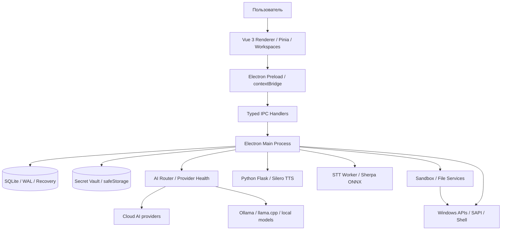

# A.R.C. — комплексный аудит готовности к релизу

**Дата аудита:** 16 ноября 2026 года  
**Репозиторий:** https://github.com/DdepRest/ARC  
**Ветка:** `main`  
**Зафиксированный commit:** `98098327e9b8761ecf855d0566e2c1f6c9b265c4`  
**Версия в `package.json`:** `1.0.12`  
**Назначение документа:** техническое основание для AI-кодера, который будет доводить A.R.C. до проверяемой release-ready версии.

> **Важное ограничение методики.** Аудит выполнен по публичному исходному коду, структуре репозитория, проектной документации и фактическим логам GitHub Actions. Репозиторий не клонировался и приложение не запускалось на физической Windows-машине в рамках этой проверки. Поэтому ниже отдельно обозначены: подтверждённые дефекты статического анализа, факты CI и сценарии, которые ещё нужно подтвердить на установленном Windows-приложении. Нельзя считать статический аудит заменой ручному QA на чистой Windows 10/11.

---

# 1. Итоговое заключение

## 1.1. Решение по релизу

**Текущий статус: RELEASE CANDIDATE / НЕ ГОТОВ К ПУБЛИЧНОМУ СТАБИЛЬНОМУ РЕЛИЗУ.**

У A.R.C. уже есть значительная инженерная база: Electron Main/Preload/Renderer, выделенный Shared-слой, Vue/Pinia, SQLite, восстановление повреждённой БД, безопасное хранилище секретов, IPC-контракты, AI-router, STT/TTS-подсистемы, система разрешений, дизайн-токены и более сотни файлов тестов. Это не ранний прототип.

Однако релизная готовность определяется не количеством сервисов и тестов, а тем, может ли чистая Windows-машина установить приложение, выполнить основные сценарии, сохранить данные, безопасно обработать сбои и восстановиться после перезапуска. В текущем состоянии остаются подтверждённые дефекты в CI packaging, записи секретов, файловой песочнице, синхронизации задач и упаковке словарей TTS. Не завершена натурная проверка полного дерева процессов Electron + Renderer + Python + STT worker.

**Главный вывод:** не переписывать архитектуру и не начинать новый большой UI-редизайн. Сначала закрыть release pipeline, затем устранить целостность данных и границы безопасности, после — доказать работоспособность установщика и голосового контура на чистой Windows.

> **Обновление статуса после Release Hardening (21.11.2026 — RC Freeze):** Все инженерные задачи `ARC_RELEASE_HARDENING_TZ.md` (Sprint 0–3 включая `S3-11` Phase A/B/C на **195** strict TS файлах с **0 ошибок `--strict`** во всём незащищённом production-коде и во всех 141 `.test.ts` [общепроектный `--strict`: `125 → 6`, остаток строго в защищённых зонах], инженерная подготовка Sprint 4 `S4-01`..`S4-06` + пошаговый пакет владельца `docs/WINDOWS-QA-HANDOFF.md` + `scripts/compare-qa-snapshots.cjs` + fail-closed 7-gate валидатор доказательств `scripts/verify-windows-qa-bundle.cjs`, машинно-читаемый реестр §7.4 `docs/release-status-registry.json`, разделы 9–11, фиксы жизненного цикла `STTService.shutdown()`, offline/degraded-тесты, сценарии §12.2 без Python/FFmpeg и с кириллическими путями, а также устойчивость §12.6 к отключению аудиоустройств, сну ОС и обрыву сети) выполнены и верифицированы в Linux-контейнере (`npm run gate` — 141/141 тестовый файл, 943/943 теста, 0 ошибок `lint`/`lint:strict`/`check-boundaries`/`check-visual-constitution`; `npm run generate:sbom` — 455 компонентов CycloneDX 1.5; `npm run analyze:bundle` — `8 892.31 KB` raw / `2 014.81 KB` gzip / `1 848.73 KB` brotli). **Sprint 0 Windows CI** подтверждён в GitHub Actions Run #8 (`ARC-Setup-1.0.12-x64.exe`, `ARC-Portable-1.0.12-x64.exe`, `SHA256SUMS.txt`). **Production-код `v1.0.12 RC` заморожен; статус релиза остаётся `RELEASE CANDIDATE (UNSIGNED)` до завершения живого Windows QA** (`S4-01` 2–4ч soak, `S4-02` upgrade/DPAPI, `S4-03` Clean Win10/11, `S4-04` UX-матрица, подпись артефактов и branch protection). Оригинальный текст аудита от 16.11.2026 ниже сохранён как исходный baseline.

## 1.2. Наиболее важные подтверждённые находки

| Приоритет | Проблема | Состояние | Последствие |
|---|---|---|---|
| P0 | Windows CI запускает неявную публикацию через electron-builder без `GH_TOKEN` | **VERIFIED (`S0-01`, [Run #8](https://github.com/DdepRest/ARC/actions/runs/43931936756), commit `a3cd3ec`)** — добавлен `--publish never` | Устранено: CI build и upload проходят без `GH_TOKEN` |
| P0 | NSIS и Portable используют один `artifactName` | **VERIFIED (`S0-02`, [Run #8](https://github.com/DdepRest/ARC/actions/runs/43931936756), commit `a3cd3ec`)** — заданы `ARC-Setup-${version}-${arch}` и `ARC-Portable-${version}-${arch}` | Устранено: оба EXE формируются независимо, коллизия невозможна |
| P1 | Secret Vault возвращает успех, даже когда запись на диск не удалась | **IMPLEMENTED (`S1-01`)** — fail-closed `setSecret()`, staging `.tmp` + `fsyncSync` + pre-rename read-back/DPAPI verify + `renameSync` | Ошибки записи больше не скрываются за `success: true` и RAM fallback; unit-тесты пройдены на Linux, требуется прогон Windows CI / DPAPI |
| P1 | Миграция секретов удаляет legacy-файл без проверки успешной записи новой версии | **IMPLEMENTED (`S1-01`)** — проверка записи и расшифровки до `unlinkSync`, канонический ключ `gemini_api_key` | Legacy `secure-keys.json` и `ai-providers.json` `p.apiKey` сохраняются при ошибке миграции; требуется проверка на Windows DPAPI |
| P1 | Sandbox проверяет путь лексически, но не защищается от symlink/junction/reparse point | **IMPLEMENTED (`S1-02`)** — единый `path-guard.ts`: `lstatSync` по каждому компоненту + `realpathSync` + повторная проверка перед записью/удалением + `O_NOFOLLOW` + защита custom root | Выход через symlink/junction/reparse point блокируется; unit/негативные тесты пройдены на Linux, ожидает Windows CI |
| P1 | Shell allowlist проверяет подстроку имени бинарника, а запуск выполняется через `exec()` | **IMPLEMENTED (`S1-03`)** — структурированный payload `{ executable, args, cwd, purpose }`, `spawn(..., { shell: false })`, точный match allowlist (+`.exe`/`.cmd`/`.bat`), default-deny, timeout 30s + `AbortSignal` + kill tree, буфер 64 KB + маскировка секретов | Спуфинг бинарников и shell-инъекции блокируются до запуска; unit-тесты пройдены на Linux, ожидает `windows-latest` CI |
| P1 | Task store обновляет карту синхронизации до подтверждения записи и очищает dirty-состояние после неудачи | **IMPLEMENTED (`S1-05`)** — ACK-подтверждённый snapshot, dirty-журнал (`arc_tasks_pending_ops_v1`), per-task FIFO сериализация + monotonic revision, timeout/backoff retry и честный error toast (`SyncToast`) | Неподтверждённые записи сохраняются как dirty и переживают перезапуск; ложный `✦ SYNCED` не показывается до SQLite ACK; unit-тесты пройдены на Linux, ожидает Windows QA |
| P1 | Python TTS ищет словари по `cwd/Voice/dicts`, но release layout не гарантирует этот путь | **IMPLEMENTED (`S2-01`)** — `extraResources -> Voice/dicts` (без дублирования в `app.asar`/`asarUnpack`), единый Main resolver + env `ARC_TTS_DICTS_DIR` / `ARC_TTS_USER_DICTS_DIR` / `ARC_TTS_LOGS_DIR`, read-only bundled SQLite (`immutable=1`), overlay пользовательских словарей и WAL в `userData`, диагностика `READY`/`DEGRADED`/`ERROR` в `/status`, `/reload_dicts` и `TTSSection.vue` | Комплектные словари доступны Python вне `app.asar`, WAL/логи не пишутся в каталог установки; unit/Python-тесты пройдены на Linux, требуется натурное Windows packaged QA |
| P1 | Автоматический TTS fallback на Edge TTS может отправлять произносимый текст во внешний сервис | **IMPLEMENTED (`S2-05`)** — явный opt-in `allowCloudTtsFallback` (default `false`), хранение политики в `userData/tts-policy.json` + sync с `settings.store`, блок Edge в `forcedOfflineMode`, fallback `Silero → SAPI` / `unavailable`, UI-диагностика и редактирование TTS-логов | В local-only и `forcedOfflineMode` речь не покидает устройство; unit-тесты (`tts-policy.util.test.ts`, `tts.service.test.ts`, `voice-status.test.ts`) пройдены на Linux; живой Windows SAPI/Edge QA — `NOT RUN` |
| P1 | Отмена обычных Sherpa-загрузок очищает Map, но не отменяет HTTP-запрос и запись файла | **IMPLEMENTED (`S2-03`)** — per-model `AbortController` + реальный destroy socket/stream, isolated `.staging/<session>/*.part` с атомарной публикацией комплекта, раздельные `cancelDownload(modelId)` / `cancelAllDownloads()` (+ targeted IPC `stt:cancel-download`), терминальное состояние `status: 'cancelled'` без маскировки под ошибку и отмена загрузки в `BuiltInWhisperService.abort()` | Отмена прерывает сеть и закрывает/удаляет `.part`/`.staging` с сохранением ранее рабочей модели; реальные HTTP/FS-тесты (`sherpa-downloader-cancellation.test.ts`, `gigaam-sources.test.ts`, `modelDownload.store.test.ts`) пройдены на Linux; живая отмена в окне Windows UI и на реальном HF — `NOT RUN` |
| P1/P2 | Загрузки ML-моделей не имеют единой строгой SHA-256-проверки и закреплённого манифеста | **IMPLEMENTED (`S2-04`)** — единый `model-supply-chain.manifest.ts` (immutable commits + pinned sizes/SHA-256), fail-closed staging + atomic replace, HTTPS-only `TRUSTED_MODEL_HOSTS` + SSRF/DNS rebinding guard на каждом redirect hop, strict SHA-256 для `v5_6_ru.pt` и `PYTHON_TTS_BUNDLE_MANIFEST` (вместо MD5), честный provenance (`verified` / `unverified_manual` / `tampered`) | Автозагрузки не активируются без точного SHA-256 и размера; ручные модели не промоутятся в `verified`; реальные HTTP/FS/Python-тесты (`supply-chain-integrity.test.ts`) пройдены на Linux; живой прогон против HF/Silero и Windows packaged QA — `NOT RUN` |
| P2 | Разрозненные статусы voice/model setup (`missing`, `downloaded`, `verified`, `loaded`, `active`, `cancelled`) | **IMPLEMENTED (`S2-07`)** — единая state machine `VoiceModelSetupState` + раздельный `ResourceReadinessLayer` в `voice-model-state-machine.ts`, реальный `checking` при таймауте STT, восстановление live runtime при открытии Settings | Отсутствующие модели не маскируются под ошибку runtime; `unverified_manual`, `verified`, `loaded` и `active` разделены; unit-тесты на Linux пройдены; живой Electron/Windows UI QA — `NOT RUN` |
| P2 | JSON fallback БД в dev-режиме обозначается как `PERSISTENT_SQLITE` и `NORMAL` | **IMPLEMENTED (`S3-02`)** — разделены `sqlite`/`PERSISTENT_SQLITE`, `json-degraded`/`DEGRADED`, `json-test` и `json-safe-mode`/`DB_SAFE_MODE` с явными `limitations[]` | Диагностика и UI отображают реальный storage engine без маскировки под SQLite; unit/SSR тесты на Linux пройдены, живой Windows QA `NOT RUN` |
| P2 | Reset system data не очищает все секреты и журналы, хотя называется полным сбросом | **IMPLEMENTED (`S3-08`, Вариант A)** — единый `reset-policy.ts`, разделены сброс параметров UI и сброс данных приложения в `StorageDataSection.vue`/`SystemResetBlock.vue`, явные списки удаляемого и сохраняемого, защита перекрытия `%APPDATA%` и честный fail на `EBUSY` | Интерфейс точно описывает объём удаления; Secret Vault, логи, бэкапы, словари/политика TTS и модели (по умолчанию) строго сохраняются; unit/IPC/SSR тесты на Linux пройдены, живой Windows QA `NOT RUN` |
| P2 | Modules UI и `system:modules` используют разные статические реестры | **IMPLEMENTED (`S3-04`)** — единый Shared-реестр 14 capabilities (`modules-capability.registry.ts`) и `ModulesCapabilityService` с fault-isolated runtime adapters | Единый источник правды по статусам модулей; `planned` строго помечены как недоступные (`v1.1`); unit/IPC/SSR тесты на Linux пройдены, живой Windows QA `NOT RUN` |

## 1.3. Что уже сделано хорошо и не должно быть переписано без причины

- Основное разделение Electron Main / Preload / Renderer / Shared.
- Использование `contextBridge` вместо прямой передачи `ipcRenderer` в Renderer.
- `contextIsolation: true`, `nodeIntegration: false`.
- Единичный экземпляр приложения.
- SQLite WAL, `integrity_check`, повторные попытки при lock, карантин связки DB/WAL/SHM и безопасный режим при проблемах с нативным драйвером.
- Проверяемый снимок БД через SQLite Online Backup API и отдельный `integrity_check` перед экспортом.
- Отдельный STT worker, heartbeat, попытка восстановления, переключение на резервный движок.
- В TTS уже присутствует `try/finally` для очистки активного AbortController — ранее известная проблема «вечного busy» не должна повторно ставиться в работу без воспроизведения.
- Синхронизация задач уже переведена на upsert/diff-подход; проблему следует исправить точечно, не возвращая полный DELETE/reinsert.
- Раздел «Интеллект» уже получил Master–Detail-инспектор провайдеров и машину состояний draft. Не надо переделывать его заново.
- Визуальная конституция проходит CI: все девять счётчиков нарушений равны нулю в 369 проверяемых renderer-файлах.
- Piper и Kokoro уже честно помечены как Planned/disabled для будущей версии; не включать их как будто они готовы.

---

# 2. Снимок репозитория и качество доказательств

## 2.1. Масштаб

Срез `main` на указанном commit:

| Метрика | Значение |
|---|---:|
| Всего файлов | 1 020 |
| Размер содержимого Git tree | около 38,1 MB |
| Файлы в `src/` | 604 |
| Документы в `docs/` | 222 |
| Файлы тестов `*.test.*` / `*.spec.*` | 106 |
| Vue SFC | 204 |
| TypeScript-файлы | 369 |
| Python-файлы | 14 |
| Изображения PNG | 154 |
| Версия приложения | 1.0.12 |

Количество тестовых файлов — не показатель качества покрытия. По `docs/current-state.md` заявлено 664 unit/integration tests; актуальный workflow на зафиксированном commit подтверждает успешный Vitest run и Windows Vitest run, но не доказывает полноту тестирования установщика, пользовательских сценариев и реальных многопроцессных нагрузок.

## 2.2. Состояние GitHub на момент проверки

- Ветка `main` существует; других активных веток в кратком срезе не обнаружено.
- `main` не защищена branch protection (`protected: false`).
- Тегов и опубликованных GitHub Releases не обнаружено.
- Следовательно, нет доказанной цепочки: защищённый PR → обязательные проверки → release tag → собранные артефакты → опубликованный релиз.
- GitHub Actions run #6 для commit `98098327…` имеет общий `failure`, но причина не в TypeScript или тестах, а в публикации Portable target без `GH_TOKEN`.

## 2.3. Статус проверок CI

Workflow: `.github/workflows/ci.yml`.

**Linux job `Lint, Architecture, Test & Build Validation`:**
- `npm ci` — pass;
- TypeScript `npm run lint` — pass;
- file size guard — pass;
- visual constitution — pass;
- Vitest — pass;
- Electron/Renderer build — pass.

**Windows job `Package Windows x64 (NSIS & Portable)`:**
- `npm ci` — pass;
- TypeScript — pass;
- Vitest на Windows — pass;
- Electron/Renderer build — pass;
- нативные зависимости `better-sqlite3` и `sharp` подготовлены;
- NSIS installer был успешно собран;
- при переходе к Portable electron-builder попытался автоматически опубликовать пакет и завершился ошибкой отсутствующего `GH_TOKEN`;
- шаги проверки EXE, SHA-256 и upload-artifact были пропущены.

Это хорошая новость: Windows-тестовый этап уже работает. Но текущий pipeline не выдаёт проверенные артефакты, поэтому Windows distribution gate пока не закрыт.

**Точная причина:** `npm run pack:win` запускает `electron-builder --win` без `--publish never`. electron-builder обнаруживает CI и использует implicit publishing. Для обычной CI-сборки публикация не нужна: GitHub Actions должен сохранить файлы через `actions/upload-artifact`.

Дополнительный дефект: один `win.artifactName` задан для обоих targets:

```json
"win": {
  "artifactName": "ARC-Setup-${version}.${ext}",
  "target": ["nsis", "portable"]
}
```

Лог показывает, что и NSIS, и Portable строятся как `dist\\ARC-Setup-1.0.12.exe`. Это надо устранить разными именами, например:
- `A.R.C.-Setup-1.0.12-x64.exe` для NSIS;
- `A.R.C.-Portable-1.0.12-x64.exe` для Portable.

Названия — пример, coder должен подобрать корректный синтаксис electron-builder `artifactName` per-target и доказать, что оба файла существуют независимо.

## 2.4. Что не проверено натурно

- Установка NSIS на чистую Windows 10 и Windows 11.
- Первый запуск от обычного пользователя без Python, FFmpeg, CUDA и предварительно установленных моделей.
- Обновление поверх предыдущей версии с сохранением пользовательских данных.
- Деинсталляция без удаления пользовательских данных.
- Portable запуск из пути с пробелами, кириллицей и ограниченными правами.
- Реальная работа STT/TTS после установки.
- Смена устройства аудио, недоступность микрофона, переподключение устройства.
- Offline/slow network, частичные загрузки, отмена, повторная загрузка и повреждение моделей.
- Реальное потребление RAM/VRAM/CPU по всему дереву процессов.
- Многопроцессный soak test минимум 2–4 часа.
- Проверка восстановления БД после аварийного завершения процесса/питания.

---

# 3. Технологический стек и назначение подсистем

## 3.1. Desktop / UI

| Технология | Назначение | Оценка |
|---|---|---|
| Electron 34.x | Desktop runtime, Main/Renderer, системные интеграции | Подходит, но требует Electron hardening и реального Windows QA |
| Node.js 22.x | Backend runtime и инструменты сборки | Хорошая базовая линия |
| electron-vite 5 | Сборка Main, Preload, Renderer | Нормальная схема для проекта такого типа |
| electron-builder 26 | NSIS и Portable packaging | Работает на этапе сборки; CI publish/artifact конфигурация неисправна |
| Vue 3.5 | UI и Composition API | Подходит |
| TypeScript 5.8 | Типизация | Используется активно, но TS strict-режим не включён |
| Pinia 2.3 | Клиентское состояние | Подходит, важна дисциплина синхронизации с Main/DB |
| Tailwind CSS 4 | Layout/utility styling | Подходит, есть собственные design tokens |
| Lucide Vue Next | Иконки | Подходит |
| Three.js 0.174 | 3D Reactor/WebGL | Выделенная визуальная подсистема; защищённая область |
| marked + DOMPurify | Markdown rendering/sanitization | Направление верное; проверить единый безопасный renderer для всех источников текста |

## 3.2. AI и маршрутизация

- `@google/genai` — Gemini API.
- OpenAI-compatible HTTP providers — подключение внешних API через endpoint/model/key.
- OpenRouter и другие внешние endpoints — через provider configuration.
- Ollama — локальный HTTP endpoint.
- `node-llama-cpp` — локальный GGUF inference в Node/Electron.
- `@xenova/transformers` — локальные/браузерные ML pipeline, включая worker assets.
- jsep — разбор выражений/условий.
- litegraph.js — графовые/визуальные сценарии.
- Внутренний AI router, provider health, retries, quarantine/circuit breaker, LLM cache, request cancellation.

**Аудиторская оценка:** наличие fallback-механизмов — сильная сторона. Главный остаточный риск не в отсутствии router, а в правдивости статусов, секретах, управлении лимитами/таймаутами и пользовательской видимости того, куда уходит запрос. Убедиться, что любой cloud fallback отражён в UI/логах и не нарушает локальный режим.

## 3.3. База данных и хранение

- `better-sqlite3` 12.x — синхронный SQLite API для Main process.
- SQLite WAL и busy timeout.
- FTS5/индексы/таблицы диалогов, задач, памяти, целей и действий.
- Отдельные recovery helpers, quarantine DB/WAL/SHM, retry при lock.
- JSONDatabase — fallback/тестовый движок.
- Verified database snapshot через Online Backup API и integrity check.
- ZIP export и исключение секретов из архива.

**Оценка:** SQLite/recovery — одна из наиболее зрелых частей проекта. Её надо укреплять тестами миграций и отказов, а не заменять другим хранилищем.

## 3.4. Голосовой контур

**STT:**
- `sherpa-onnx-node` 1.13.7;
- Zipformer RU;
- Whisper Small ONNX;
- GigaAM CTC как дополнительный движок;
- Silero VAD;
- отдельный `scripts/stt_worker.js` process;
- IPC между Main и worker, heartbeat, restart, hot swap.

**TTS:**
- Python Flask server (`silero_server.py`);
- Silero TTS v5.6 RU;
- `torch`, `scipy`, `soundfile`, `flask`, `onnxruntime`, `ruaccent` и DSP pipeline;
- Edge TTS fallback;
- Windows SAPI fallback.

**Важное:** Piper и Kokoro помечены как planned/disabled — это корректное состояние, пока реализация не готова.

**Риск первого запуска:** Python environment может создаваться на машине пользователя, зависимости устанавливаются через pip, Silero weights скачиваются отдельно, STT models могут скачиваться при запуске. Значит, приложение не является полностью self-contained/offline-ready в первом запуске. Это нужно не скрывать, а превратить в управляемый setup flow с размером загрузки, источником, лицензией, свободным местом, прогрессом, отменой и возможностью отложить голос.

## 3.5. Infrastructure / security

- `contextBridge` API через Preload.
- IPC handlers в Main.
- `safeStorage`/Windows DPAPI для секретов.
- ApprovalService и ApprovalDialog для действий, требующих согласия.
- PolicyEngine и SandboxedFS.
- CSP и Origin validation.
- Logger / sanitizer.
- StorageManager и архивы.
- Systeminformation и собственная телеметрия.

**Оценка:** нужные уровни архитектуры уже существуют. Проблема — конкретные обходы и некорректные результаты операций внутри них. Не надо создавать ещё одну параллельную систему доступа или второе хранилище секретов; нужно довести текущие единые механизмы.

---

# 4. Архитектурная карта



**Правило архитектуры:** Renderer не должен становиться источником истины для критичных данных. Main/SQLite подтверждают запись, а Renderer отображает сохранённое состояние и честные статусы. Внешние процессы запускаются с минимальными полномочиями и управляемым жизненным циклом.

---

# 5. Подробный реестр проблем

## P0 — обязательные релизные блокеры

### P0-01. Исправить Windows release packaging pipeline — **VERIFIED (S0-01..S0-03) / IMPLEMENTED (S0-04)**

> **Актуализация по фактам CI ([Run #8](https://github.com/DdepRest/ARC/actions/runs/43931936756), commit `a3cd3ec`):**
> - **S0-01 (`--publish never`, без `GH_TOKEN`):** **VERIFIED** ([Windows job `133527116076`](https://github.com/DdepRest/ARC/actions/runs/43931936756/job/133527116076)).
> - **S0-02 (раздельные `artifactName` для NSIS и Portable):** **VERIFIED** (`ARC-Setup-1.0.12-x64.exe` и `ARC-Portable-1.0.12-x64.exe`).
> - **S0-03 (PE-верификация, `.blockmap`, `SHA256SUMS.txt` и upload-artifact):** **VERIFIED** (`scripts/verify-win-artifacts.ps1`, `-SelfTest` pass, артефакт `arc-windows-x64-a3cd3ecb6d249eabd354023e0e5e1c220db74bb0`, `476 900 615` B).
> - **S0-04 (разделение CI и Release publishing workflow):** **IMPLEMENTED** (`.github/workflows/ci.yml` + `.github/workflows/release.yml`, ожидает прогона в GitHub Actions).

**Файлы:**
- `package.json` — `scripts.pack:win`, `build.win`, `build.win.target`, `artifactName`.
- `.github/workflows/ci.yml` — `package-win`.
- `.github/workflows/release.yml` — выделенный release publishing workflow (`v*` / `workflow_dispatch`).
- `scripts/verify-win-artifacts.ps1` — PE-проверка, `.blockmap` и `SHA256SUMS.txt`.

**Факт (на commit аудита `98098327`):** Windows job проходил tests и build, но падал на Portable target из-за неявной публикации без `GH_TOKEN`. На commit `a3cd3ec` ([Run #8](https://github.com/DdepRest/ARC/actions/runs/43931936756)) проблемы упаковки и верификации устранены.

**Acceptance criteria:**
- [x] Новый `main` CI run завершается success на Linux и Windows ([Run #8](https://github.com/DdepRest/ARC/actions/runs/43931936756): [Linux `133526372152`](https://github.com/DdepRest/ARC/actions/runs/43931936756/job/133526372152), [Windows `133527116076`](https://github.com/DdepRest/ARC/actions/runs/43931936756/job/133527116076)).
- [x] `dist/` содержит два разных EXE: NSIS и Portable.
- [x] Их SHA-256 различаются; оба имени уникальны.
- [x] Оба загружены как GitHub workflow artifacts.
- [x] Сборка не обращается к GitHub Release API при обычном push/PR.
- [x] Отсутствие publish token не влияет на обычную упаковку.

### P0-02. Проверить два артефакта на чистой Windows — **BLOCKED (`S0-05` — требуется ручной Windows QA)**

Это не исправление кода, а обязательный release gate. После P0-01 установить и запустить **оба** артефакта отдельно ([Run #8](https://github.com/DdepRest/ARC/actions/runs/43931936756): `ARC-Setup-1.0.12-x64.exe`, `ARC-Portable-1.0.12-x64.exe`). В Linux-контейнере задача **BLOCKED** до проведения натурного QA владельцем.

**Acceptance criteria:**
- NSIS устанавливается в каталог пользователя без admin elevation по умолчанию.
- Portable запускается из отдельной папки без установки.
- Оба создают корректную директорию пользовательских данных.
- SQLite native binding загружается; приложение не попадает в `DB_SAFE_MODE` без причины.
- UI стартует, основные workspace открываются, нет непрерывного падения Main/Renderer.
- Удаление NSIS не удаляет user data; это поведение подтверждено тестом.
- Путь профиля/приложения с кириллицей и пробелами проверен.

---

## P1 — критичные надёжность, безопасность и целостность

### P1-01. Сделать Secret Vault транзакционно честным — **IMPLEMENTED (`S1-01`, unit-тесты Linux пройдены; Windows DPAPI / CI `NOT RUN`)**

**Файлы:** `src/main/services/security/secret-vault.service.ts`, `src/main/services/security/secret-vault.storage.ts`, `src/main/services/security/secret-vault.migration.ts`, `src/main/ipc/settings.ipc.ts`, `src/main/services/llm/providers/provider-manager.ts`, `src/main/ipc/ai.ipc.ts`.

**Проблемы:**
- `writeVaultFileV2()` возвращает `boolean`.
- `setSecret()` вызывает `writeVaultFileV2(vault)`, но не проверяет результат и возвращает `success: true` даже при ошибке записи.
- `migrateLegacySecretsOnStartup()` вызывает запись новой версии, не проверяет её результат и после этого пытается удалить legacy-файл.
- Запись делается напрямую в `secrets.json`, без staging + atomic rename.
- Gemini ключ хранится в двух именованных записях (generic `gemini_api_key` и provider-scoped ключ), создавая несколько источников истины.

**Реализация:**
1. `setSecret()` должен возвращать `success:false` с безопасной диагностикой, если запись не состоялась.
2. Сохранение: temp-файл в той же директории → write → flush/fsync где поддерживается → rename/replace → read-back + schema validation.
3. Миграция: сохранить legacy source; записать новое хранилище; заново прочитать и расшифровать/проверить все migrated entries; только после успешной проверки архивировать/удалять legacy-файл.
4. При EACCES/EROFS/ENOSPC пользователь получает ясный статус: «ключ не сохранён», без вывода самого ключа.
5. Определить канонический ключ Gemini; старые записи поддержать только как миграцию.
6. Убедиться, что секреты не попадают в stdout, crash logs, diagnostic exports и child process environment без явной необходимости.

**Тесты:**
- write failure;
- disk full / ENOSPC;
- access denied;
- malformed/torn vault;
- crash после write temp, до rename;
- migration fails writing new vault — legacy остаётся;
- migration succeeds — legacy убирается только после проверки;
- restart + DPAPI decrypt;
- safeStorage unavailable / session-only mode честно показывается.

### P1-02. Закрыть symlink / junction escape в файловой песочнице — **IMPLEMENTED (`S1-02`, unit-тесты Linux пройдены; Windows CI `NOT RUN`)**

**Файлы:**
- `src/main/services/sandbox/path-guard.ts` (единый path guard: `validateSandboxRootSync`, `resolveAndValidateSandboxPathSync`, `isPathAllowedInRootsSync`, `readFileNoFollow`, `writeFileNoFollow`).
- `src/main/services/sandbox/sandbox-audit.helper.ts` (`createSandboxBackupFile` с `lstat`-проверкой против копирования symlink в `~/.arc/backups`, `resolveSandboxDecisionId`, `recordSandboxOperation`).
- `src/main/services/sandbox/SandboxedFS.ts` (`resolvePath`, read/write/delete/rename/copy с повторной валидацией перед мутацией).
- `src/main/services/files.service.ts` (`isPathAllowed`, защита `setCustomAllowedRoots`/`addAllowedRoot` от symlink root).
- `src/main/ipc/files.ipc.ts` (разделение режимов `list`/`read`/`write`/`delete`, фильтрация symlink в `files:list`, запрет удаления саму root-директорию).

**Проблема:** текущая проверка `path.resolve` + `path.relative` защищает от обычного `../` traversal, но не проверяет реальный путь файловой системы. Ссылка внутри разрешённой директории может вести наружу. На Windows нужно учитывать symlink, junction и reparse points.

**Реализация:**
- [x] 1. Вынести единый path guard (`path-guard.ts`), который проверяет каждый существующий компонент пути через `lstatSync` и запрещает неожиданные ссылки/reparse points.
- [x] 2. Для существующих целей и родителей разрешать `realpathSync`, сравнивать canonical path с canonical root и проверять совпадение относительного пути.
- [x] 3. Перед destructive operation (`writeFile`, `deleteFile`, `renameFile`, `copyFile`, `files:write`, `files:delete`) повторно проверять путь непосредственно перед операцией; не полагаться на проверку до `approvalService.requestApproval`.
- [x] 4. Для новых файлов валидировать canonical parent directory.
- [x] 5. Не разрешать root менять свои границы через custom root symlink (`validateSandboxRootSync` в `SandboxedFS` и `files.service.ts`).
- [x] 6. Разделить операции `read`/`list`/`write`/`delete`/`rename`/`copy` (включая запрет модификации/удаления самой root-директории `allowRootSelf: false`).
- [x] 7. Продумать TOCTOU: использовать `O_NOFOLLOW` при открытии дескрипторов на POSIX (`readFileNoFollow`, `writeFileNoFollow`), проверять `lstat` при создании backup и документировать остаточные платформенные ограничения Node.js/Windows в `path-guard.ts`.

**Тесты (`SandboxedFS.test.ts`, `files.service.test.ts`, `files.ipc.test.ts` — 21/21 пройдены на Linux):**
- [x] `root/link -> outside` для read/write/delete;
- [x] вложенная symlink;
- [x] эмуляция Windows junction/reparse point (`realpathSync` отклоняется при `lstat.isSymbolicLink() === false`);
- [x] сломанная ссылка (dangling symlink);
- [x] destination rename/copy через ссылку;
- [x] parent directory link (включая запись нового файла через родительскую ссылку);
- [x] отклонение custom symlink root и защита от удаления самой root-директории;
- [x] normal in-root operations остаются рабочими;
- [ ] натурный прогон на `windows-latest` CI с реальными NTFS junction (`NOT RUN` локально в Linux-контейнере).

### P1-03. Усилить политику shell execution — **IMPLEMENTED (`S1-03` + `S1-04`, unit-тесты Linux пройдены, Windows CI `NOT RUN`)**

**Файлы:**
- `src/main/services/commands/shell-command.parser.ts` *(новый модуль)* — разбор и валидация структурированного payload / argv-токенизация, блокировка shell-метасимволов (`; | & > < \` $( ${ \n \0`) и проверка `cwd`.
- `src/main/services/commands/shell-process.helper.ts` *(новый модуль)* — завершение дерева процессов (`taskkill /T /F` на Windows, `-pid` на POSIX), ограниченное накопление вывода и безопасные сниппеты.
- `src/main/services/sandbox/PolicyEngine.ts` — точное совпадение `allowedBinaries` (с допустимыми Windows-расширениями `.exe`/`.cmd`/`.bat`), default-deny при отсутствии правила/пустом списке.
- `src/main/services/commands/shell-executor.ts` — запуск через `spawn(..., { shell: false })`, timeout 30s, `AbortSignal`, уничтожение дерева процессов, ограничение вывода 64 KB/поток, маскировка секретов.
- `src/main/services/security/shell-approval.service.ts` — структурированное preview с `executable`, `args`, `cwd`, `purpose`, `shellMode` и предупреждением для `unsafe_raw_shell`.
- `src/main/services/MacroExecutor.ts` — поддержка структурированных свойств `actions/shell` и маскировка секретов в логе.
- `src/main/ipc/approval.ipc.ts`, `src/main/services/approval.service.ts`, `src/main/index.ts`, `src/main/preload.ts`, `src/renderer/stores/security.store.ts`, `src/renderer/components/security/ApprovalDialog.vue` *(`S1-04` — проверка доверенного `event.sender` / `mainFrame` / origin, удаление дублирующего канала `ui:approval-resolve`, автоотказ при закрытии/перезагрузке окна и FIFO-очередь запросов)*.

**Проблема:**
- allowlist бинарников использует `includes()` на имени команды, а не точное сравнение executable;
- запуск идёт через `exec(command)`, то есть через системный shell;
- нет явного command timeout, AbortSignal и гарантированного kill process tree;
- `stderr/stdout` могут содержать чувствительные данные;
- approval IPC валидирует только строковый ID и не ограничивает отправителя ожидаемым `webContents`.

**Реализация:**
- [x] 1. Перейти на структурированный payload `{ executable, args, cwd, purpose }` (плюс безопасный argv-парсер с `shell: false` для legacy-строк макросов в `MacroExecutor.ts` и `shell-command.parser.ts`).
- [x] 2. Для разрешённых операций использовать `spawn` с `shell: false` и точный allowlist executable/path (`PolicyEngine.ts`, включая стандартные Windows-расширения `.exe`/`.cmd`/`.bat` без подстановки произвольных путей).
- [x] 3. Произвольный raw shell выведен в отдельный fail-closed режим `unsafe_raw_shell` с обязательным caller opt-in, принудительным interactive approval и предупреждением о последствиях.
- [x] 4. `PolicyEngine` по умолчанию deny (`allowed: false`, `reason: 'no_matching_rule'`).
- [x] 5. Заданы timeout (`30_000` мс по умолчанию), отмена через `AbortSignal`, ограничение `stdout`/`stderr` (`64 KB` с флагом `outputTruncated`), закрытие потоков и kill всего process tree (`taskkill /T /F` на Windows, `-pid` на POSIX).
- [x] 6. Секреты/PII маскируются через `maskSecrets()` (включая устранение `O(n^2)` backtracking в `log-sanitizer.ts`); в лог пишутся `commandHash`, sanitized `executable`, `exitCode` и урезанный фрагмент (`<= 256` символов).
- [x] 7. В approval handler (`approval.ipc.ts` + `ApprovalService.isTrustedSender`) проверяется, что `event.sender` — текущий доверенный `mainWindow.webContents`, `mainFrame` и origin (`isTrustedOrigin`), а `id` числится в `pendingApprovals`, не истёк и совпадает по `expectedWebContentsId`; при закрытии/разрушении/навигации окна все pending запросы автоматически отклоняются.
- [x] 8. Удалён дублирующий IPC alias `ui:approval-resolve` после проверки всех callers (`preload.ts` использует единый `ui:approval-response`), добавлена FIFO-очередь в `security.store.ts`.

**Тесты (`PolicyEngine.test.ts`, `shell-executor.test.ts`, `shell-approval.service.test.ts`, `MacroExecutor.test.ts`, `log-sanitizer.test.ts`, `approval.ipc.test.ts`, `approval.service.test.ts`, `ApprovalDialog.test.ts` — пройдены на Linux):**
- [x] `nodeevil`, `mygit`, `npm-helper` и path-prefixed бинарники не проходят как `node/git/npm`;
- [x] попытки shell metacharacter injection (`;`, `|`, `&&`, `>`, `` ` ``, `$(...)`, `\n`);
- [x] таймаут и отмена (`AbortSignal`) завершают дочернее дерево процессов, буфер вывода ограничен 64 KB, секреты маскируются;
- [x] отказ approval не запускает команду;
- [x] дублирующий, небулевый и просроченный approval response отклоняется (`approval.ipc.test.ts`, `approval.service.test.ts`);
- [x] запрос от неизвестного `sender` / subframe / недоверенного origin отклоняется без затирания легитимного pending запроса;
- [ ] натурный прогон на `windows-latest` CI (`taskkill /T /F`, `.exe`/`.cmd`) — `NOT RUN` локально в Linux-контейнере.

### P1-04. Исправить подтверждение сохранения Tasks — **IMPLEMENTED (`S1-05`, unit-тесты Linux пройдены; живой Electron/Windows QA `NOT RUN`)**

**Файлы:**
- `src/renderer/features/tasks/utils/tasks-sync.helper.ts` *(новый модуль)* — schema upgrade helper, deterministic diff serializer, `invokeWithTimeout` и persistent dirty-журнал `arc_tasks_pending_ops_v1`.
- `src/renderer/features/tasks/stores/tasks.store.ts` — ACK-gated `lastSyncedSnapshotMap`, реактивные dirty-состояния (`syncState`, `lastSyncError`, `dirtyTaskIds`, `pendingDeleteTaskIds`, `hasUnsyncedChanges`), per-task FIFO очередь + monotonic revision guard, `beforeunload` flush, ограниченный exponential backoff retry и startup reconciliation против authoritative SQLite.
- `src/renderer/features/settings/stores/settings.store.ts` — расширение `triggerSyncToast` (`variant?: 'synced' | 'error'`, `actionLabel?: string`).
- `src/renderer/components/ui/SyncToast.vue` — честное отображение ошибки/повтора (`✦ ОШИБКА БД` / `✦ SYNC FAIL` и кнопка `Повторить` / `Retry`) вместо ложного `✦ SYNCED`.

**Проблема:**
- `persistTaskUpsert()` обновляет `lastSyncedSnapshotMap` до подтверждения IPC;
- при ошибке IPC ловит ошибку и возвращает исходную задачу;
- `persistTaskDelete()` удаляет snapshot до подтверждения успешного удаления;
- `saveTasks()` после `Promise.all` всегда перестраивает snapshot map, даже если часть операций завершилась неуспешно.

**Результат:** Renderer может считать данные синхронизированными, когда Main/SQLite ничего не сохранили. После рестарта пользователь потеряет последнее изменение или увидит удалённую задачу снова.

**Реализация:**
- [x] 1. Держать отдельные `pending/dirty` операции (`dirtyUpsertIds`, `pendingDeleteIds`, `pendingClearAll`, `arc_tasks_pending_ops_v1`) до позитивного ack от Main.
- [x] 2. Snapshot (`lastSyncedSnapshotMap`) обновлять только по фактическому сохранённому ответу из SQLite после проверки `success !== false` и совпадения `task.id`.
- [x] 3. На `{success:false}`, throw, timeout, server mismatch, `beforeunload` или закрытие IPC — сохранять dirty state и показывать ошибку/кнопку повторной синхронизации.
- [x] 4. Удаление подтверждать только после успешного delete ack (и защищать от воскрешения через stale `tasks:changed` broadcast).
- [x] 5. Предотвращать конкурентные конфликты upsert/delete по одному ID через per-task FIFO queue (`perTaskQueueMap`) и monotonic `taskRevisionMap`.
- [x] 6. Поддержан ограниченный retry с exponential backoff (`MAX_AUTO_RETRIES = 3`); после перезапуска перечитываются authoritative tasks из DB и примиряются/доигрываются dirty операции.
- [x] 7. Сохранена текущая two-pass upsert/diff-архитектура без возврата full-table replacement.

**Тесты (`tasks.store.test.ts`, `SyncToast.test.ts`, `tasks.ipc.test.ts`, `tasks.service.test.ts` — пройдены на Linux):**
- [x] upsert success (toast только после ACK);
- [x] upsert `success:false` и `server response mismatch`;
- [x] IPC throws;
- [x] IPC зависает и timeout (`IPC_TIMEOUT`);
- [x] delete failure и защита от broadcast-воскрешения;
- [x] параллельные updates одной задачи и race update-then-delete;
- [x] `beforeunload` flush и рестарт приложения после failed write (reconciliation & replay);
- [x] ограниченный exponential backoff retry и UI не отображает ложное «сохранено» (`SyncToast.test.ts`);
- [ ] натурный прогон Electron + SQLite на Windows (`NOT RUN` в Linux-контейнере).

### P1-05. Исправить размещение TTS dictionaries в packaged app — [IMPLEMENTED (`S2-01`) — unit/Python тесты пройдены; Windows packaged QA `NOT RUN`]

**Файлы:**
- `tts_dict_loader.py`, `silero_server.py`.
- `src/main/services/python_server.service.ts`, `src/main/services/python_sync.util.ts`.
- `src/main/ipc/voice.ipc.ts`, `src/main/preload.ts`.
- `src/renderer/features/settings/logic/voice-status.ts`, `src/renderer/features/settings/components/sections/TTSSection.vue`.
- `package.json` (`build.files`, `build.asarUnpack`, `build.extraResources`).
- `src/main/services/python_server.paths.test.ts`, `src/renderer/features/settings/logic/voice-status.test.ts`.

**Проблема:** `tts_dict_loader.py` строит путь `os.path.join(os.getcwd(), 'Voice', 'dicts')`. В packaged запуске Python server получает `cwd: this.getPath('.')`, которое может разрешиться в `process.resourcesPath`. При этом `package.json` помещает `Voice/dicts/**/*` в app files/asarUnpack, но отдельного `extraResources` mapping в `resources/Voice/dicts` нет. Python, работающий из `resources`, может не найти словари в ожидаемом `cwd/Voice/dicts`.

**Реализация:**
1. [x] Убрана неявная зависимость от `os.getcwd()`: пути разрешаются динамически через `_resolve_paths()` с приоритетом `ARC_TTS_DICTS_DIR`, `ARC_TTS_USER_DICTS_DIR`, `ARC_TTS_LOGS_DIR` и fallback от `_SCRIPT_DIR`.
2. [x] Единый Main-резолвер (`resolveTtsDictsPaths`, `ensureTtsDictsWritableDirs`, `prepareTtsDictsSpawnEnv` в `python_sync.util.ts` + `PythonServerService.resolveTtsDictsPaths()`) передаёт абсолютные env paths при запуске Python.
3. [x] В `package.json` словари `Voice/dicts` перенесены исключительно в `build.extraResources`, удалены из `build.asarUnpack` и исключены из `app.asar` (`!Voice/dicts/**/*`) без дублирования.
4. [x] Read-only режим для комплектной директории: bundled `tts_pronunciation.db` открывается только с `?immutable=1` + `PRAGMA query_only=ON`; WAL/SHM и `tts_unknown_words.log` пишутся исключительно в `userData/tts_dicts` и `userData/logs`; пользовательские переопределения накладываются поверх bundled с приоритетом user.
5. [x] Единая диагностика `READY` / `DEGRADED` / `ERROR` (кол-во файлов/записей/ошибок, пути, `lastLoadedAt`) выводится при старте Python, в `GET /status`, `POST /reload_dicts`, IPC (`tts:server-status`, `tts:reload-dictionaries`) и в UI `TTSSection.vue` + `voice-status.ts`.

**Тесты:**
- [x] Запуск из исходников и packaged/compat layout (`ARC_TTS_DICTS_DIR`, `resources/Voice/dicts`, `app.asar.unpacked/Voice/dicts`, `prepareTtsDictsSpawnEnv`);
- [x] Реальная загрузка комплектных словарей и применение к тексту (`PayPal`, `АРК`, `здорово`) из стороннего `cwd` без записи WAL/логов в read-only каталог;
- [x] Overlay пользовательских переопределений, degraded state на битом JSON/отсутствующем словаре, `ERROR` на отсутствии каталога, UI-состояния `READY`/`DEGRADED`/`ERROR`;
- [ ] Натурный запуск `win-unpacked`, NSIS installer и Portable EXE на Windows (`NOT RUN` в Linux-контейнере).

### P1-06. Сделать отмену Sherpa downloads реальной — **IMPLEMENTED (`S2-03`)**

**Файлы:** `src/main/services/sherpa-downloader.service.ts`, `src/main/services/sherpa-download-task.helper.ts`, `src/main/services/sherpa-http-download.util.ts`, `src/main/services/gigaam-sources.service.ts`, `src/main/services/hf-rate-limiter.service.ts`, `src/main/services/sherpa-validator.util.ts`, `src/main/services/built-in-whisper.service.ts`, `src/main/services/stt-config.helper.ts`, `src/main/services/stt.service.ts`, `src/main/ipc/voice.ipc.ts`, `src/main/preload.ts`, `src/env.d.ts`, `src/renderer/features/modelDownload/stores/modelDownload.store.ts`, `src/renderer/components/voice/VoiceQuickPanel.vue`, `src/renderer/features/settings/composables/useModelHubSession.ts`.

**Что реализовано:**
1. Per-model `ActiveDownloadTask` с собственным `AbortController`, трекингом активных `ClientRequest` / `IncomingMessage` / `fs.WriteStream` и временных файлов; cleanup только в `finally` после закрытия файловых потоков.
2. Targeted `cancelDownload(modelId)` (возвращает `boolean`, не затрагивает параллельные загрузки) и глобальный `cancelAllDownloads()`; единый IPC `stt:cancel-download` с опциональным `modelId`; отмена pending `load-*` в `BuiltInWhisperService.abort(modelId?)`.
3. Isolated `.staging/<session>/*.part` (и prune orphaned `.staging`), проверка размеров/целостности комплекта (и sacrificial validator с `AbortSignal` для GigaAM) до атомарной публикации и записи `download_meta.json`, сохранение прежней рабочей модели при отмене/ошибке.
4. Отдельное терминальное состояние `{ success: false, cancelled: true, status: 'cancelled' }` и progress-событие `status: 'cancelled'` без error toast/красного бейджа в UI.

**Проверки:**
- [x] Unit- и реальные HTTP/FS-тесты на Linux (`sherpa-downloader.service.test.ts`, `sherpa-downloader-cancellation.test.ts`, `gigaam-sources.test.ts`, `modelDownload.store.test.ts`): отмена `zipformer-ru`, `whisper-small`, `silero-vad`, `gigaam-ctc`, параллельная изоляция, `cancelAllDownloads`, 302 redirect, retry backoff, 429 cooldown abort, сохранение старой рабочей модели и мгновенный retry после отмены;
- [ ] Живая отмена загрузок с реального HuggingFace / `hf-mirror` и ручной прогон UI/файловых блокировок `EBUSY` на Windows (`NOT RUN` в Linux-контейнере).

### P1-07. Закрепить целостность и происхождение скачиваемых моделей — **IMPLEMENTED (`S2-04`)**

**Файлы:** `src/shared/types/model-integrity.ts`, `src/main/services/model-supply-chain.manifest.ts`, `src/main/utils/network-security.util.ts`, `src/main/services/model-integrity.util.ts`, `src/main/services/sherpa-http-download.util.ts`, `src/main/services/sherpa-downloader.service.ts`, `src/main/services/gigaam-sources.service.ts`, `src/main/services/sherpa-paths.util.ts`, `src/main/services/stt-config.helper.ts`, `src/main/services/stt-models-list.helper.ts`, `src/main/services/python_integrity.util.ts`, `src/main/services/python_sync.util.ts`, `src/main/services/python_server.service.ts`, `src/main/ipc/voice.ipc.ts`, `scripts/download_models.js`, `src/env.d.ts`, `src/renderer/features/settings/components/sections/model-hub.registry.ts`, `src/renderer/features/settings/composables/useModelHubSession.ts`, `src/renderer/features/settings/components/sections/ModelManagerSection.vue`, `src/renderer/features/settings/components/sections/models/ModelCard.vue`, `src/renderer/components/voice/VoiceQuickPanel.vue`, `src/main/services/supply-chain-integrity.test.ts`.

**Что реализовано:**
1. [x] Единый `model-supply-chain.manifest.ts`: pinned revisions (commit hashes/tags), filenames, exact expected bytes, SHA-256, license URL, locale и `engineCompatibility` для `zipformer-ru`, `whisper-small`, `gigaam-ctc` (v3/v2), `silero-vad`, `v5_6_ru.pt` и `PYTHON_TTS_BUNDLE_MANIFEST`.
2. [x] Per-hop HTTPS + `TRUSTED_MODEL_HOSTS` allowlist (`validateTrustedDownloadUrl`) + `createSsrfSafeLookup` (блокировка private/loopback/link-local/CGNAT/IPv6 ULA и IP-литералов) с лимитом редиректов (5), `maxBytes` и fail-fast без retry на security-ошибках; синхронизировано в `scripts/download_models.js`.
3. [x] Staged downloads (`.staging`), проверка exact size + SHA-256 (`verifyStagedFileDigest`) и отложенная атомарная публикация без порчи рабочих моделей; fail-closed при missing/mismatched SHA-256.
4. [x] Pre-load / pre-spawn gates (`attemptGigaamHotSwap`, `VoiceQuickPanel.vue`, `PythonServerService.start`, `syncPythonFiles`) и strict SHA-256 проверка для `v5_6_ru.pt` (`147664410` bytes).
5. [x] MD5 в `python_sync.util.ts` заменён на SHA-256; проверка комплекта Python TTS по `PYTHON_TTS_BUNDLE_MANIFEST`.
6. [x] Локальный provenance в `download_meta.json` и честная классификация в UI/IPC (`verified` / `unverified_manual` / `tampered`), без автоповышения ручных моделей до `verified`.
7. [ ] Supply-chain audit npm-зависимостей и лицензий моделей (`S4-05`, отдельный этап Sprint 4).

**Проверки:**
- [x] Автоматические unit/HTTP/FS/Python SHA-256 тесты (`supply-chain-integrity.test.ts`, `sherpa-downloader.service.test.ts`, `sherpa-downloader-cancellation.test.ts`, `gigaam-sources.test.ts`, `python_server.service.test.ts`, `python_server.paths.test.ts`, `stt.service.test.ts`) на Linux;
- [ ] Живое скачивание с HuggingFace / Silero и проверка packaged Windows сборки (`NOT RUN` в Linux-контейнере).

### P1-08. Сделать cloud TTS fallback явным и контролируемым — **IMPLEMENTED (`S2-05`)**

**Файлы:** `src/main/services/tts-policy.util.ts`, `src/main/services/tts-engines.util.ts`, `src/main/services/tts.service.ts`, `src/main/ipc/voice.ipc.ts`, `src/main/ipc/ai.ipc.ts`, `src/main/services/MacroExecutor.ts`, `src/main/preload-tts.ts`, `src/env.d.ts`, `src/renderer/bootstrap/plugins.ts`, `src/renderer/features/settings/stores/settings.store.ts`, `src/renderer/stores/ui.store.ts`, `src/renderer/features/commands/utils/macroNodes.ts`, `src/renderer/features/settings/logic/voice-status.ts`, `src/renderer/features/settings/components/sections/TTSSection.vue`, `src/renderer/features/settings/composables/useSettingsSearch.ts`, `src/main/services/tts-policy.util.test.ts`, `src/main/services/tts.service.test.ts`, `src/renderer/features/settings/logic/voice-status.test.ts`.

**Проблема:** при недоступности Python/Silero TTS код автоматически переходит на Edge TTS, а при отказе Edge — на SAPI. Edge TTS является внешним сервисом, поэтому текст пользователя может покинуть устройство без отдельного согласия именно на cloud TTS.

**Что реализовано:**
1. [x] Единая политика `tts-policy.util.ts` с настройкой `allowCloudTtsFallback` (`false` по умолчанию и при миграции), персистенцией в `userData/tts-policy.json` и синхронизацией с `settings.store.ts` (`tts:set-policy` / `voice:speak` / `ai.ipc.ts`). В `TTSSection.vue` добавлен toggle `tts.allow_cloud_fallback` с явным предупреждением о передаче текста внешнему провайдеру Edge TTS.
2. [x] При `allowCloudTtsFallback = false` цепочка `auto`/`silero` идёт строго на локальный `system` (SAPI) без вызова Edge TTS; `forcedOfflineMode = true` принудительно блокирует Edge TTS (даже при `provider === 'edge'`). При отказе всех разрешённых движков выставляется статус `'unavailable'` + `lastErrorReason`.
3. [x] В `TTSSection.vue` и `voice-status.ts` отображаются активный движок (`silero`/`edge`/`system`/`unavailable`), факт удалённой cloud-обработки, офлайн-блокировка и причина недоступности.
4. [x] Сохранены `try/finally`, `AbortController` (`cancelCurrent`) и очередность вызовов; отмена первого движка прерывает цепочку fallback.
5. [x] Сырой приватный текст удалён из TTS-логов (`MacroExecutor.ts`, `ui.store.ts` и `macroNodes.ts` логируют только метаданные длины/хэша).

**Проверки:**
- [x] Vitest-тесты на Linux (`tts-policy.util.test.ts`, `tts.service.test.ts`, `voice-status.test.ts`, `MacroExecutor.test.ts`): local-only never calls Edge, opt-in calls Edge, `forcedOfflineMode` blocks Edge, `unavailable` state, cancel prevents fallback, persistence & migration default `false`;
- [ ] Живой прогон Windows SAPI / Edge TTS / Silero и UI-переключателя на Windows (`NOT RUN` в Linux-контейнере).

### P1-09. Сделать первый запуск управляемым, не скачивать тяжёлые модели неожиданно — **IMPLEMENTED (`S2-06`) — unit-тесты на Linux пройдены; живой первый запуск на чистой Windows `NOT RUN`**

**Файлы:**
- `src/main/index.ts`;
- `src/main/services/voice-setup.service.ts` *(новый сервис управляемой настройки голоса)*;
- `src/main/services/python_server.service.ts`, `src/main/services/python_sync.util.ts`, `src/main/services/python_deps.util.ts`;
- `src/main/services/stt.service.ts`, `src/main/services/stt-config.helper.ts`;
- `src/main/services/sherpa-downloader.service.ts`, `src/main/services/gigaam-sources.service.ts`;
- `src/main/ipc/voice.ipc.ts`, `src/main/preload-tts.ts`, `src/env.d.ts`;
- `src/renderer/features/modelDownload/stores/modelDownload.store.ts`, `src/renderer/components/ui/DownloadNotificationDock.vue`;
- `src/renderer/components/onboarding/steps/VoiceSetupCard.vue`, `src/renderer/components/onboarding/steps/VoiceMicStep.vue`;
- тесты `src/main/services/voice-setup.service.test.ts`, `src/renderer/features/modelDownload/stores/modelDownload.store.test.ts`.

**Проблема:** TTS Python setup может создавать venv, запускать pip install и загружать Silero model. STT startup, если не найден ни один базовый движок, может начать загрузку Zipformer/Whisper/VAD после `ready-to-show`. Это потенциально большие объёмы сетевого трафика, длительный запуск и рост CPU/disk usage на слабом компьютере.

**Что реализовано (`S2-06`):**
1. [x] Onboarding (`VoiceMicStep.vue` / `VoiceSetupCard.vue`) явно показывает список требуемых и опциональных голосовых компонентов, источник (`github.com/k2-fsa/sherpa-onnx`, `huggingface.co/csukuangfj/...`, `models.silero.ai`, `PyPI`), точный размер из манифеста (или `неизвестен` для Python/pip пакетов), требуемое место на диске и необходимость сети.
2. [x] Добавлен явный выбор: `Настроить голос сейчас`, `Позже`, `Продолжить без голоса / системный fallback` (`provider: 'native'`, отключение wake-word).
3. [x] Разделены обязательные базовые компоненты (`silero-vad`, `zipformer-ru`, `silero-tts-v5`, `python-env`) и опциональные модели повышенной точности (`whisper-small`, `gigaam-ctc`).
4. [x] Загрузка выполняется только по явному запросу пользователя; прогресс считается по реальным `bytes_done`/`total_bytes` (удалён фиктивный fallback `235 MB` в `modelDownload.store.ts`), а ETA отображается только после минимум 2 реальных замеров скорости.
5. [x] Поддержаны `Пауза` / `Отменить` / `Повторить` и single-flight защита в `voiceSetupService.startSetup()`.
6. [x] На старте (`ready-to-show`) и при `startListening()` отключены несогласованные `autoDownloadMissingModels`, фоновая докачка `gigaam-ctc`, авто-создание `venv`, `pip install` и скачивание `v5_6_ru.pt` (`allowProvisioning: false`).
7. [x] Отображаются честные health states: `runtime_missing`, `dependencies_missing`, `model_missing`, `downloading`, `verifying`, `ready`, `degraded`, `failed`, `cancelled`.
8. [ ] Натурная проверка чистого первого запуска без моделей и сети на Windows 10/11 (`NOT RUN` в Linux-контейнере).

### P1-10. Уточнить обработку зависимостей Python — **IMPLEMENTED (`S2-02`) — unit/Python тесты пройдены на Linux; реальная установка `pip` / Windows x64 QA `NOT RUN`**

**Файлы:**
- `src/main/services/python_deps.contract.ts` *(новый модуль контракта готовности, probe-скрипта и парсера `requirements-silero.txt`)*;
- `src/main/services/python_deps.util.ts`;
- `src/main/services/python_server.service.ts`;
- `src/main/ipc/voice.ipc.ts`;
- `silero_server.py`;
- `requirements-silero.txt`;
- `src/renderer/features/settings/logic/voice-status.ts`, `src/renderer/features/settings/components/sections/TTSSection.vue`;
- тесты `src/main/services/python_deps.util.test.ts`, `src/main/services/python_server.service.test.ts`, `src/renderer/features/settings/logic/voice-status.test.ts`.

**Проблема:** сначала проверяется полный импорт `torch, scipy, soundfile, flask, onnxruntime, ruaccent`. Если он не проходит, после pip installation второй fallback проверяет только `torch, scipy, soundfile, flask` и может вернуть `success:true`, хотя `onnxruntime` и `ruaccent` по-прежнему не импортируются. Это допустимо только если они действительно optional и TTS корректно деградирует; сейчас контракт `success` неоднозначен.

**Реализация (`S2-02`):**
- [x] Разделены Core (`torch`, `torchaudio`, `soundfile`, `flask`, `flask_cors`, `omegaconf`, `yaml`, `numpy`), DSP (`scipy` + `ffmpeg`) и Optional Accent (`onnxruntime`, `ruaccent`); `success: true` возвращается только при `coreReady === true`.
- [x] Возвращается детальная карта `DependencyCheckResult` (`state`: `READY`/`DEGRADED`/`ERROR`, `phase`, `reason`, `coreReady`, `dspReady`, `accentReady`, `ffmpegReady`, `pythonRuntime`, `installedPackages`, `missingCore`, `missingOptional`, `errors`), передаваемая через `silero_server.py /status`, IPC `tts:server-status` и `TTSSection.vue`.
- [x] `requirements-silero.txt` разделён на Core и Optional Accent с совместимыми верхними/нижними границами версий; добавлена проверка Python 3.10–3.12 и 64-bit архитектуры на `win32` + диагностика ABI/wheel несовместимости `onnxruntime`.
- [x] Введены single-flight блокировка (исключён второй параллельный `pip`), idle timeout (300s), wall-clock cap (`ARC_PIP_WALL_TIMEOUT_SEC`, 1800s) и процессная отмена `cancelDependencyInstall()` через `PythonServerService.stop()`.
- [x] `ffmpeg` проверяется отдельно от обязательного ядра и не блокирует запуск Silero TTS (при отсутствии `ffmpeg`/`scipy` или `ruaccent` используется честный статус `DEGRADED`, а `silero_server.py` безопасно работает без `scipy.signal` и без `ruaccent`).
- [ ] Живая установка зависимостей через `pip` в Windows x64 окружении (`win_amd64` wheels, `ruaccent` ONNX INT8, `ffmpeg`) — `NOT RUN` в Linux-контейнере.

### P1-11. Уточнить Electron origin/permission boundary — **IMPLEMENTED (`S3-03`)**

**Файлы:**
- `src/shared/config/csp.config.ts`;
- `src/main/services/security/electron-security.util.ts`;
- `src/main/services/approval.service.ts`;
- `src/main/index.ts`;
- `docs/security.md`;
- `src/shared/config/csp.config.test.ts`, `src/main/services/security/electron-security.util.test.ts`, `src/main/ipc/approval.ipc.test.ts`.

**Что сделано (`S3-03`):**
- [x] `isTrustedOrigin()` + `isTrustedFileUrl()` принимают в packaged `file://` исключительно URL в пределах канонического `trustedFileRoot` (`resolveTrustedRendererRoot(__dirname)`), fail closed без `trustedFileRoot`, блокируют UNC host, traversal (`..`, `\`, `%2e`, `%2f`, `%5c`, `%00`) и sibling-prefix bypass; `ApprovalService` передаёт `trustedFileRoot` при проверке sender.
- [x] В `src/main/index.ts` (активной `BrowserWindow` factory; орфанный `src/main/windows/mainWindow.ts` и защищённый `useVoice.ts` не изменялись) явно выставлены `sandbox: true`, `webSecurity: true`, `webviewTag: false`, `devTools: allowDevTools`; в собранном `out/preload/index.js` проверен единственный `require("electron")`.
- [x] Внешние URL парсятся через `isSafeExternalHttpUrl()` (`new URL` → только `http:`/`https:` без embedded credentials); навешены `will-navigate` и `will-attach-webview` guards.
- [x] DevTools в production отключены по умолчанию (`F12`, `Ctrl+Shift+I`, `webPreferences.devTools`, `openDevTools()`), включаются только через `--debug` или `ARC_ALLOW_DEVTOOLS=1`.
- [x] `PROD_CSP` и `DEV_CSP` очищены от неиспользуемых Google Fonts и широких `https:`/`ws:`/`wss:` wildcards (`img-src`, `media-src`, `connect-src`, `font-src` ограничены узкими origins); добавлены `object-src 'none'`, `base-uri 'self'`, `form-action 'self'` и HTTP-заголовок `frame-ancestors 'none'`; сохранены обоснованные `'unsafe-eval'`/`'wasm-unsafe-eval'` для `litegraph.js` и `onnxruntime-web`.
- [x] CORS rewrite для `whisper.worker.ts` (вместо изменения защищённого `useVoice.ts`) сужен до HTTPS allowlist (`huggingface.co`, `hf.co`, `hf-mirror.com`) + проверки доверенного renderer `webContentsUrl`/initiator.
- [x] Threat model и исключения CSP задокументированы в `docs/security.md`; unit/security-boundary тесты пройдены на Linux (`csp.config.test.ts`, `electron-security.util.test.ts`, `approval.ipc.test.ts`).
- [ ] Живой запуск packaged Electron на Windows (`sandbox: true`, WebGL Reactor, AudioWorklet, `whisper.worker.ts`, DevTools gate) — `NOT RUN` в Linux-контейнере.

### P1-12. Сделать версию DB schema управляемой — **IMPLEMENTED**

**Файлы:** `src/main/services/database.ts`, `src/main/services/database-migrations.registry.ts`, `src/main/services/database-migrations.validation.ts`, `src/main/services/database-migrations.backup.ts`, `src/main/services/database-migrations.runner.ts`, `src/main/services/database-recovery.types.ts`, `src/main/services/diagnostics.service.ts`, `src/main/services/database-migrations.test.ts`.

**Что сделано:**
- Введена детерминированная последовательность миграций `v1`–`v8` (`LATEST_SCHEMA_VERSION = 8`) с SHA-256 checksum каждой миграции.
- Источник истины: `PRAGMA user_version` + таблица аудита `schema_migrations` (`version`, `id`, `name`, `checksum`, `applied_at`, `execution_ms`, `status`), обновляемые внутри транзакции каждого шага.
- При запуске с неприменёнными миграциями на непустой существующей БД после проверки `PRAGMA integrity_check` создаётся и верифицируется pre-migration snapshot через `VACUUM INTO` (с проверкой `integrity_check=ok`, `user_version` и SHA-256 в `migration-backup-meta.json`).
- При провале бэкапа, расхождении `user_version` ↔ `schema_migrations`, подмене checksum, неизвестной миграции, версии `> LATEST_SCHEMA_VERSION` или ошибке шага миграции изменения шага откатываются, успешная промежуточная версия сохраняется, а приложение переходит в read-only `DB_SAFE_MODE`.
- В `database-migrations.test.ts` подтверждены сценарии fresh `v0→v8`, legacy `v0→v8`, intermediate `v2→v8`, идемпотентный рестарт, rollback при падении на шаге `v5`, отказ pre-migration бэкапа, drift/checksum/v99 (`NOT RUN` живой Windows upgrade-тест).

---

## P2 — важные исправления качества и UX

### P2-01. Честно маркировать JSONDatabase fallback — **IMPLEMENTED**

**Файлы:** `src/main/services/database-engine-metadata.ts`, `src/main/services/database-recovery.types.ts`, `src/main/services/database.ts`, `src/main/services/diagnostics.service.ts`, `src/renderer/App.vue`, `src/renderer/features/settings/components/sections/system/storage-db-presentation.ts`, `src/renderer/features/settings/components/sections/system/StorageDataSection.vue`, `src/renderer/features/settings/components/sections/system/DiagnosticsSection.vue`.

**Реализовано (S3-02):**
- Непакетированный fallback при отсутствии native `better-sqlite3` и отсутствии `arc.db` работает как явный `mode: 'DEGRADED'`, `engine: 'json-degraded'`, `storageStatus: 'PERSISTENT_JSON_DEGRADED'` (никогда не `PERSISTENT_SQLITE`); при наличии `arc.db` на диске или `app.isPackaged === true` всегда включается строгий read-only `DB_SAFE_MODE` (`engine: 'json-safe-mode'`, `storageStatus: 'VOLATILE_STORAGE'`).
- `JSONDatabase` декларирует `supportsTransactions = false`, `supportsRollback = false`, `capabilities` и `limitations[]` (`getDatabaseEngineMetadata`), передаваемые через `system:get-db-status` и `DiagnosticsService.collectReport()`.
- `App.vue`, `StorageDataSection.vue` и `DiagnosticsSection.vue` честно показывают активный `engine`, `storageStatus`, статус ACID/rollback и список ограничений; подтверждено в `database-json-semantics.test.ts` и `storage-db-presentation.test.ts` на Linux (`NOT RUN` в живом packaged Windows-приложении).

### P2-02. Привести Reset к заявленному поведению — **IMPLEMENTED (`S3-08`, Вариант A; живой Windows QA `NOT RUN`)**

**Файлы:** `src/shared/config/reset-policy.ts`, `src/main/services/storage-reset.util.ts`, `src/main/services/storage-manager.service.ts`, `src/main/ipc/app.ipc.ts`, `src/env.d.ts`, `src/renderer/features/settings/components/sections/system/SystemResetBlock.vue`, `src/renderer/features/settings/components/sections/system/StorageDataSection.vue`, `src/renderer/features/settings/composables/useSettingsSearch.ts`, `src/renderer/features/settings/components/sections/general/SystemResourcesSection.vue`, `src/main/services/storage-reset.test.ts`.

**Утверждённое решение владельца:** **Вариант A (Reset configuration/data)** + два раздельных действия в разделе «Данные и хранилище».

**Реализовано в `S3-08`:**
- [x] Введён единый разделяемый контракт `reset-policy.ts` с точным перечнем удаляемых целей (`database/`, `config/`, `cache/`, `macros/`, профили Chromium, `arc.db*`, `arc.db_fallback.json`, `arc-performance-settings.json`, опционально `models/`) и защищённых активов (`secrets.json`, `secrets.json.corrupt.*.bak`, `logs/`, `csp-violations.log`, `backups/`, `tts_dicts/`, `tts-policy.json`, а также `models/` по умолчанию).
- [x] В `StorageDataSection.vue` + `SystemResetBlock.vue` устранена формулировка «Сброс к заводским параметрам» и разделены два честных действия с явными списками «Будет удалено / сброшено» и «Сохранится без изменений» (включая динамическое переключение чекбокса `clearModels`): сброс параметров UI и кэшей (без перезапуска) и сброс данных приложения (Вариант A, с перезапуском).
- [x] В `app.ipc.ts` и `storage-reset.util.ts` добавлены runtime-валидация payload (`normalizeResetOptions`), защита перекрытия путей `%APPDATA%` с активным `dataDir`, возврат `removedTargets`/`preservedAssets`/`failedTargets` и отказ без тихого перезапуска при ошибке удаления цели (`EBUSY`/`EACCES`).
- [x] Исправлена противоречивая подпись про удаление API-ключей в устаревшем несмонтированном `SystemResourcesSection.vue`.
- [x] Проверено unit/IPC/SSR тестами на Linux (`storage-reset.test.ts` — 6, `app.ipc.test.ts` — 10, `storage-db-presentation.test.ts` — 4; общий прогон `npm test`: 126 файлов / 869 тестов, `lint`, `check-sizes`, `check-visual-constitution` 0 нарушений, `build`).
- [ ] Живой прогон сброса и перезапуска в packaged Electron на Windows — `NOT RUN` в Linux-контейнере.

### P2-03. Сделать Modules registry единым и честным — **IMPLEMENTED (`S3-04`)**

**Файлы:**
- `src/shared/config/modules-capability.registry.ts`, `src/main/services/modules-capability.evaluators.ts`, `src/main/services/modules-capability.service.ts`.
- `src/main/ipc/system.ipc.ts` (`system:modules`), `src/main/preload.ts`, `src/shared/types/ipc.ts`, `src/env.d.ts`, `src/renderer/bootstrap/mock-database.ts`.
- `src/renderer/stores/system.store.ts`, `src/renderer/composables/useElectron.ts`, `src/renderer/features/modules/logic/module-presentation.ts`, `src/renderer/features/modules/components/ModulesView.vue`.

**Реализовано в `S3-04`:**
- [x] Введён единый capability registry (`MODULES_CAPABILITY_DEFINITIONS`, 14 модулей) в Shared и runtime health adapters в Main (`ModulesCapabilityService`), полностью устранившие дублирование статических списков.
- [x] Типизированы `id`, `name`, `description`, `subsystem`, `category`, `lifecycleState` (`implemented`/`planned`/`disabled`), `availability`, `health` (`checking`/`ready`/`degraded`/`unavailable`/`error`/`unknown`), `entrypoint`, `dependencies`, `lastCheckedAt`, `reason`.
- [x] `system:modules` возвращает единый `ModulesCapabilitySnapshot` (`capabilities[]`, `summary`, производный `legacyStatusMap`); пассивное чтение кэша на poll и явный manual refresh-проб по кнопке «Обновить» без сетевых вызовов и автозапуска Python.
- [x] `agents`, `tools-mcp`, `architecture`, `sandbox` жёстко закреплены инвариантами как `lifecycleState: 'planned'`, `availability: 'unavailable'`, `health: 'unavailable'`, `entrypoint: null` и отображаются как «Запланировано в v1.1».
- [x] Проверено unit/IPC/SSR тестами на Linux (`modules-capability.service.test.ts`, `system.ipc.test.ts`, `ModulesView.test.ts`; общий прогон 124 файла / 838 тестов).
- [ ] Живой визуальный QA `ModulesView` в packaged Electron на Windows — `NOT RUN` в Linux-контейнере.

### P2-04. Исправить неверное сообщение AI decomposition fallback — **IMPLEMENTED (`S3-05`)**

**Файлы:**
- `src/shared/types/models/task.ts`, `src/shared/types/ipc.ts`, `src/env.d.ts`, `src/main/services/objective/objective-decomposer.service.ts`, `src/main/ipc/tasks.ipc.ts`.
- `src/renderer/features/tasks/types.ts`, `src/renderer/features/tasks/utils/tasks-sync.helper.ts`, `src/renderer/features/settings/stores/settings.store.ts`, `src/renderer/components/ui/SyncToast.vue`.
- `src/renderer/features/tasks/composables/useAiDecomp.ts`, `src/renderer/features/tasks/components/TaskContextRail.vue`, `src/renderer/features/tasks/components/TaskItem.vue`.

**Реализовано в `S3-05`:**
- [x] Main/IPC (`objective-decomposer.service.ts` + `tasks:ai-decompose`) и `useAiDecomp.ts` возвращают типизированный `source: 'llm' | 'local_template'` и `fallbackReason`.
- [x] `SyncToast` получил честный вариант `'warn'` (`✦ ЛОКАЛЬНЫЙ ШАБЛОН`); при локальном шаблоне больше не показывается сообщение «ИИ декомпозиция задачи завершена».
- [x] В `TaskContextRail.vue` и `TaskItem.vue` добавлены явная индикация источника (`Источник: LLM` vs `Шаблон · ИИ офлайн`), блокировка дублирующего повтора после LLM и контролируемый `Повтор ИИ` поверх шаблона с сохранением ручных шагов и маркировки `[Локальный шаблон — ИИ офлайн]`.
- [x] Проверено unit/IPC/toast/template тестами на Linux (`tasks.ipc.test.ts`, `useAiDecomp.test.ts`, `SyncToast.test.ts`, `ObjectiveEngine.decomp.test.ts`; общий прогон 124 файла / 845 тестов).
- [ ] Живой QA с реальным онлайн/офлайн LLM в packaged Electron на Windows — `NOT RUN` в Linux-контейнере.

### P2-05. Обработать сохранение первого запуска асинхронно — **IMPLEMENTED (`S3-06`; живой Windows QA `NOT RUN`)**

**Файлы:**
- `src/renderer/components/onboarding/FirstRunWizardModal.vue`, `src/renderer/components/onboarding/composables/useFirstRunWizard.ts`, `src/renderer/components/onboarding/utils/wizard-save.ts`, `src/renderer/components/onboarding/utils/ai-step-persistence.ts`, `src/renderer/components/onboarding/utils/voice-setup-format.ts`.
- `src/renderer/components/onboarding/steps/AiModeStep.vue`, `src/renderer/components/onboarding/steps/VoiceMicStep.vue`, `src/renderer/components/onboarding/steps/VoiceSetupCard.vue`, `src/renderer/components/onboarding/steps/GraphicsStep.vue`.
- `src/renderer/features/settings/stores/settings.store.ts`, `src/renderer/components/ui/SyncToast.vue`, `src/renderer/bootstrap/plugins.ts`.

**Реализовано в `S3-06`:**
- [x] `skipWizard()` (включая `Escape`), `nextStep()` и `finishWizard()` работают асинхронно через single-flight контроллер (`useFirstRunWizard.ts`), дожидаются `saveCurrentState()` активного шага и выполняют немедленный verified flush `arc_state_settings` в `localStorage` до закрытия мастера.
- [x] Разделены critical (введённый API-ключ / AI-провайдер + запись `firstRunCompleted`/настроек) и optional настройки (голос/микрофон, 3D-пресет графики): при ошибке критического сохранения мастер остаётся открытым, `firstRunCompleted` откатывается в `false`, показывается ошибка с кнопкой `Повторить`.
- [x] При сбое опциональных настроек пропуск/завершение разрешается с явным `'warn'` уведомлением `SyncToast` (`✦ ВНИМАНИЕ`), а двойной клик/повторный submit и двойное сохранение шага 3 заблокированы.
- [x] Проверено unit/SFC/Pinia тестами на Linux (`FirstRunWizardModal.test.ts` — 12 тестов, `SyncToast.test.ts` — 4 теста; общий прогон `npm test`: 124 файла / 854 теста, `lint`, `check-sizes`, `check-visual-constitution` 0 нарушений, `build`).
- [ ] Живой QA First Run Wizard с реальным Secret Vault и перезапуском packaged Electron на Windows — `NOT RUN` в Linux-контейнере.

### P2-06. Убрать ложное ощущение автозапуска/готовности модулей — **IMPLEMENTED (`S2-07` + `S3-04`; живой Windows QA `NOT RUN`)**

Состояния `active`, `calibrating`, `planned` должны соответствовать фактическим capability state. Нельзя показывать «Active» только потому, что карточка прописана в массиве. Статусы Voice, AI, GPU и Model readiness должны приходить с реальных проверок и использовать единый словарь `unknown / checking / ready / degraded / unavailable / error`.

- [x] Voice & Model Setup (`S2-07`): внедрена единая state machine `VoiceModelSetupState` (`unknown → checking → missing → consent_required → downloading → verifying → ready` + `cancelled`, `degraded`, `unavailable`, `failed`, `incompatible`) с разделением слоя готовности `ResourceReadinessLayer` (`none | downloaded | verified | loaded | active`), проверено в `voice-model-state-machine.test.ts` и `useModelHubSession.s2-07.test.ts`.
- [x] Modules Capability Registry (`S3-04`): `ModulesView.vue`, `system.store.ts`, `useElectron.ts`, `mock-database.ts` и `system:modules` переведены на единый `ModulesCapabilitySnapshot` с реальными Main-адаптерами (SQLite/JSON, AI providers/health, STT/TTS/Python, Skills, Scheduler, Eco/Telemetry), словарём `checking / ready / degraded / unavailable / error / unknown` и запретом `ready`/`entrypoint` для `planned` roadmap-карточек (проверено тестами на Linux; живой Windows UI QA `NOT RUN`).

### P2-07. ZIP export должен fail closed на некорректном provider config — **IMPLEMENTED (`S3-07`; живой Windows QA `NOT RUN`)**

**Файлы:** `src/main/utils/backup-redaction.util.ts`, `src/main/utils/zip-writer.ts`, `src/main/utils/zip-writer.test.ts`.

**Реализовано в `S3-07`:**
- [x] `sanitizeExportConfigBuffer()` переведён в режим fail-closed: при ошибке `JSON.parse`, невалидной структуре верхнего уровня или превышении лимита вложенности (32) исходный `Buffer` больше никогда не возвращается — вместо него записывается безопасный redacted placeholder JSON без исходных байтов, а в `manifest.json` (`redaction.warnings` / `redaction.placeholderEntries`) фиксируется диагностическая запись.
- [x] Реализована рекурсивная очистка объектов, массивов, заголовков, URL-кредов и альтернативных секретных полей (`apiKey`, `secret`, `token`, `accessToken`, `refreshToken`, `clientSecret`, `password`, `privateKey`, `authorization`, `x-api-key`, `credentials` и др.).
- [x] Проверено тестами на Linux (`zip-writer.test.ts` — 7 тестов, `storage-manager.service.test.ts` — 10 тестов; общий прогон `npm test`: 125 файлов / 861 тест).
- [ ] Живой QA экспорта на Windows — `NOT RUN` в Linux-контейнере.

### P2-08. Проверить пределы ZIP writer — **IMPLEMENTED (`S3-07`; живой Windows QA `NOT RUN`)**

**Файлы:** `src/main/utils/zip-codec.util.ts`, `src/main/utils/zip-writer.ts`, `src/main/utils/zip-writer.test.ts`.

**Реализовано в `S3-07`:**
- [x] Без добавления новых npm-зависимостей (так как бэкап исключает `models/` и `cache/`) зафиксированы и принудительно проверяются лимиты `ZIP_ARCHIVE_LIMITS` (`format: 'zip32'`, `maxEntries=2000`, `maxSingleFileBytes=256 MiB`, `maxTotalUncompressedBytes=512 MiB`, `maxArchiveBytes=512 MiB`) с фиксацией в `manifest.json` (`limits`).
- [x] Проверка `lstat` (пропуск symlinks на файлы/директории и `arc-performance-settings.json`) и проверка `stat.size` выполняются до чтения файла в память (`readFile` не вызывается для oversized-файлов).
- [x] В `readZipArchiveEntries()` добавлены проверка `CRC-32`, сверка несжатого размера, защита от переполнения ZIP32 и ограничение `maxOutputLength` для `inflateRawSync` против ZIP-бомб (покрыто тестами `zip-writer.test.ts`).
- [ ] Живой QA крупных бэкапов в packaged Electron на Windows — `NOT RUN` в Linux-контейнере.

### P2-09. Улучшить PowerShell SAPI quoting — **IMPLEMENTED (`S3-09`) — unit-тесты на Linux пройдены; живой Windows SAPI QA `NOT RUN`**

**Файлы:** `src/main/services/system-tts.util.ts`, `src/main/services/tts.service.ts`, `src/main/services/tts-engines.util.ts`, `src/main/services/system-tts.util.test.ts`, `src/main/services/tts.service.test.ts`.

- [x] Удалена конкатенация пути temp-файла в PowerShell source string и удалён `child_process.exec` из `tts.service.ts`.
- [x] `WINDOWS_SAPI_POWERSHELL_SCRIPT` стал статическим, путь передаётся строго через `env.ARC_TTS_TEXT_FILE` + `-LiteralPath`, запуск выполняется через `spawn(..., { shell: false, windowsHide: true })` (для Windows SAPI, macOS `say -f` и Linux `espeak -f`).
- [x] Реализованы адаптивный таймаут (`15s`–`180s`), валидация exit code / сигнала, безопасное завершение дерева процесса через `execFile('taskkill', ['/pid', ..., '/t', '/f'])` и гарантированный cleanup temp-файла при успехе, ошибке, таймауте и `stop()`.
- [x] Автотестами проверены пути с пробелами, кириллицей, апострофами, скобками, `$` и `;` (`system-tts.util.test.ts` — 9, `tts.service.test.ts` — 20).
- [ ] Живой прогон Windows SAPI на нестандартном профиле пользователя — `NOT RUN` в Linux-контейнере.

### P2-10. Снизить расхождение build metadata — **IMPLEMENTED (`S3-10`) — unit/build-gate тесты на Linux пройдены; Windows CI EXE QA `NOT RUN`**

**Файлы:** `src/shared/config/build-metadata.ts`, `src/shared/config/build-metadata.resolver.ts`, `electron.vite.config.ts`, `vite.config.ts`, `.github/workflows/ci.yml`, `.github/workflows/release.yml`, `src/env.d.ts`, `src/main/services/diagnostics.service.ts`, `src/renderer/main.ts`, `src/renderer/features/settings/config/releases.registry.ts`, `src/renderer/features/settings/components/sections/system/DiagnosticsSection.vue`, `src/renderer/features/settings/composables/usePerformanceTest.ts`, `src/shared/config/build-metadata.test.ts`.

- [x] Устранён hardcoded fallback `'9048f71'` в `electron.vite.config.ts`, `vite.config.ts`, `src/renderer/main.ts` и `releases.registry.ts`; в `usePerformanceTest.ts` убрана устаревшая метка `v0.2.2-AI`.
- [x] В `.github/workflows/ci.yml` и `.github/workflows/release.yml` добавлена передача `BUILD_COMMIT: ${{ github.sha }}` и `ARC_REQUIRE_BUILD_COMMIT: 'true'`; без валидного SHA сборка в CI/release падает fail-closed, а в локальном dev-режиме без Git используется явный `unknown`.
- [x] Константы версии и коммита внедряются одновременно в `main` и `renderer`, отображаются в `DiagnosticsSection.vue` (`system.diag.build_meta`) и включаются в `DiagnosticsService.collectReport()` (`app.version`, `app.commit`, `app.commitSource`).
- [ ] Проверка соответствия commit metadata в собранном Windows EXE реальному GitHub Actions run — `NOT RUN` в Linux-контейнере.

### P2-11. Включить lint/format и постепенный strict TS — **IMPLEMENTED (`S3-11`) — Linux gate пройден; `windows-latest` CI `NOT RUN`**

**Файлы:** `tsconfig.strict.json`, `scripts/check-static-boundaries.js`, `package.json`, `.github/workflows/ci.yml`, `.github/workflows/release.yml`, `docs/typescript-strictness-roadmap.md`, `src/env.d.ts`, `src/main/services/llm/model-name.util.ts`, `src/main/index.ts`, `src/renderer/bootstrap/mock-database.ts`, `src/renderer/features/commands/commands.registry.ts`, `src/renderer/layouts/composables/useCommandCenter.ts`, `src/renderer/composables/useVoiceCommands.ts` + 14 ранее исправленных модулей и 5 тестовых наборов (`RouteApproval`, `AtomicRollback`, `ObjectiveEngine.decomp`, `gigaam-sources`, `storage-manager.service`), `src/shared/config/static-boundaries.test.ts`.

- [x] По решению владельца реализована поэтапная строгая проверка без добавления новых npm-зависимостей и без big-bang rewrite легаси-кода.
- [x] `tsconfig.strict.json` (`strict: true`, `strictNullChecks: true`, `noImplicitAny: true`, `noImplicitOverride: true`) расширен до Фазы A + Фазы B + Фазы C — **195** исходных `.ts`-файлов в `src/`, `npm run lint:strict` = **0 ошибок** (во всём незащищённом production-коде и во всех 141 `.test.ts` — **0** ошибок `--strict`).
- [x] Добавлен проверщик границ `scripts/check-static-boundaries.js` (`npm run check-boundaries`), проверяющий 209 Vue SFC через `@vue/compiler-sfc`, паритет IPC-каналов Preload ↔ Main (`182/186` invoke, `6` send, `41` events) и анти-регрессионные правила безопасности/упаковки.
- [x] Обе проверки добавлены в `npm run gate`, `.github/workflows/ci.yml` и `.github/workflows/release.yml`.
- [x] Обновлена дорожная карта Typing Debt (`docs/typescript-strictness-roadmap.md`): общепроектный долг снижен до абсолютного минимума вне защищённых зон (`--strict`: 125 → **6** [0 в незащищённом production, 0 в `.test.ts`, 6 в защищённых зонах], `--noImplicitAny`: 108 → **74**, `--strictNullChecks`: 137 → **35**).

### P2-12. Включить ручные состояния загрузки и диагностику первого запуска — **IMPLEMENTED (`S2-06` + `S2-07`) — unit-тесты на Linux пройдены; живой Windows UI QA `NOT RUN`**

При установке без Python, FFmpeg, моделей или сети пользователь должен видеть: что недоступно, почему, можно ли пользоваться остальной частью A.R.C., сколько загружено и что будет скачано. Не использовать ложные «готово», «активен», 100%, статические размеры без проверки и прогресс, который продолжает жить после отмены.

- [x] `S2-06`: честный onboarding (`VoiceSetupCard.vue`) с реальными размерами (`неизвестен` для pip), ETA после 2+ замеров и `setup_now` / `later` / `system_fallback`.
- [x] `S2-07`: отсутствие ресурсов в Settings отображается как `missing` / `consent_required` (warn-бейдж + CTA на установку, не ошибка runtime), таймаут `FALLBACK_STT_MODELS_LIST` честно выставляет `checking` (`downloaded: false`), `cancelled` немедленно выводит модель из `downloading`.

---

# 6. UX/UI: что сохранить, что улучшить

## 6.1. Текущая сильная сторона

UI имеет собственную визуальную конституцию, тёмную поверхностную иерархию, design tokens, общие settings primitives, workspace navigation, заголовки секций, summary strips и отдельные state indicators. CI подтверждает отсутствие нарушений текущего набора визуальных запретов в проверяемых renderer files.

В частности, Provider settings уже реализованы как Master–Detail:
- компактный список provider gateways;
- выбранный provider отображается в правом инспекторе;
- есть группы настройки endpoint/access, models/routing, generation limits;
- имеется draft state machine `clean → dirty → saving → saved → error`;
- смена провайдера может требовать сохранения/отмены draft.

Это правильное направление. Не начинать новый общий редизайн раздела «Интеллект».

## 6.2. Что проверить визуально в реальном окне

Проверка исходников не даёт достоверного вывода о том, насколько комфортно интерфейс воспринимается при разных масштабах и реальном размере окна. Перед релизом нужны screenshots/recordings минимум в следующих режимах:

| Разрешение/масштаб | Что проверять |
|---|---|
| 1920×1080, 100% | Полная композиция, баланс Reactor/Workspace, пустоты/плотность |
| 1366×768, 100% | Переполнение панелей, scroll traps, заголовки, футеры, карточки |
| 1366×768, 125% | Высота секций, обрезка контента, кнопки и диалоги |
| 1280×720 | Компактный ноутбук, первая видимая зона настроек, bottom bars |
| 390×844 (если mobile/tablet поддерживается) | Навигация, одно-панельная схема, touch target |

## 6.3. Направления полировки без смены концепции

1. **Уменьшить повторение одинаковой иерархии.** Если каждая секция имеет паспорт, summary strip, нумерованные группы и одинаковые блоки, интерфейс может казаться чрезмерно унифицированным. Сохранять структуру, но применять summary только там, где показатели реально помогают принять решение.
2. **Не плодить бейджи.** Цветные статусы нужны для состояний, требующих внимания; остальные значения — спокойный текст/точка/label.
3. **Первый экран важнее глубины дизайна.** В 1366×768 пользователь должен сразу видеть ключевое действие и основной статус, а не только паспорт секции и несколько summary cards.
4. **Провайдеры — не обычные настройки.** Это конфигурация интеграции и диагностики, поэтому Master–Detail лучше простого длинного списка карточек.
5. **Честные статусы.** `Configured`, `Tested`, `Available`, `Active`, `Selected`, `Loaded` — разные состояния; не объединять в один зелёный «Активен».
6. **Пустые, ошибочные и degraded states.** У каждой системы должен быть UX не только для success: нет ключа, ключ не сохранён, endpoint неверный, модель не скачана, сеть выключена, драйвер недоступен, разрешение отклонено.
7. **Accessibility.** Проверить focus trap, возврат фокуса после modal, Esc semantics, tab order, aria labels, reduced motion, keyboard navigation. В ApprovalDialog уже есть часть keyboard/focus behavior, но следует проверить реальный accessibility tree.
8. **ApprovalDialog.** Команда, инициатор, риск, scope, cwd, timeout и последствия должны читаться до подтверждения. Кнопка «Выполнить» не должна быть визуально доминирующим default action в рискованном сценарии.

## 6.4. Не менять в рамках release hardening

- Не менять визуальный язык «живой консоли вокруг Reactor» на SaaS dashboard или generic cards.
- Не добавлять blue gaming neon / декоративные tech-HUD элементы.
- Не начинать полную перестройку навигации без usability evidence.
- Не переписывать `ReactorCore.vue`, `src/renderer/composables/useVoice.ts`, встроенный LLM service и 3D reactor files: они перечислены в `AGENTS.md` как protected areas.
- Не трогать protected files лишь ради соблюдения общих лимитов строк; сначала декомпозировать задачу и получить явное разрешение владельца.

---

# 7. Технический долг, кандидаты на удаление и дубли

> Нельзя удалять файлы только потому, что название выглядит старым или файл не найден в одном компоненте. Перед удалением нужен глобальный поиск импортов, динамических `require`, путей из конфигов, сборки, документации и пользовательских данных.

## 7.1. Подтверждённые дубли источников состояния

**Modules registry:** статический массив в `ModulesView.vue` и независимый hardcoded `system:modules` в `system.ipc.ts`. Это две независимые версии правды. Объединить через capability registry (P2-03).

**Gemini API key:** provider-scoped запись и generic `gemini_api_key` могут хранить одно и то же значение. Нужен один canonical source of truth; старые ключи оставить как миграционные aliases.

**Approval IPC:** `ui:approval-response` и `ui:approval-resolve` делают одну и ту же операцию. Проверить callers, оставить один versioned канал.

## 7.2. Кандидаты на удаление после проверки ссылок

| Путь/элемент | Почему кандидат | Что требуется до удаления |
|---|---|---|
| `src/main/windows/mainWindow.ts` | Есть отдельная функция создания окна, а активный Main entry создаёт окно inline в `src/main/index.ts`; helper может быть orphan | Подтверждено отсутствие runtime-импортов; **сохранён без удаления по решению владельца** |
| `src/renderer/components/ui/ApprovalDialog.vue` | Wrapper очень тонкий (8 строк) | Не удалять как дубликат автоматически: он импортирует `security/ApprovalDialog.vue`; проверить все точки импорта и унифицировать только при упрощении |
| `myload/english_pronunciation_dict.py` | Большой loose-файл (~4.3 MB); текущий `tts_dict_loader.py` читает `Voice/dicts` | Полный поиск `myload`, `english_pronunciation_dict` в py/ts/js/json/build scripts/docs; проверить, не используется ли генератором словарей |
| `screeninfo/` | Корневой набор PNG screenshots (~2 MB) может быть только документацией | Найти ссылки из README/docs; оставить нужные иллюстрации или перенести в docs/assets/archive |
| `public/assets/aistudio/` | 69 PNG (~17 MB), похожи на auxiliary/demo asset set | Проверить реальные Vite publicDir, ссылки в исходниках и CI; не удалять, пока не доказано отсутствие runtime reference |
| Legacy Vosk resources/scripts/requirements | Пакет и postinstall script ещё содержат Vosk path cleanup references; текущий STT engine — Sherpa/Whisper/GigaAM | Найти все imports, scripts, migration paths и user data; удалить только если нет backward compatibility requirement |
| `docs/archive/*`, `docs/phase6-*`, старые audit plans | Исторические документы пересекаются с current-state/roadmap | Не удалять историю; перенести статус в один canonical backlog и пометить документы как historical/superseded |

## 7.3. Не считать дубликатами

- `vite.config.ts` и `electron.vite.config.ts`: это разные конфигурационные роли; не объединять без доказательства.
- `src/renderer/components/ui/ApprovalDialog.vue` и `security/ApprovalDialog.vue`: первый — wrapper второго, не независимая реализация.
- SQLite snapshot service и recovery utility: это разные механизмы — export consistency vs startup recovery.
- STT Zipformer/Whisper/GigaAM: не удалять один движок только из-за пересечения назначения; fallback diversity — важное свойство при наличии реальных тестов и понятного выбора.
- TTS Silero/Edge/SAPI: разные engine tiers, но cloud fallback требует privacy consent.

## 7.4. Гигиена документации

- `docs/00-index.md` содержит ссылку на `docs/AI-STUDIO-CONTEXT.md`, которого не найдено в текущем tree. Исправить ссылку или восстановить документ.
- `docs/current-state.md` сообщает, что Gate G8 закрыт и Linux gate зелёный, но текущий Windows release pipeline всё ещё падает после сборки из-за GH_TOKEN. Изменить статус: Linux validation passed; Windows tests/build passed; artifact/release packaging verification blocked by implicit publishing and artifact naming.
- `docs/STATISTICS.md` корректно признаёт synthetic single-process soak. Не переписывать его под видом реального многопроцессного результата.
- `docs/PROJECT_RELEASE_ROADMAP.md` уже содержит релизную дорожную карту; обновить статусы и evidence, не создавать новую competing roadmap.
- Сделать один canonical `docs/current-state.md` + машинно-читаемый issue/status registry. Каждый пункт имеет `OPEN / IN_PROGRESS / FIXED / VERIFIED`, commit, тест, evidence URL, дату проверки.
- Архивировать superseded docs, но не удалять инженерную историю.

> **Статус §7.4 (21.11.2026 — IMPLEMENTED):** `docs/AI-STUDIO-CONTEXT.md` подтверждён в дереве, `docs/00-index.md` дополнен разделом Release Hardening и ссылками на `docs/WINDOWS-QA-HANDOFF.md` и `docs/release-status-registry.json`; создан канонический машинно-читаемый реестр `docs/release-status-registry.json` (все 38 задач `S0-01`..`S4-06` + `SEC-09`..`SEC-11`, привязка к `P0-01`..`P2-12`, честный инвариант `windowsQaStatus: NOT_RUN` ↔ `status != VERIFIED`), покрытый тестом целостности `src/shared/config/release-status-registry.test.ts`; `docs/current-state.md`, `docs/STATISTICS.md` и `docs/PROJECT_RELEASE_ROADMAP.md` синхронизированы.

---

# 8. Производительность и устойчивость на слабых ПК

## 8.1. Что известно

`docs/STATISTICS.md` прямо классифицирует текущий `scripts/soak-test.js --mode=simulation` как synthetic Node.js/SQLite benchmark. Он измеряет RSS/heap одного Node процесса, SQLite operations, JSON serialization и PCM arrays. Renderer RSS и Python RSS — N/A, а старые historical values были симуляцией.

Документ показывает:
- 30 минут synthetic run;
- рост RSS около 6.87 MB;
- ноль EMFILE;
- около 1 850 SQLite operations/sec.

Это полезный unit/performance smoke test. Но это не доказательство того, что весь A.R.C. стабилен несколько часов.

## 8.2. Что добавить

Создать `soak-test:real` или отдельный test harness на Windows, который собирает actual process tree:
- Main process;
- Chromium Renderer/GPU processes;
- Python TTS process;
- STT worker;
- model download/LLM local runtime при включении.

Снимать раз в 5–10 секунд:
- per-process private working set / RSS;
- total app RSS;
- CPU time / average CPU;
- GPU memory/engine load, если доступно;
- handles/threads;
- child process PID/lifetime/restart count;
- JS heap/renderer crash events;
- SQLite lock duration, write latency, WAL size;
- TTS latency, STT latency, dropped audio frames;
- active model/runtime state;
- download throughput and cancellation.

**Тестовые профили:**
1. Idle 30 min.
2. Chat streaming + repeated cancel.
3. STT active 30 min with microphone input.
4. TTS repeated generation and playback.
5. Chat + STT + TTS sequential/overlapping according to concurrency policy.
6. Minimized/background Eco state.
7. Repeated workspace navigation and open/close modals.
8. Provider outage + fallback + recovery.
9. Network drop during model download.
10. Sleep/resume and screen lock/unlock.

Критерии памяти определить по реальным замерам на low-end Windows baseline, а не назначать произвольный лимит без hardware matrix. Нужны p50/p95 latency, stable RSS plateau, zero unhandled exceptions, no orphan child process, no runaway CPU when hidden.

## 8.3. Bundle size

В Windows build log видны renderer chunks примерно:
- main `index-*.js` ~3.93 MB raw;
- `SettingsPanel` ~749 KB raw;
- Whisper worker ~1.43 MB raw;
- `TasksView` ~291 KB raw.

Это не означает автоматически плохую загрузку: нужно смотреть gzip/brotli, initial chunk graph и runtime. Но initial bundle около 3.9 MB — достаточная причина провести bundle analysis и проверить, что тяжелые Workspaces, ML runtimes, editors и settings sections грузятся только по необходимости.

**Не менять `ReactorCore` ради chunk splitting без отдельного разрешения.** Сначала analyzer и evidence. У Settings уже есть lazy splitting, но текущий чанк SettingsPanel остаётся значительным.

---

# 9. Лицензии и дистрибуция

`package.json` указывает MIT для самого приложения, но это не распространяет автоматически MIT на все bundled models и внешние веса.

`THIRD_PARTY_NOTICES.md` сообщает:
- Silero RU `v5_6_ru.pt` — CC BY-NC-SA 4.0, non-commercial;
- Silero VAD — MIT;
- GigaAM — MIT (проверить upstream model card и конкретный checkpoint);
- Whisper — MIT;
- sherpa-onnx — Apache-2.0;
- локальные GGUF models — лицензии зависят от выбранной модели.

**Обязательные действия:**
1. Проверить exact model weights и exact upstream revision, который скачивается или включается в package.
2. Не обещать коммерческую пригодность приложения целиком, пока bundled Silero license не урегулирована.
3. Если планируется коммерческая дистрибуция — получить подходящую Silero license или исключить NC model weights и использовать допустимый on-demand path/альтернативный движок с подходящей лицензией.
4. Сгенерировать SBOM (CycloneDX/SPDX) для npm, Python dependencies и packaged model assets.
5. Проверить лицензии transitive dependencies, шрифтов, изображений, audio assets, models and tokenizer files.
6. В manifest архива/моделей указывать source, revision, checksum, license URL and attribution.
7. Не считать `THIRD_PARTY_NOTICES.md` от 2 ноября актуальным без повторной сверки: текущие версии и model delivery paths могли измениться.

---

# 10. Приоритетная дорожная карта для AI-кодера

Рекомендуется выполнять по одной задаче за раз. Нельзя объединять P0 packaging, Secret Vault и Sandbox в один необозримый рефакторинг.

## Sprint 0 — Release pipeline (P0)

- [x] **Задача 0.1 (`S0-01`):** исправить `pack:win` и отсутствие `GH_TOKEN`; `--publish never` для CI — **VERIFIED** ([Run #8](https://github.com/DdepRest/ARC/actions/runs/43931936756), commit `a3cd3ec`).
- [x] **Задача 0.2 (`S0-02`):** разделить NSIS/Portable filenames — **VERIFIED** ([Run #8](https://github.com/DdepRest/ARC/actions/runs/43931936756), commit `a3cd3ec`).
- [x] **Задача 0.3 (`S0-03`):** artifact checks, PE-верификация, SHA-256, upload workflow artifacts — **VERIFIED** ([Run #8](https://github.com/DdepRest/ARC/actions/runs/43931936756), [Windows job](https://github.com/DdepRest/ARC/actions/runs/43931936756/job/133527116076)).
- [ ] **Задача 0.4 (`S0-04`):** разделить CI validation и Release publishing (`.github/workflows/ci.yml` + `.github/workflows/release.yml`) — **IMPLEMENTED** (ожидает подтверждения на GitHub Actions).
- [ ] **Задача 0.5 (`S0-05`):** smoke test двух EXE на чистой Windows 10/11 — **BLOCKED** (требуется ручной Windows QA владельцем по артефактам [Run #8](https://github.com/DdepRest/ARC/actions/runs/43931936756)).

Выход: оба EXE построены, уникальны, сохранены как artifacts в Run #8; после подтверждения S0-04 и ручного Windows QA (S0-05) Sprint 0 будет закрыт.

## Sprint 1 — Data integrity + security (P1)

- [x] **Задача 1.1 (`S1-01`):** Secret Vault write/verification/migration atomicity — **IMPLEMENTED** (unit- и негативные тесты пройдены на Linux; реальный Windows DPAPI и `windows-latest` CI — `NOT RUN`).
- [x] **Задача 1.2 (`S1-02`):** SandboxedFS symlink/junction boundary — **IMPLEMENTED** (unit- и негативные тесты `21/21` пройдены на Linux; `windows-latest` CI — `NOT RUN`).
- [x] **Задача 1.3 (`S1-03`):** Shell execution contract and exact allowlist — **IMPLEMENTED** (unit- и негативные тесты пройдены на Linux; `windows-latest` CI — `NOT RUN`).
- [x] **Задача 1.4 (`S1-04`):** Approval sender validation — **IMPLEMENTED** (unit- и негативные тесты пройдены на Linux; `windows-latest` CI — `NOT RUN`).
- [x] **Задача 1.5 (`S1-05`):** Tasks upsert/delete dirty acknowledgement — **IMPLEMENTED** (unit- и негативные тесты пройдены на Linux; живой Electron + SQLite на Windows — `NOT RUN`).

Выход: ни одна ошибка записи не маскируется как success; нет выхода из sandbox через links; shell policy реально ограничивает executable; approvals только от доверенного UI; task changes survive restart.

## Sprint 2 — Runtime packaging and voice (P1)

- [x] **Задача 2.1 (`S2-01`):** packaged TTS dictionary resolution — **IMPLEMENTED** (unit + Python loader/text_prep тесты пройдены на Linux; живой Windows packaged QA — `NOT RUN`).
- [x] **Задача 2.2 (`S2-02`):** Python dependency readiness contract, pinned constraints and fallback clarity — **IMPLEMENTED** (unit/integration + Python probe тесты пройдены на Linux; живая Windows x64 `pip` установка и `ruaccent`/`ffmpeg` runtime QA — `NOT RUN`).
- [x] **Задача 2.3 (`S2-03`):** реальные cancel tokens для Sherpa downloads — **IMPLEMENTED** (per-model `AbortController`, isolated `.staging`, targeted vs global cancel, `status: 'cancelled'` без error-маскировки; реальные HTTP/FS и store-тесты пройдены на Linux; живая отмена на Windows/HF — `NOT RUN`).
- [x] **Задача 2.4 (`S2-04`):** hash manifest и redirect host allowlist для всех model downloads — **IMPLEMENTED** (`model-supply-chain.manifest.ts`, per-hop HTTPS + `TRUSTED_MODEL_HOSTS` + SSRF guard, staged SHA-256 verification, strict `v5_6_ru.pt` + Python TTS SHA-256, `verified`/`unverified_manual`/`tampered` provenance; тесты на Linux пройдены; живой HF/Silero и Windows runtime QA — `NOT RUN`).
- [x] **Задача 2.5 (`S2-05`):** cloud TTS privacy opt-in — **IMPLEMENTED** (`allowCloudTtsFallback` default `false`, `userData/tts-policy.json` + `settings.store` sync, `forcedOfflineMode` block, strict `Silero → SAPI` / `unavailable`, UI diagnostic + redacted TTS logs; unit-тесты пройдены на Linux; живой Windows SAPI/Edge QA — `NOT RUN`).
- [x] **Задача 2.6 (`S2-06`):** onboarding/first-run voice setup — no surprise downloads — **IMPLEMENTED** (`allowProvisioning: false` на `ready-to-show`, запрет авто-загрузки в `startListening`, `voiceSetupService` + `VoiceSetupCard.vue` с выбором `Настроить голос сейчас`/`Позже`/`Продолжить без голоса / системный fallback`, реальный `bytes_done`/`total_bytes` без фейковых `235 MB`, ETA после `>= 2` замеров; unit-тесты на Linux пройдены; живой Windows first-run QA — `NOT RUN`).
- [x] **Задача 2.7 (`S2-07`):** единая state machine для voice/model setup — **IMPLEMENTED** (`src/shared/utils/voice-model-state-machine.ts` с типизированными переходами `VoiceModelSetupState` и раздельным `ResourceReadinessLayer`: `none`/`downloaded`/`verified`/`loaded`/`active`, честный `checking` при таймауте STT, отсутствие ресурсов без ложной ошибки runtime в `stt.service.ts`/`useSttStatus.ts`/`voice-status.ts`, восстановление live-состояния при переоткрытии `ModelManagerSection.vue`/`STTSection.vue`/`TTSSection.vue`; 118 тест-файлов / 796 тестов на Linux пройдены; живой Windows UI QA — `NOT RUN`).

Выход: установленные версии загружают словари, голоса диагностируются, отмены настоящие, скачанные assets проверены, приватность не нарушается неявным cloud fallback, состояния voice/model setup типизированы и согласованы между Main и Settings (`S2-01`..`S2-07` завершены в коде; `VERIFIED` — после живого Windows QA).

## Sprint 3 — Database, Electron hardening and UX semantics

- [x] **Задача 3.1 (`S3-01` / `P1-12`):** versioned DB migrations — **IMPLEMENTED** (`PRAGMA user_version` + `schema_migrations` с SHA-256 контролем, 8 версионированных миграций `v1`–`v8`, верифицированный pre-migration snapshot `VACUUM INTO`, rollback + `DB_SAFE_MODE` при ошибке/drift/tampering, диагностика реальной версии схемы; реальные SQLite тесты на Linux пройдены; живой Windows upgrade QA — `NOT RUN`).  
- [x] **Задача 3.2 (`S3-02` / `P2-01`):** JSON fallback status semantics — **IMPLEMENTED** (разделены `sqlite`/`PERSISTENT_SQLITE`, `json-degraded`/`DEGRADED`/`PERSISTENT_JSON_DEGRADED`, `json-test`/`TEST_EPHEMERAL` и `json-safe-mode`/`DB_SAFE_MODE`/`VOLATILE_STORAGE`, запрет split-brain при наличии `arc.db` и в packaged build, `supportsTransactions=false`/`supportsRollback=false` и `limitations[]` в `DiagnosticsService` + UI `App.vue`/`StorageDataSection.vue`/`DiagnosticsSection.vue`; unit/SSR тесты на Linux пройдены, живой Windows QA — `NOT RUN`).
- [x] **Задача 3.3 (`S3-03` / `P1-11`):** CSP/origin/permissions hardening — **IMPLEMENTED** (canonical `trustedFileRoot` для `file://` и fail-closed `isTrustedOrigin`, `sandbox: true`/`webSecurity: true`/`webviewTag: false`, `isSafeExternalHttpUrl`, `will-navigate`/`will-attach-webview`, production DevTools gate `--debug`/`ARC_ALLOW_DEVTOOLS=1`, суженный `PROD_CSP` + HTTP `frame-ancestors 'none'`, узкий HF CORS allowlist для `whisper.worker.ts`, threat model в `docs/security.md`; unit/security-boundary тесты пройдены на Linux, живой Electron/Windows QA — `NOT RUN`).  
- [x] **Задача 3.4 (`S3-04` / `P2-03` / `P2-06`):** Modules capability registry — **IMPLEMENTED** (единый Shared-реестр 14 capabilities в `modules-capability.registry.ts`, fault-isolated runtime adapters в `ModulesCapabilityService` с пассивным чтением кэша и опциональным manual refresh-пробом, единый `ModulesCapabilitySnapshot` в `system:modules`/`system.store.ts`/`useElectron.ts`/`ModulesView.vue`, честный `unknown` в `mock-database.ts`, жёсткий инвариант `planned → unavailable` без `entrypoint`; unit/IPC/SSR тесты пройдены на Linux, живой Windows UI QA — `NOT RUN`).  
- [x] **Задача 3.5 (`S3-05` + `S3-06`):** truthful local-template decomposition *(**`S3-05` — IMPLEMENTED**: `source: 'llm' | 'local_template'`, `fallbackReason`, `'warn'` toast, блокировка повтора после LLM + retry поверх шаблона в `TaskContextRail.vue`/`TaskItem.vue`)* + onboarding save *(**`S3-06` — IMPLEMENTED**: async `skipWizard()`/`nextStep()`/`finishWizard()` с single-flight lock, critical AI/storage vs optional voice/graphics, verified flush `arc_state_settings` с откатом, честные `saving`/`saved`/`error` + `Повторить` и `'warn'` toast; 124 файла / 854 теста на Linux пройдены, живой Windows QA `NOT RUN`)*.  
- [x] **Задача 3.6 (`S3-07` / `P2-07` + `P2-08`):** fail-closed backup sanitization and ZIP limits — **IMPLEMENTED** (`backup-redaction.util.ts` с рекурсивной очисткой вложенных/альтернативных секретов и безопасным redacted placeholder + `manifest.json` `redaction.warnings`, `zip-codec.util.ts`/`zip-writer.ts` с `ZIP_ARCHIVE_LIMITS` (`2000` записей / `256 MiB` файл / `512 MiB` всего), pre-read `lstat`/size-проверками без новых пакетов и `CRC-32`/ZIP-bomb проверкой при чтении; 125 файлов / 861 тест на Linux пройдены, живой Windows QA `NOT RUN`).
- [x] **Задача 3.7 (`S3-08` / `P2-02`):** honest Variant A reset semantics and separated UI/data reset controls — **IMPLEMENTED** (единый `reset-policy.ts`, `storage-reset.util.ts` с защитой перекрытия `%APPDATA%` и честным `success: false` без перезапуска при `EBUSY`, runtime-валидация `system:reset-data`, раздельные действия сброса UI и данных приложения в `SystemResetBlock.vue` / `StorageDataSection.vue` с явными списками удаляемого и сохраняемого, защита Secret Vault/логов/бэкапов/словарей TTS/политики TTS и моделей по умолчанию; 126 файлов / 869 тестов на Linux пройдены, живой Windows QA `NOT RUN`).
- [x] **Задача 3.8 (`S3-09` + `S3-10` / `P2-09` + `P2-10`):** safe PowerShell/SAPI execution & accurate CI/release build metadata — **IMPLEMENTED** (`system-tts.util.ts` с передачей пути через `env.ARC_TTS_TEXT_FILE` + `shell: false`, адаптивным таймаутом `15s`–`180s`, `execFile('taskkill')` и cleanup; `build-metadata.ts` + `build-metadata.resolver.ts` без hardcoded `'9048f71'`, `BUILD_COMMIT=${{ github.sha }}` + fail-closed `ARC_REQUIRE_BUILD_COMMIT=true` в `ci.yml`/`release.yml`, `app.commit`/`app.version` в `DiagnosticsService` и `DiagnosticsSection.vue`; 128 файлов / 887 тестов на Linux пройдены, живой Windows SAPI & Windows CI EXE QA `NOT RUN`).
- [x] **Задача 3.9 (`S3-11` + `S3-12` / `P2-11`):** staged strict TypeScript / Vue / IPC boundary checks & Windows packaging identity/signing verification — **IMPLEMENTED** (`tsconfig.strict.json` Phase A+B+C на **195** файлах с **0 ошибок**, снижение общепроектного `--strict` 125→6 при **0 ошибок** во всём незащищённом production-коде и во всех 141 `.test.ts`, `scripts/check-static-boundaries.js` + `npm run check-boundaries` для 209 Vue SFC и паритета IPC, `docs/typescript-strictness-roadmap.md`; фирменная многоразмерная иконка `build/icon.ico` + `build/icon.png` + `resolveAppWindowIconPath()` в `BrowserWindow`, метаданные `DdepRest` / `github.com/DdepRest/ARC`, синхронизированный `THIRD_PARTY_NOTICES.md` на 20 пакетов, честная проверка PE `FileVersionInfo` и `Get-AuthenticodeSignature` в `verify-win-artifacts.ps1` + `verify-win-signature.ps1` с классификацией `TRUSTED_SIGNED`/`UNSIGNED`/`INVALID_OR_UNTRUSTED`; `npm run gate` и 141 файл / 943 теста пройдены на Linux; живой Windows packaging/icon/Authenticode QA `NOT RUN`).

Выход Sprint 3: все задачи Sprint 3 (`S3-01`..`S3-12`) реализованы и закрыты тестами/gate в Linux (`IMPLEMENTED`); финальный `VERIFIED` — после живого Windows QA в Sprint 4.

## Sprint 4 — Real Release QA

- [ ] **Задача 4.1 (`S4-01`):** 2–4 hour real process-tree soak — **IMPLEMENTED (инструментарий) / NOT RUN (живой Windows прогон)** (`scripts/windows-soak-harness.ps1` с PS5.1/7+ и `InvariantCulture` CSV, `scripts/soak-report-analyzer.cjs`, `docs/STATISTICS.md` §1.4, `soak-analyzer.test.ts` 4/4 на Linux, `-SelfTest` в `ci.yml`; живой 2–4ч прогон на Windows `NOT RUN`).
- [ ] **Задача 4.2 (`S4-02`):** user data upgrade/downgrade/migration tests — **IMPLEMENTED (протокол, preflight и компаратор снимков) / NOT RUN (живой Windows прогон)** (`scripts/windows-qa-preflight.ps1` режимы `preflight`/`snapshot-before`/`snapshot-after`/`compare-snapshots`, `scripts/compare-qa-snapshots.cjs`, `docs/WINDOWS-RELEASE-QA-PROTOCOL.md`, `docs/WINDOWS-QA-HANDOFF.md`; живой upgrade/DPAPI/uninstall прогон на Windows `NOT RUN`).
- [ ] **Задача 4.3 (`S4-03`):** clean OS matrix, sleep/resume, network loss, crash recovery — **IMPLEMENTED (протокол) / NOT RUN (живой Windows прогон)** (`scripts/windows-qa-preflight.ps1` + 8-строчная матрица Clean OS и сценарии recovery в `docs/WINDOWS-RELEASE-QA-PROTOCOL.md` и `docs/WINDOWS-QA-HANDOFF.md`; живой Windows 10/11 прогон `NOT RUN`).
- [ ] **Задача 4.4 (`S4-04`):** UX screenshot matrix (1920×1080, 1366×768, 125%, 1280×720) — **IMPLEMENTED (протокол) / NOT RUN (живой Windows прогон)** (`docs/WINDOWS-RELEASE-QA-PROTOCOL.md` §S4-04 + `docs/WINDOWS-QA-HANDOFF.md`; живые скриншоты и accessibility QA в окне Windows `NOT RUN`).
- [x] **Задача 4.5 (`S4-05`):** dependency/model SBOM and license review — **IMPLEMENTED** (`scripts/generate-sbom.cjs` / `npm run generate:sbom` → CycloneDX 1.5 `dist/sbom-cyclonedx.json` на 455 компонентов: 432 npm, 11 Python, 6 ML-моделей с source/revision/SHA-256/license, 6 локальных шрифтов/иконок; `THIRD_PARTY_NOTICES.md` обновлён с явной некоммерческой границей Silero `CC BY-NC-SA 4.0`; `sbom-provenance.test.ts` 2/2 на Linux).
- [ ] **Задача 4.6 (`S4-06`):** release notes, checksums, signing and publishing workflow — **IMPLEMENTED (RC-комплект, handoff-пакет, 7-gate валидатор доказательств, реестр и workflows) / NOT RUN (Windows QA, подпись и release approval)** (`docs/release-notes-v1.0.12-rc.md`, `docs/WINDOWS-QA-HANDOFF.md`, `scripts/verify-windows-qa-bundle.cjs` / `npm run verify:qa-bundle` + `windows-qa-bundle-validator.test.ts` 6/6, `docs/release-status-registry.json`, `CHANGELOG.md`, `ci.yml` и `release.yml` с выгрузкой `SHA256SUMS.txt`, `ARTIFACT_VERIFICATION.json`, `sbom-cyclonedx.json`, `THIRD_PARTY_NOTICES.md`; статус подписи честно зафиксирован как `UNSIGNED`, живой Windows QA и ручной запуск GitHub Release `NOT RUN`).

---

# 11. Release acceptance checklist

## Build and artifacts

- [x] Linux validation job green. — **VERIFIED** ([Run #8, job `133526372152`](https://github.com/DdepRest/ARC/actions/runs/43931936756/job/133526372152))
- [x] Windows validation job green. — **VERIFIED** ([Run #8, job `133527116076`](https://github.com/DdepRest/ARC/actions/runs/43931936756/job/133527116076))
- [x] Windows NSIS build green. — **VERIFIED** ([Run #8, job `133527116076`](https://github.com/DdepRest/ARC/actions/runs/43931936756/job/133527116076))
- [x] Windows Portable build green. — **VERIFIED** ([Run #8, job `133527116076`](https://github.com/DdepRest/ARC/actions/runs/43931936756/job/133527116076))
- [x] NSIS and Portable filenames are unique. — **VERIFIED** (`ARC-Setup-1.0.12-x64.exe`, `ARC-Portable-1.0.12-x64.exe`, [Run #8](https://github.com/DdepRest/ARC/actions/runs/43931936756))
- [x] Artifact size checks pass. — **VERIFIED** (PE-структура + непустой overlay + `.blockmap` в `scripts/verify-win-artifacts.ps1`, [Run #8](https://github.com/DdepRest/ARC/actions/runs/43931936756))
- [x] SHA-256 generated and published with files. — **VERIFIED** (`dist/SHA256SUMS.txt` в workflow artifact [Run #8](https://github.com/DdepRest/ARC/actions/runs/43931936756))
- [x] CI build runs with `--publish never` and no `GH_TOKEN`. — **VERIFIED** ([Run #8](https://github.com/DdepRest/ARC/actions/runs/43931936756))
- [ ] GitHub Release publication occurs only in explicit tag workflow. *(IMPLEMENTED в `S0-04`: `.github/workflows/release.yml`, ожидает прогона на GitHub Actions)*
- [ ] App author, homepage/repository, app icon and file metadata configured. *(IMPLEMENTED в `S3-12`: `DdepRest` / `https://github.com/DdepRest/ARC`, многоразмерный `build/icon.ico` 16..256 px + `build/icon.png` + `BrowserWindow({ icon })`, `THIRD_PARTY_NOTICES.md` синхронизирован на 20 runtime-пакетов, PE `FileVersionInfo` и честный `Get-AuthenticodeSignature` в `verify-win-artifacts.ps1` + `verify-win-signature.ps1`; 130 файлов / 897 тестов и `npm run gate` пройдены на Linux; живая сборка/подпись/проверка иконки и ярлыков на Windows `NOT RUN`, текущий статус подписи `UNSIGNED`)*
- [ ] Build commit SHA accurately reports the current commit. *(IMPLEMENTED в `S3-10`: `build-metadata.resolver.ts` + `build-metadata.ts`, удалён `'9048f71'`, `BUILD_COMMIT=${{ github.sha }}` + `ARC_REQUIRE_BUILD_COMMIT=true` в `ci.yml`/`release.yml`, `DiagnosticsService` и `DiagnosticsSection.vue` показывают версию и коммит; Linux-сборка/gate и 128 файлов / 887 тестов пройдены, проверка Windows EXE из GitHub Actions `NOT RUN`)*

## First run / runtime

- [ ] Clean Windows 10 install.
- [ ] Clean Windows 11 install.
- [ ] No Python installed: clear supported behavior. *(IMPLEMENTED: `recordPythonNotFound()` в `python_deps.util.ts` фиксирует `ERROR`/`python_not_found` при отсутствии Python без spawn, `VoiceSetupService` возвращает `python-env: runtime_missing`, `PythonServerService.start` корректно деградирует на системный TTS; проверено `env-degradation-and-paths.test.ts` + `python_server.service.test.ts` на Linux, живой Windows QA `NOT RUN`)*
- [ ] No FFmpeg: clear degraded behavior, no broken startup. *(IMPLEMENTED: `probeFfmpegAsync` в `python_deps.util.ts` и `get_ffmpeg_bin()`/`self_test_dsp()` в `silero_server.py` проверяют `isFile()` для `ARC_FFMPEG_PATH` и чисто переходят в `DEGRADED`/raw WAV mode без ложного `selftest FAILED` и без блокировки старта; проверено `env-degradation-and-paths.test.ts` + `python_deps.util.test.ts` на Linux, живой Windows QA `NOT RUN`)*
- [ ] No models installed: user sees size/source and chooses whether to download. *(IMPLEMENTED в `S2-06`: `VoiceSetupCard.vue` + `voiceSetupService.getStatus()`, unit-тесты на Linux пройдены, живой Windows QA `NOT RUN`)*
- [ ] Model downloads can be cancelled and leave no partial final model. *(IMPLEMENTED в `S2-03` / `S2-06`: staging + `AbortController`, unit/HTTP/FS тесты пройдены на Linux, живой Windows QA `NOT RUN`)*
- [ ] All models pass SHA-256 verification. *(IMPLEMENTED в `S2-04`: проверено unit/HTTP/FS/Python SHA-256 тестами на Linux; живое скачивание на чистой Windows 10/11 с HF/Silero — `NOT RUN`)*
- [ ] TTS dictionary files load in packaged app. *(IMPLEMENTED в `S2-01`: `extraResources -> Voice/dicts`, env `ARC_TTS_DICTS_DIR`/`ARC_TTS_USER_DICTS_DIR`, read-only SQLite `immutable=1`, unit + Python loader/text_prep тесты на Linux пройдены; живой Windows packaged `win-unpacked`/NSIS/Portable QA `NOT RUN`)*
- [ ] STT fallback to Whisper/Sherpa is observable and correct. *(IMPLEMENTED в `S2-07` + финал STT lifecycle: единая `VoiceModelSetupState`, `sttService.shutdown()` на выходе приложения, авто-восстановление Whisper при падении воркера, crash-loop guard с честным `failed`/`lastInitError`, `stt-lifecycle.test.ts` 5/5 + `stt.service.test.ts` 10/10 на Linux; живой Windows worker QA `NOT RUN`)*
- [ ] Cloud TTS fallback requires explicit opt-in. *(IMPLEMENTED в `S2-05`: `allowCloudTtsFallback` default/migration `false` в `userData/tts-policy.json` и `settings.store`, блок Edge TTS в local-only и `forcedOfflineMode`; unit-тесты на Linux пройдены, живой Windows SAPI/Edge QA — `NOT RUN`)*
- [ ] App remains usable when AI provider and voice services are offline. *(IMPLEMENTED: `offline-degraded-usability.test.ts` 4/4 подтверждает работу локальных SQLite-модулей Tasks/Memory/Objectives/Skills/Scenarios при офлайн AI и Voice, явный `local_template` fallback при ошибке/таймауте LLM, блокировку Edge TTS в `forcedOfflineMode` и восстановление карантина провайдера; живой Windows offline QA `NOT RUN`)*

## Data and security

- [ ] Secret Vault returns success only after durable write verification. *(IMPLEMENTED в `S1-01`: unit/негативные тесты пройдены на Linux, ожидает Windows CI / DPAPI QA)*
- [ ] Migration does not delete old secret file before verified new storage. *(IMPLEMENTED в `S1-01`: unit/негативные тесты пройдены на Linux, ожидает Windows CI / DPAPI QA)*
- [ ] Sandbox rejects symlink and junction escapes. *(IMPLEMENTED в `S1-02`: unit/негативные тесты пройдены на Linux, ожидает Windows CI)*
- [ ] Shell allowlist exact matches; shell is not used implicitly. *(IMPLEMENTED в `S1-03`: unit/негативные тесты пройдены на Linux, ожидает Windows CI)*
- [ ] Approval rejects untrusted sender and expired request. *(IMPLEMENTED в `S1-04` + доусилено `S3-03` canonical `trustedFileRoot` / origin / sandbox / CSP boundary: unit/негативные тесты пройдены на Linux, живой Electron/Windows QA `NOT RUN`)*
- [ ] Tasks do not mark unacknowledged writes as synced. *(IMPLEMENTED в `S1-05`: unit/негативные тесты пройдены на Linux, ожидает живой Electron/Windows QA)*
- [ ] SQLite migration tests cover existing user DB versions. *(IMPLEMENTED в `S3-01`: `database-migrations.registry.ts` `v1`–`v8`, `PRAGMA user_version` + `schema_migrations`, verified `VACUUM INTO` snapshot, `database-migrations.test.ts` на реальном `better-sqlite3` пройдены на Linux; живой Windows upgrade QA `NOT RUN`)*
- [ ] Corrupt DB enters safe mode/recovery without silent data deletion. *(IMPLEMENTED в WAL-quarantine + `S3-01`: двухфазный карантин и pre-migration snapshot сохраняют исходные файлы и включают read-only `DB_SAFE_MODE` с честным UI-баннером; живой Windows QA `NOT RUN`)*
- [ ] Export backup never includes raw keys, including malformed provider config. *(IMPLEMENTED в `S3-07`: fail-closed `backup-redaction.util.ts` + redacted placeholder + `manifest.json` diagnostics + `ZIP_ARCHIVE_LIMITS` + `CRC-32` проверка; unit/SQLite тесты на Linux пройдены, живой Windows Electron QA `NOT RUN`)*
- [ ] Reset behavior exactly matches its UI description. *(IMPLEMENTED в `S3-08` по утверждённому Варианту A: единый `reset-policy.ts`, раздельные действия сброса параметров UI и данных приложения в `SystemResetBlock.vue`/`StorageDataSection.vue`, явные списки удаляемого и сохраняемого, runtime-валидация `system:reset-data`, защита перекрытия `%APPDATA%` и честный отказ на `EBUSY`; 126 файлов / 869 тестов на Linux пройдены, живой Windows Electron QA `NOT RUN`)*

## UI/UX and accessibility

- [ ] No false positive green/active statuses. *(IMPLEMENTED в `S2-07` для Voice/Model Setup и в `S3-04` для `ModulesView` / `system:modules` / `mock-database.ts`; живой Windows UI QA `NOT RUN`)*
- [ ] No permanent loading state after service failure. *(IMPLEMENTED в `S2-03` / `S2-07`: `cancelled`/`failed` немедленно сбрасывают `downloading`, timeout `FALLBACK_STT_MODELS_LIST` ставит `checking` до прихода `stt:models-updated`; живой Windows UI QA `NOT RUN`)*
- [ ] Error, offline, cancelled, degraded and unknown states are distinct. *(IMPLEMENTED в `S2-07` и `S3-04`: формализованы в `VoiceModelSetupState` и `CapabilityHealth` с unit-тестами; живой Windows UI QA `NOT RUN`)*
- [ ] ApprovalDialog keyboard flow and focus restoration work. *(IMPLEMENTED в §9: `ApprovalDialog.vue` + `approval-dialog.helpers.ts` — сохранение/возврат фокуса, полный `Tab`/`Shift+Tab` trap, `Escape`, структурированные метаданные и динамический `timeoutMs`; `ApprovalDialog.test.ts` 7/7 + `ui/ApprovalDialog.test.ts` 4/4 на Linux; живой Windows UI QA `NOT RUN`)*
- [ ] First Run Wizard cannot close before required settings save. *(IMPLEMENTED в `S3-06`: async `skipWizard()`/`nextStep()`/`finishWizard()`, single-flight lock, verified flush `arc_state_settings` с откатом при ошибке, разделение critical AI/storage vs optional voice/graphics и `'warn'` toast; unit/SFC тесты на Linux пройдены, живой Windows UI & restart QA `NOT RUN`)*
- [ ] Main workflows tested at 1366×768 and 125% scaling. *(Протокол `docs/WINDOWS-RELEASE-QA-PROTOCOL.md` §S4-04 подготовлен; живой Windows UI QA `NOT RUN`)*
- [ ] No clipped primary actions or trapped scroll areas. *(Протокол `docs/WINDOWS-RELEASE-QA-PROTOCOL.md` §S4-04 подготовлен; живой Windows UI QA `NOT RUN`)*
- [ ] Settings Provider Master–Detail draft flow survives switching and errors. *(IMPLEMENTED в §9: `useProviderInspectorDraft.test.ts` 4/4 покрывает `clean→dirty→saving→saved`, switch guard (`cancel`/`discard`/`saveAndSwitch`), ошибки URL/IPC, сохранение `••••••••••••••••`, `enabled` merge и 7 статусов; живой Windows UI QA `NOT RUN`)*
- [ ] Module status reflects real capability registry. *(IMPLEMENTED в `S3-04`: единый `ModulesCapabilitySnapshot` для `system:modules` и `ModulesView.vue`; unit/IPC/SSR тесты пройдены на Linux, живой Windows UI QA `NOT RUN`)*

## Stability and distribution

- [ ] 2–4 hour real process-tree soak completed on Windows. *(Harness/analyzer `IMPLEMENTED` в `S4-01`; живой Windows прогон `NOT RUN`)*
- [ ] No orphaned Python/STT process after close/restart. *(`sttService.shutdown()` + `sherpaDownloaderService.cancelAllDownloads()` + `PythonServerService.stop()` подключены в `window-all-closed`/`before-quit` в `src/main/index.ts`, проверка `IMPLEMENTED` в `S4-01`; живой Windows прогон `NOT RUN`)*
- [ ] No sustained memory growth after warmup beyond defined hardware baseline. *(OLS slope gate `IMPLEMENTED` в `S4-01`; живой Windows прогон `NOT RUN`)*
- [ ] Audio device unplug/replug handled. *(IMPLEMENTED в `VoiceAudioSection.vue` + `useMicTest.ts`: подписка `devicechange`, fallback при `OverconstrainedError`/`NotFoundError`, обработка `track.onended` и отзыв Blob URL; проверено `useMicTest.test.ts` 3/3 на Linux; живой Windows прогон `NOT RUN`)*
- [ ] Sleep/resume handled. *(IMPLEMENTED: `powerMonitor.on('resume'/'unlock-screen')` + catch-up `<=15м` без дублей и пропуск `>15м` проверены `runtime-resilience.test.ts` на Linux; живой Windows прогон `NOT RUN`)*
- [ ] Network loss/recovery handled. *(IMPLEMENTED: автовыход `ProviderHealthManager` из cooldown/карантина и восстановление загрузки модели после TCP-обрыва (`socket.destroy`) без битых файлов проверены `runtime-resilience.test.ts` на Linux; живой Windows прогон `NOT RUN`)*
- [ ] Upgrade installation preserves user data. *(Сборщик `scripts/windows-qa-preflight.ps1` + компаратор `scripts/compare-qa-snapshots.cjs` + протокол `S4-02`; живой Windows прогон `NOT RUN`)*
- [ ] Uninstall preserves user data by default (if that is intended product policy). *(`deleteAppDataOnUninstall: false` + компаратор `scripts/compare-qa-snapshots.cjs` + протокол `S4-02`; живой Windows прогон `NOT RUN`)*
- [x] SBOM and third-party model license inventory reviewed. *(IMPLEMENTED в `S4-05`: CycloneDX 1.5 SBOM `dist/sbom-cyclonedx.json` на 455 компонентов + `THIRD_PARTY_NOTICES.md` с некоммерческой границей Silero `CC BY-NC-SA 4.0`, проверено `sbom-provenance.test.ts`)*
- [ ] GitHub branch protection enforces required checks. *(Настраивается владельцем в GitHub Settings репозитория)*

---

# 12. Инструкции AI-кодеру

Ниже — рабочие ограничения. Они важнее стремления «сделать красиво» или переписать всё за один проход.

1. **Сначала исследуй, потом меняй.** Перед каждой задачей проверь все call sites, imports, dynamic requires, IPC callers, persisted schema, packaging paths and docs references.
2. **Одна задача — один PR/изолированный commit.** Не смешивай security patch с UI redesign или оптимизацией, если одно не требуется для другого.
3. **Не удаляй совместимость наугад.** Старые поля, файлы, модели и ключи могут быть частью upgrade path. Сначала migration tests.
4. **Не маскируй ошибки.** Не возвращай `success:true`, если данные не сохранены; не показывай «Active», если не проверен runtime; не заменяй реальную загрузку статическим прогрессом.
5. **Никакой фиктивной телеметрии.** `0`, `100%`, temperature, GPU VRAM, model loaded и module active должны быть измерены или явно `unknown/unavailable`.
6. **Сначала безопасность и сохранность данных, затем косметика.** Приоритет: P0 packaging → P1 data/security → voice/download reliability → P2 UX cleanup.
7. **Protected areas не менять без явного разрешения владельца:** `ReactorCore.vue`, `src/renderer/composables/useVoice.ts`, `src/main/services/built-in-llm.service.ts` и обозначенные в `AGENTS.md` защищённые 3D/voice зоны.
8. **Соблюдай лимиты проекта:** логика/UI components/services/composables/utilities — до 400 строк; data/registry/store/config — до 800 строк, кроме уже задокументированных исключений. При превышении — делить по ответственности, а не только переносить строки.
9. **Не добавляй тяжёлую зависимость без причины.** Сначала докажи, что проблему нельзя решить существующим стеком; оценить maintenance, license, bundle size and Windows native compatibility.
10. **Не включай planned features.** Piper, Kokoro, MCP, Agent Swarm и другие roadmap items не нужно выдавать за production capabilities.
11. **Сохраняй визуальную конституцию.** Не менять дизайн-систему и общий язык A.R.C.; небольшая адресная полировка допустима после воспроизводимого UI defect.
12. **Добавляй тесты на отказ, а не только happy path.** Ошибка диска, отмена, timeout, crash, network loss, invalid payload, symlink, restart, stale state.
13. **Проверяй сборку именно на Windows.** Linux build не доказывает работоспособность Windows native modules, paths, SAPI, DPAPI, NSIS, Portable.
14. **Обновляй каноническую документацию только после фактической проверки.** Не отмечай задачу `DONE` по результату написания кода; `VERIFIED` — только после тестов и evidence.
15. **Отчёт после каждой задачи должен содержать:** изменённые файлы, поведение до/после, причину исправления, tests added/updated, команды и реальные результаты, остаточные риски, влияние на protected zones, migration/backward compatibility, commit SHA.

## Формат отчёта кодера

```text
TASK: P1-xx — <название>
STATUS: IMPLEMENTED / VERIFIED / BLOCKED
ROOT CAUSE:
CHANGED FILES:
BEHAVIORAL CHANGE:
TESTS ADDED:
TEST COMMANDS + EXACT RESULTS:
WINDOWS RESULT:
DATA MIGRATION / BACKWARD COMPATIBILITY:
SECURITY IMPACT:
PROTECTED FILES: untouched / approved change
KNOWN LIMITATIONS:
COMMIT:
```

---

# 13. Источники и точки проверки

Все ссылки ниже указывают на состояние зафиксированного commit, если URL содержит SHA. При реализации кодеру следует сверять их с актуальным `main`, так как ветка может измениться после аудита.

- Repository: https://github.com/DdepRest/ARC
- Exact commit: https://github.com/DdepRest/ARC/commit/98098327e9b8761ecf855d0566e2c1f6c9b265c4
- Latest workflow run #6: https://github.com/DdepRest/ARC/actions/runs/43762168104
- `package.json`: https://github.com/DdepRest/ARC/blob/98098327e9b8761ecf855d0566e2c1f6c9b265c4/package.json
- CI workflow: https://github.com/DdepRest/ARC/blob/98098327e9b8761ecf855d0566e2c1f6c9b265c4/.github/workflows/ci.yml
- Electron Main startup: https://github.com/DdepRest/ARC/blob/98098327e9b8761ecf855d0566e2c1f6c9b265c4/src/main/index.ts
- Preload API: https://github.com/DdepRest/ARC/blob/98098327e9b8761ecf855d0566e2c1f6c9b265c4/src/main/preload.ts
- CSP/origin: https://github.com/DdepRest/ARC/blob/98098327e9b8761ecf855d0566e2c1f6c9b265c4/src/shared/config/csp.config.ts
- Secret Vault: https://github.com/DdepRest/ARC/blob/98098327e9b8761ecf855d0566e2c1f6c9b265c4/src/main/services/security/secret-vault.service.ts
- Sandbox FS: https://github.com/DdepRest/ARC/blob/98098327e9b8761ecf855d0566e2c1f6c9b265c4/src/main/services/sandbox/SandboxedFS.ts
- Policy Engine: https://github.com/DdepRest/ARC/blob/98098327e9b8761ecf855d0566e2c1f6c9b265c4/src/main/services/sandbox/PolicyEngine.ts
- Shell executor: https://github.com/DdepRest/ARC/blob/98098327e9b8761ecf855d0566e2c1f6c9b265c4/src/main/services/commands/shell-executor.ts
- Tasks store: https://github.com/DdepRest/ARC/blob/98098327e9b8761ecf855d0566e2c1f6c9b265c4/src/renderer/features/tasks/stores/tasks.store.ts
- TTS service: https://github.com/DdepRest/ARC/blob/98098327e9b8761ecf855d0566e2c1f6c9b265c4/src/main/services/tts.service.ts
- Python server: https://github.com/DdepRest/ARC/blob/98098327e9b8761ecf855d0566e2c1f6c9b265c4/src/main/services/python_server.service.ts
- Python dependency setup: https://github.com/DdepRest/ARC/blob/98098327e9b8761ecf855d0566e2c1f6c9b265c4/src/main/services/python_deps.util.ts
- Sherpa downloader: https://github.com/DdepRest/ARC/blob/98098327e9b8761ecf855d0566e2c1f6c9b265c4/src/main/services/sherpa-downloader.service.ts
- TTS dictionaries: https://github.com/DdepRest/ARC/blob/98098327e9b8761ecf855d0566e2c1f6c9b265c4/tts_dict_loader.py
- ZIP backup writer: https://github.com/DdepRest/ARC/blob/98098327e9b8761ecf855d0566e2c1f6c9b265c4/src/main/utils/zip-writer.ts
- Storage reset: https://github.com/DdepRest/ARC/blob/98098327e9b8761ecf855d0566e2c1f6c9b265c4/src/main/services/storage-manager.service.ts
- Current state: https://github.com/DdepRest/ARC/blob/98098327e9b8761ecf855d0566e2c1f6c9b265c4/docs/current-state.md
- Performance/soak stats: https://github.com/DdepRest/ARC/blob/98098327e9b8761ecf855d0566e2c1f6c9b265c4/docs/STATISTICS.md
- Release roadmap: https://github.com/DdepRest/ARC/blob/98098327e9b8761ecf855d0566e2c1f6c9b265c4/docs/PROJECT_RELEASE_ROADMAP.md
- Settings architecture: https://github.com/DdepRest/ARC/blob/98098327e9b8761ecf855d0566e2c1f6c9b265c4/docs/settings-architecture.md
- Third-party notices: https://github.com/DdepRest/ARC/blob/98098327e9b8761ecf855d0566e2c1f6c9b265c4/THIRD_PARTY_NOTICES.md
- Protected zones and coding constraints: https://github.com/DdepRest/ARC/blob/98098327e9b8761ecf855d0566e2c1f6c9b265c4/AGENTS.md

---

# Финальный вердикт

A.R.C. обладает хорошей архитектурной основой и достаточно большим объёмом уже работающей функциональности. Его не следует переписывать с нуля и не следует превращать релизную подготовку в ещё один бесконечный редизайн.

**Самая рациональная стратегия:** сначала гарантировать, что Windows CI выдаёт два корректных артефакта; затем закрыть Secret Vault, sandbox, shell и task persistence; затем проверить voice/model setup и честные privacy states; после этого провести реальный multi-process soak и чистую Windows release QA.

До прохождения этих gates приложение можно продолжать использовать и тестировать как release candidate, но обозначать его как доказанно готовый стабильный публичный релиз пока преждевременно.
