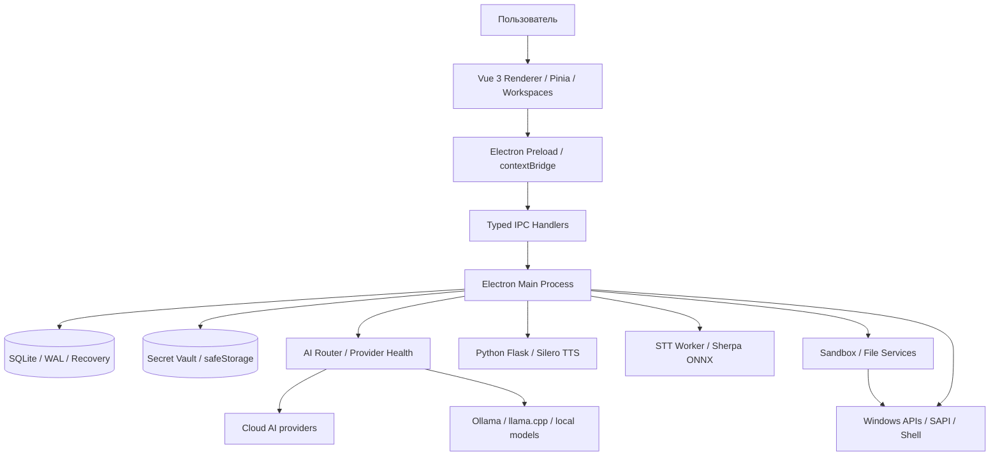

# A.R.C. — комплексный аудит готовности к релизу

**Дата аудита:** 16 ноября 2026 года  
**Репозиторий:** https://github.com/DdepRest/ARC  
**Ветка:** `main`  
**Зафиксированный commit:** `98098327e9b8761ecf855d0566e2c1f6c9b265c4`  
**Версия в `package.json`:** `1.0.12`  
**Назначение документа:** техническое основание для AI-кодера, который будет доводить A.R.C. до проверяемой release-ready версии.

> **Важное ограничение методики.** Аудит выполнен по публичному исходному коду, структуре репозитория, проектной документации и фактическим логам GitHub Actions. Репозиторий не клонировался и приложение не запускалось на физической Windows-машине в рамках этой проверки. Поэтому ниже отдельно обозначены: подтверждённые дефекты статического анализа, факты CI и сценарии, которые ещё нужно подтвердить на установленном Windows-приложении. Нельзя считать статический аудит заменой ручному QA на чистой Windows 10/11.

---

# 1. Итоговое заключение

## 1.1. Решение по релизу

**Текущий статус: RELEASE CANDIDATE / НЕ ГОТОВ К ПУБЛИЧНОМУ СТАБИЛЬНОМУ РЕЛИЗУ.**

У A.R.C. уже есть значительная инженерная база: Electron Main/Preload/Renderer, выделенный Shared-слой, Vue/Pinia, SQLite, восстановление повреждённой БД, безопасное хранилище секретов, IPC-контракты, AI-router, STT/TTS-подсистемы, система разрешений, дизайн-токены и более сотни файлов тестов. Это не ранний прототип.

Однако релизная готовность определяется не количеством сервисов и тестов, а тем, может ли чистая Windows-машина установить приложение, выполнить основные сценарии, сохранить данные, безопасно обработать сбои и восстановиться после перезапуска. В текущем состоянии остаются подтверждённые дефекты в CI packaging, записи секретов, файловой песочнице, синхронизации задач и упаковке словарей TTS. Не завершена натурная проверка полного дерева процессов Electron + Renderer + Python + STT worker.

**Главный вывод:** не переписывать архитектуру и не начинать новый большой UI-редизайн. Сначала закрыть release pipeline, затем устранить целостность данных и границы безопасности, после — доказать работоспособность установщика и голосового контура на чистой Windows.

## 1.2. Наиболее важные подтверждённые находки

| Приоритет | Проблема | Состояние | Последствие |
|---|---|---|---|
| P0 | Windows CI запускает неявную публикацию через electron-builder без `GH_TOKEN` | Подтверждено логом job | Release job завершается ошибкой, проверки и загрузка артефактов не запускаются |
| P0 | NSIS и Portable используют один `artifactName` | Подтверждено `package.json` и логом | Возможна перезапись/коллизия двух EXE; артефакты не имеют однозначных имён |
| P1 | Secret Vault возвращает успех, даже когда запись на диск не удалась | Подтверждено кодом | UI может сообщить об успешном сохранении ключа, которого после рестарта не будет |
| P1 | Миграция секретов удаляет legacy-файл без проверки успешной записи новой версии | Подтверждено кодом | Потеря сохранённых API-ключей при EACCES/диске/сбое записи |
| P1 | Sandbox проверяет путь лексически, но не защищается от symlink/junction/reparse point | Подтверждено кодом | Возможен выход за пределы sandbox через ссылку на внешний файл |
| P1 | Shell allowlist проверяет подстроку имени бинарника, а запуск выполняется через `exec()` | Подтверждено кодом | Политика разрешённых бинарников не является строгой изоляцией исполнения |
| P1 | Task store обновляет карту синхронизации до подтверждения записи и очищает dirty-состояние после неудачи | Подтверждено кодом | Не сохранённое изменение может выглядеть синхронизированным и потеряться после перезапуска |
| P1 | Python TTS ищет словари по `cwd/Voice/dicts`, но release layout не гарантирует этот путь | Подтверждено конфигурацией сборки + кодом Python | В установленной версии может отсутствовать пользовательский словарь произношения |
| P1 | Автоматический TTS fallback на Edge TTS может отправлять произносимый текст во внешний сервис | Подтверждено кодом | Нарушается ожидаемая локальность/приватность без отдельного согласия пользователя |
| P1 | Отмена обычных Sherpa-загрузок очищает Map, но не отменяет HTTP-запрос и запись файла | Подтверждено кодом | Загрузка продолжает расходовать сеть/диск после нажатия «Отмена» |
| P1/P2 | Загрузки ML-моделей не имеют единой строгой SHA-256-проверки и закреплённого манифеста | Подтверждено кодом | Слабая проверка целостности загружаемых исполняемых/модельных данных |
| P2 | JSON fallback БД в dev-режиме обозначается как `PERSISTENT_SQLITE` и `NORMAL` | Подтверждено кодом | Неверная диагностика состояния и семантики транзакций |
| P2 | Reset system data не очищает все секреты и журналы, хотя называется полным сбросом | Подтверждено кодом | Поведение интерфейса может не соответствовать ожиданиям пользователя |
| P2 | Modules UI и `system:modules` используют разные статические реестры | Подтверждено кодом | Статус модулей не отражает одно реальное состояние системы |

## 1.3. Что уже сделано хорошо и не должно быть переписано без причины

- Основное разделение Electron Main / Preload / Renderer / Shared.
- Использование `contextBridge` вместо прямой передачи `ipcRenderer` в Renderer.
- `contextIsolation: true`, `nodeIntegration: false`.
- Единичный экземпляр приложения.
- SQLite WAL, `integrity_check`, повторные попытки при lock, карантин связки DB/WAL/SHM и безопасный режим при проблемах с нативным драйвером.
- Проверяемый снимок БД через SQLite Online Backup API и отдельный `integrity_check` перед экспортом.
- Отдельный STT worker, heartbeat, попытка восстановления, переключение на резервный движок.
- В TTS уже присутствует `try/finally` для очистки активного AbortController — ранее известная проблема «вечного busy» не должна повторно ставиться в работу без воспроизведения.
- Синхронизация задач уже переведена на upsert/diff-подход; проблему следует исправить точечно, не возвращая полный DELETE/reinsert.
- Раздел «Интеллект» уже получил Master–Detail-инспектор провайдеров и машину состояний draft. Не надо переделывать его заново.
- Визуальная конституция проходит CI: все девять счётчиков нарушений равны нулю в 369 проверяемых renderer-файлах.
- Piper и Kokoro уже честно помечены как Planned/disabled для будущей версии; не включать их как будто они готовы.

---

# 2. Снимок репозитория и качество доказательств

## 2.1. Масштаб

Срез `main` на указанном commit:

| Метрика | Значение |
|---|---:|
| Всего файлов | 1 020 |
| Размер содержимого Git tree | около 38,1 MB |
| Файлы в `src/` | 604 |
| Документы в `docs/` | 222 |
| Файлы тестов `*.test.*` / `*.spec.*` | 106 |
| Vue SFC | 204 |
| TypeScript-файлы | 369 |
| Python-файлы | 14 |
| Изображения PNG | 154 |
| Версия приложения | 1.0.12 |

Количество тестовых файлов — не показатель качества покрытия. По `docs/current-state.md` заявлено 664 unit/integration tests; актуальный workflow на зафиксированном commit подтверждает успешный Vitest run и Windows Vitest run, но не доказывает полноту тестирования установщика, пользовательских сценариев и реальных многопроцессных нагрузок.

## 2.2. Состояние GitHub на момент проверки

- Ветка `main` существует; других активных веток в кратком срезе не обнаружено.
- `main` не защищена branch protection (`protected: false`).
- Тегов и опубликованных GitHub Releases не обнаружено.
- Следовательно, нет доказанной цепочки: защищённый PR → обязательные проверки → release tag → собранные артефакты → опубликованный релиз.
- GitHub Actions run #6 для commit `98098327…` имеет общий `failure`, но причина не в TypeScript или тестах, а в публикации Portable target без `GH_TOKEN`.

## 2.3. Статус проверок CI

Workflow: `.github/workflows/ci.yml`.

**Linux job `Lint, Architecture, Test & Build Validation`:**
- `npm ci` — pass;
- TypeScript `npm run lint` — pass;
- file size guard — pass;
- visual constitution — pass;
- Vitest — pass;
- Electron/Renderer build — pass.

**Windows job `Package Windows x64 (NSIS & Portable)`:**
- `npm ci` — pass;
- TypeScript — pass;
- Vitest на Windows — pass;
- Electron/Renderer build — pass;
- нативные зависимости `better-sqlite3` и `sharp` подготовлены;
- NSIS installer был успешно собран;
- при переходе к Portable electron-builder попытался автоматически опубликовать пакет и завершился ошибкой отсутствующего `GH_TOKEN`;
- шаги проверки EXE, SHA-256 и upload-artifact были пропущены.

Это хорошая новость: Windows-тестовый этап уже работает. Но текущий pipeline не выдаёт проверенные артефакты, поэтому Windows distribution gate пока не закрыт.

**Точная причина:** `npm run pack:win` запускает `electron-builder --win` без `--publish never`. electron-builder обнаруживает CI и использует implicit publishing. Для обычной CI-сборки публикация не нужна: GitHub Actions должен сохранить файлы через `actions/upload-artifact`.

Дополнительный дефект: один `win.artifactName` задан для обоих targets:

```json
"win": {
  "artifactName": "ARC-Setup-${version}.${ext}",
  "target": ["nsis", "portable"]
}
```

Лог показывает, что и NSIS, и Portable строятся как `dist\\ARC-Setup-1.0.12.exe`. Это надо устранить разными именами, например:
- `A.R.C.-Setup-1.0.12-x64.exe` для NSIS;
- `A.R.C.-Portable-1.0.12-x64.exe` для Portable.

Названия — пример, coder должен подобрать корректный синтаксис electron-builder `artifactName` per-target и доказать, что оба файла существуют независимо.

## 2.4. Что не проверено натурно

- Установка NSIS на чистую Windows 10 и Windows 11.
- Первый запуск от обычного пользователя без Python, FFmpeg, CUDA и предварительно установленных моделей.
- Обновление поверх предыдущей версии с сохранением пользовательских данных.
- Деинсталляция без удаления пользовательских данных.
- Portable запуск из пути с пробелами, кириллицей и ограниченными правами.
- Реальная работа STT/TTS после установки.
- Смена устройства аудио, недоступность микрофона, переподключение устройства.
- Offline/slow network, частичные загрузки, отмена, повторная загрузка и повреждение моделей.
- Реальное потребление RAM/VRAM/CPU по всему дереву процессов.
- Многопроцессный soak test минимум 2–4 часа.
- Проверка восстановления БД после аварийного завершения процесса/питания.

---

# 3. Технологический стек и назначение подсистем

## 3.1. Desktop / UI

| Технология | Назначение | Оценка |
|---|---|---|
| Electron 34.x | Desktop runtime, Main/Renderer, системные интеграции | Подходит, но требует Electron hardening и реального Windows QA |
| Node.js 22.x | Backend runtime и инструменты сборки | Хорошая базовая линия |
| electron-vite 5 | Сборка Main, Preload, Renderer | Нормальная схема для проекта такого типа |
| electron-builder 26 | NSIS и Portable packaging | Работает на этапе сборки; CI publish/artifact конфигурация неисправна |
| Vue 3.5 | UI и Composition API | Подходит |
| TypeScript 5.8 | Типизация | Используется активно, но TS strict-режим не включён |
| Pinia 2.3 | Клиентское состояние | Подходит, важна дисциплина синхронизации с Main/DB |
| Tailwind CSS 4 | Layout/utility styling | Подходит, есть собственные design tokens |
| Lucide Vue Next | Иконки | Подходит |
| Three.js 0.174 | 3D Reactor/WebGL | Выделенная визуальная подсистема; защищённая область |
| marked + DOMPurify | Markdown rendering/sanitization | Направление верное; проверить единый безопасный renderer для всех источников текста |

## 3.2. AI и маршрутизация

- `@google/genai` — Gemini API.
- OpenAI-compatible HTTP providers — подключение внешних API через endpoint/model/key.
- OpenRouter и другие внешние endpoints — через provider configuration.
- Ollama — локальный HTTP endpoint.
- `node-llama-cpp` — локальный GGUF inference в Node/Electron.
- `@xenova/transformers` — локальные/браузерные ML pipeline, включая worker assets.
- jsep — разбор выражений/условий.
- litegraph.js — графовые/визуальные сценарии.
- Внутренний AI router, provider health, retries, quarantine/circuit breaker, LLM cache, request cancellation.

**Аудиторская оценка:** наличие fallback-механизмов — сильная сторона. Главный остаточный риск не в отсутствии router, а в правдивости статусов, секретах, управлении лимитами/таймаутами и пользовательской видимости того, куда уходит запрос. Убедиться, что любой cloud fallback отражён в UI/логах и не нарушает локальный режим.

## 3.3. База данных и хранение

- `better-sqlite3` 12.x — синхронный SQLite API для Main process.
- SQLite WAL и busy timeout.
- FTS5/индексы/таблицы диалогов, задач, памяти, целей и действий.
- Отдельные recovery helpers, quarantine DB/WAL/SHM, retry при lock.
- JSONDatabase — fallback/тестовый движок.
- Verified database snapshot через Online Backup API и integrity check.
- ZIP export и исключение секретов из архива.

**Оценка:** SQLite/recovery — одна из наиболее зрелых частей проекта. Её надо укреплять тестами миграций и отказов, а не заменять другим хранилищем.

## 3.4. Голосовой контур

**STT:**
- `sherpa-onnx-node` 1.13.7;
- Zipformer RU;
- Whisper Small ONNX;
- GigaAM CTC как дополнительный движок;
- Silero VAD;
- отдельный `scripts/stt_worker.js` process;
- IPC между Main и worker, heartbeat, restart, hot swap.

**TTS:**
- Python Flask server (`silero_server.py`);
- Silero TTS v5.6 RU;
- `torch`, `scipy`, `soundfile`, `flask`, `onnxruntime`, `ruaccent` и DSP pipeline;
- Edge TTS fallback;
- Windows SAPI fallback.

**Важное:** Piper и Kokoro помечены как planned/disabled — это корректное состояние, пока реализация не готова.

**Риск первого запуска:** Python environment может создаваться на машине пользователя, зависимости устанавливаются через pip, Silero weights скачиваются отдельно, STT models могут скачиваться при запуске. Значит, приложение не является полностью self-contained/offline-ready в первом запуске. Это нужно не скрывать, а превратить в управляемый setup flow с размером загрузки, источником, лицензией, свободным местом, прогрессом, отменой и возможностью отложить голос.

## 3.5. Infrastructure / security

- `contextBridge` API через Preload.
- IPC handlers в Main.
- `safeStorage`/Windows DPAPI для секретов.
- ApprovalService и ApprovalDialog для действий, требующих согласия.
- PolicyEngine и SandboxedFS.
- CSP и Origin validation.
- Logger / sanitizer.
- StorageManager и архивы.
- Systeminformation и собственная телеметрия.

**Оценка:** нужные уровни архитектуры уже существуют. Проблема — конкретные обходы и некорректные результаты операций внутри них. Не надо создавать ещё одну параллельную систему доступа или второе хранилище секретов; нужно довести текущие единые механизмы.

---

# 4. Архитектурная карта



**Правило архитектуры:** Renderer не должен становиться источником истины для критичных данных. Main/SQLite подтверждают запись, а Renderer отображает сохранённое состояние и честные статусы. Внешние процессы запускаются с минимальными полномочиями и управляемым жизненным циклом.

---

# 5. Подробный реестр проблем

## P0 — обязательные релизные блокеры

### P0-01. Исправить Windows release packaging pipeline

**Файлы:**
- `package.json` — `scripts.pack:win`, `build.win`, `build.win.target`, `artifactName`.
- `.github/workflows/ci.yml` — `package-win`.

**Факт:** Windows job проходит tests и build. NSIS installer создаётся. На Portable target electron-builder пытается автоматически публиковать релиз и падает: `GitHub Personal Access Token is not set ... GH_TOKEN`. Следующие шаги проверки артефактов и upload skipped.

**Что сделать:**
1. В обычном CI запретить implicit publish: `electron-builder --win --publish never` (или эквивалентная надёжная конфигурация).
2. Не требовать `GH_TOKEN` для CI artifacts. Артефакты сохранять через `actions/upload-artifact`.
3. Развести `artifactName` для NSIS и Portable.
4. Собирать каждый target отдельно, чтобы исключить перезапись и облегчить диагностику.
5. Проверять, что оба `.exe` существуют, имеют уникальные имена и размер больше разумного минимума; записывать размер и SHA-256.
6. Убедиться, что workflow не пытается публиковать ничего в GitHub Release при `push` в `main`.
7. Отдельный release workflow по tag `v*` может публиковать релиз только при явном `GH_TOKEN`/`GITHUB_TOKEN` permission и явном `--publish`.

**Acceptance criteria:**
- Новый `main` CI run завершается success на Linux и Windows.
- `dist/` содержит два разных EXE: NSIS и Portable.
- Их SHA-256 различаются; оба имени уникальны.
- Оба загружены как GitHub workflow artifacts.
- Сборка не обращается к GitHub Release API при обычном push/PR.
- Отсутствие publish token не влияет на обычную упаковку.

### P0-02. Проверить два артефакта на чистой Windows

Это не исправление кода, а обязательный release gate. После P0-01 установить и запустить **оба** артефакта отдельно.

**Acceptance criteria:**
- NSIS устанавливается в каталог пользователя без admin elevation по умолчанию.
- Portable запускается из отдельной папки без установки.
- Оба создают корректную директорию пользовательских данных.
- SQLite native binding загружается; приложение не попадает в `DB_SAFE_MODE` без причины.
- UI стартует, основные workspace открываются, нет непрерывного падения Main/Renderer.
- Удаление NSIS не удаляет user data; это поведение подтверждено тестом.
- Путь профиля/приложения с кириллицей и пробелами проверен.

---

## P1 — критичные надёжность, безопасность и целостность

### P1-01. Сделать Secret Vault транзакционно честным

**Файл:** `src/main/services/security/secret-vault.service.ts`.

**Проблемы:**
- `writeVaultFileV2()` возвращает `boolean`.
- `setSecret()` вызывает `writeVaultFileV2(vault)`, но не проверяет результат и возвращает `success: true` даже при ошибке записи.
- `migrateLegacySecretsOnStartup()` вызывает запись новой версии, не проверяет её результат и после этого пытается удалить legacy-файл.
- Запись делается напрямую в `secrets.json`, без staging + atomic rename.
- Gemini ключ хранится в двух именованных записях (generic `gemini_api_key` и provider-scoped ключ), создавая несколько источников истины.

**Реализация:**
1. `setSecret()` должен возвращать `success:false` с безопасной диагностикой, если запись не состоялась.
2. Сохранение: temp-файл в той же директории → write → flush/fsync где поддерживается → rename/replace → read-back + schema validation.
3. Миграция: сохранить legacy source; записать новое хранилище; заново прочитать и расшифровать/проверить все migrated entries; только после успешной проверки архивировать/удалять legacy-файл.
4. При EACCES/EROFS/ENOSPC пользователь получает ясный статус: «ключ не сохранён», без вывода самого ключа.
5. Определить канонический ключ Gemini; старые записи поддержать только как миграцию.
6. Убедиться, что секреты не попадают в stdout, crash logs, diagnostic exports и child process environment без явной необходимости.

**Тесты:**
- write failure;
- disk full / ENOSPC;
- access denied;
- malformed/torn vault;
- crash после write temp, до rename;
- migration fails writing new vault — legacy остаётся;
- migration succeeds — legacy убирается только после проверки;
- restart + DPAPI decrypt;
- safeStorage unavailable / session-only mode честно показывается.

### P1-02. Закрыть symlink / junction escape в файловой песочнице

**Файлы:**
- `src/main/services/sandbox/SandboxedFS.ts` (`resolvePath`, read/write/delete/rename/copy).
- `src/main/services/files.service.ts` (`isPathAllowed`).
- `src/main/ipc/files.ipc.ts`.

**Проблема:** текущая проверка `path.resolve` + `path.relative` защищает от обычного `../` traversal, но не проверяет реальный путь файловой системы. Ссылка внутри разрешённой директории может вести наружу. На Windows нужно учитывать symlink, junction и reparse points.

**Реализация:**
1. Вынести единый path guard, который проверяет каждый существующий компонент пути через `lstat` и запрещает неожиданные ссылки/reparse points.
2. Для существующих целей и родителей разрешать `realpath`, сравнивать canonical path с canonical root.
3. Перед destructive operation повторно проверять путь; не полагаться на проверку, выполненную задолго до записи.
4. Для новых файлов валидировать canonical parent directory.
5. Не разрешать root менять свои границы через custom root symlink.
6. Разделить операции read/write/delete и требования approval.
7. Продумать TOCTOU: проверка и открытие должны быть максимально атомарны; где возможно использовать no-follow semantics/handle-based APIs. Документировать остаточные платформенные ограничения.

**Тесты:**
- `root/link -> outside` для read/write/delete;
- вложенная symlink;
- Windows junction/reparse point;
- сломанная ссылка;
- destination rename через ссылку;
- parent directory link;
- normal in-root operations остаются рабочими.

### P1-03. Усилить политику shell execution

**Файлы:**
- `src/main/services/sandbox/PolicyEngine.ts`.
- `src/main/services/commands/shell-executor.ts`.
- `src/main/services/security/shell-approval.service.ts`.
- `src/main/ipc/approval.ipc.ts`.

**Проблема:**
- allowlist бинарников использует `includes()` на имени команды, а не точное сравнение executable;
- запуск идёт через `exec(command)`, то есть через системный shell;
- нет явного command timeout, AbortSignal и гарантированного kill process tree;
- `stderr/stdout` могут содержать чувствительные данные;
- approval IPC валидирует только строковый ID и не ограничивает отправителя ожидаемым `webContents`.

**Реализация:**
1. Перейти на структурированный payload `{ executable, args, cwd, purpose }` вместо произвольной shell-строки там, где это возможно.
2. Для разрешённых операций использовать `spawn/execFile` с `shell:false` и точный allowlist executable/path.
3. Если shell-строка всё же нужна для отдельного режима, это отдельное явно опасное право, с обязательным approval и заметным preview.
4. `PolicyEngine` по умолчанию deny, неизвестное действие не должно автоматически становиться разрешённым.
5. Задать timeout, ограничение stdout/stderr, отмену, kill process tree, лимиты процессов.
6. Не логировать сырые секреты/полный output; логировать ID, hash команды, executable, exit code и редактированный фрагмент.
7. В approval handler проверять, что `event.sender` — текущий доверенный `mainWindow.webContents` и request действительно ожидает ответа.
8. Удалить дублирующий IPC alias только после поиска всех callers и миграции на единый контракт.

**Тесты:**
- `nodeevil`, `mygit`, `npm-helper` не проходят как `node/git/npm`;
- попытки shell metacharacter injection;
- таймаут и отмена завершают всю process tree;
- дублирующий/просроченный approval response отклоняется;
- запрос от неизвестного sender отклоняется;
- отказ approval не запускает команду.

### P1-04. Исправить подтверждение сохранения Tasks

**Файл:** `src/renderer/features/tasks/stores/tasks.store.ts`.

**Проблема:**
- `persistTaskUpsert()` обновляет `lastSyncedSnapshotMap` до подтверждения IPC;
- при ошибке IPC ловит ошибку и возвращает исходную задачу;
- `persistTaskDelete()` удаляет snapshot до подтверждения успешного удаления;
- `saveTasks()` после `Promise.all` всегда перестраивает snapshot map, даже если часть операций завершилась неуспешно.

**Результат:** Renderer может считать данные синхронизированными, когда Main/SQLite ничего не сохранили. После рестарта пользователь потеряет последнее изменение или увидит удалённую задачу снова.

**Реализация:**
1. Держать отдельные `pending/dirty` операции до позитивного ack от Main.
2. Snapshot обновлять только по фактическому сохранённому ответу из SQLite.
3. На `{success:false}`, throw, timeout, закрытие IPC — сохранять dirty state и показывать состояние ошибки/повторной синхронизации.
4. Удаление подтверждать только после успешного delete ack.
5. Избегать параллельных конфликтующих upsert/delete по одному ID; ввести per-task serialization или revision token.
6. Поддержать retry с backoff и ограничением повторов; после перезапуска перечитывать authoritative tasks из DB.
7. Не возвращать full-table replacement; текущую upsert/diff-архитектуру сохранить.

**Тесты:**
- upsert success;
- upsert `success:false`;
- IPC throws;
- IPC зависает и timeout;
- delete failure;
- параллельные updates одной задачи;
- рестарт приложения после failed write;
- UI не отображает ложное «сохранено».

### P1-05. Исправить размещение TTS dictionaries в packaged app

**Файлы:**
- `tts_dict_loader.py`.
- `src/main/services/python_server.service.ts`.
- `src/main/services/python_sync.util.ts`.
- `package.json` build `files`, `asarUnpack`, `extraResources`.

**Проблема:** `tts_dict_loader.py` строит путь `os.path.join(os.getcwd(), 'Voice', 'dicts')`. В packaged запуске Python server получает `cwd: this.getPath('.')`, которое может разрешиться в `process.resourcesPath`. При этом `package.json` помещает `Voice/dicts/**/*` в app files/asarUnpack, но отдельного `extraResources` mapping в `resources/Voice/dicts` нет. Python, работающий из `resources`, может не найти словари в ожидаемом `cwd/Voice/dicts`.

**Реализация:**
1. Не полагаться на implicit `cwd`.
2. Передавать Python абсолютный `ARC_TTS_DICTS_DIR` или другой typed env path.
3. Один helper в Main должен определять dictionary path в dev и packaged окружении.
4. Упаковщик должен помещать dicts в физический путь, доступный Python вне `app.asar`; проверить `asarUnpack` и `extraResources`.
5. Python loader должен проверять path и отдавать диагностический результат с количеством загруженных словарей.
6. При отсутствии необязательных словарей TTS может продолжать работу, но UI/diagnostics должны честно показывать degraded pronunciation mode.

**Тесты:**
- запуск из исходников;
- запуск из распакованного `win-unpacked`;
- запуск из NSIS;
- словарь содержит тестовые записи и реально применяется к синтезируемому тексту;
- отсутствующий словарь не ломает весь TTS, но отображается в diagnostics.

### P1-06. Сделать отмену Sherpa downloads реальной

**Файл:** `src/main/services/sherpa-downloader.service.ts`.

**Проблема:** `cancelDownload()` вызывает специальную отмену для GigaAM в ограниченных случаях, затем очищает `activeDownloads`. Для обычных моделей очистка Map не отменяет активный HTTP request, response stream и файловую запись.

**Реализация:**
1. Хранить на каждый modelId download task с `AbortController`, текущим request/stream, temp files и состоянием.
2. `cancelDownload(modelId)` реально abort-ит сетевые операции и файловый поток.
3. Удалять staging-файлы после отмены; никогда не оставлять частичный файл под окончательным именем.
4. Не стирать Map до завершения `finally`.
5. Отправлять отдельный terminal state `cancelled`, не маскировать отмену под network error.
6. Развести Cancel All и Cancel Model.

**Тесты:** отмена Zipformer, Whisper, VAD и GigaAM; отмена на redirect; отмена при записи; повторное скачивание после отмены; partial file отсутствует; Promise завершается один раз.

### P1-07. Закрепить целостность и происхождение скачиваемых моделей

**Файлы:**
- `src/main/services/sherpa-downloader.service.ts`.
- `src/main/services/python_sync.util.ts`.
- `src/main/services/stt-config.helper.ts`.
- `src/main/services/python_server.service.ts`.

**Проблемы:**
- общие Sherpa assets не используют единый pin SHA-256 manifest;
- redirect handling принимает location без строгого host/protocol allowlist на каждом hop;
- Silero TTS model валидируется главным образом по размеру `>10MB`;
- Python sync использует MD5 для сравнения файлов — это не годится как security/integrity proof;
- model downloads должны считаться supply-chain входом, а не обычными картинками.

**Реализация:**
1. Создать manifest моделей: `id`, upstream, immutable revision, file, expected bytes, SHA-256, license, locale, engine compatibility.
2. Все redirects принудительно HTTPS и только на разрешённые hosts.
3. Писать только во временный файл; проверить размер и SHA-256; атомарно переименовать.
4. Не допускать загрузку в директорию, из которой модель сразу исполняется/подхватывается до верификации.
5. Для Python code/resources также проверять SHA-256 ожидаемого bundle manifest.
6. Сохранять provenance manifest локально, чтобы diagnostics показывал источник, revision, checksum и статус.
7. Добавить supply-chain audit dependencies и модельных лицензий.

### P1-08. Сделать cloud TTS fallback явным и контролируемым

**Файл:** `src/main/services/tts.service.ts`.

**Проблема:** при недоступности Python/Silero TTS код автоматически переходит на Edge TTS, а при отказе Edge — на SAPI. Edge TTS является внешним сервисом, поэтому текст пользователя может покинуть устройство без отдельного согласия именно на cloud TTS.

**Реализация:**
1. Добавить настройку `allowCloudTtsFallback`, с понятным описанием, что текст отправляется стороннему TTS provider.
2. В локальном/private режиме по умолчанию использовать локальный fallback (SAPI) без cloud send.
3. При включённом cloud fallback показывать активный движок и статус remote processing.
4. Не менять текущий try/finally lifecycle и AbortController без отдельного дефекта.
5. Убедиться, что логи не сохраняют полный приватный текст.

**Тесты:** local-only mode никогда не вызывает Edge; opt-in mode вызывает Edge; статус движка корректен; отмена предотвращает последующий fallback.

### P1-09. Сделать первый запуск управляемым, не скачивать тяжёлые модели неожиданно

**Файлы:**
- `src/main/index.ts`.
- `src/main/services/python_server.service.ts`.
- `src/main/services/stt.service.ts`.
- `src/main/services/stt-config.helper.ts`.
- `src/renderer/components/onboarding/FirstRunWizardModal.vue` и steps.

**Проблема:** TTS Python setup может создавать venv, запускать pip install и загружать Silero model. STT startup, если не найден ни один базовый движок, может начать загрузку Zipformer/Whisper/VAD после `ready-to-show`. Это потенциально большие объёмы сетевого трафика, длительный запуск и рост CPU/disk usage на слабом компьютере.

**Реализация:**
1. Onboarding должен явно объяснить, какие голосовые компоненты требуются, сколько места/трафика примерно нужно и какой источник используется.
2. Дать выбор: «Настроить голос сейчас», «Позже», «Только локальный/системный fallback».
3. Разделить обязательные и дополнительные модели: минимальный STT/TTS baseline отдельно от улучшенных моделей.
4. Загружать по запросу пользователя, с реальными progress bytes/total bytes и ETA только если она рассчитана из фактической скорости.
5. Поддержать паузу/отмену/retry; не запускать второй параллельный installer.
6. Не блокировать интерактивность окна и не показывать ложный статус «готово».
7. Показать health state: runtime missing, dependencies missing, model missing, download, verifying, ready, fallback/degraded, failed.

### P1-10. Уточнить обработку зависимостей Python

**Файл:** `src/main/services/python_deps.util.ts`.

**Проблема:** сначала проверяется полный импорт `torch, scipy, soundfile, flask, onnxruntime, ruaccent`. Если он не проходит, после pip installation второй fallback проверяет только `torch, scipy, soundfile, flask` и может вернуть `success:true`, хотя `onnxruntime` и `ruaccent` по-прежнему не импортируются. Это допустимо только если они действительно optional и TTS корректно деградирует; сейчас контракт `success` неоднозначен.

**Реализация:**
- Разбить зависимости на required core, optional DSP/accent, platform-specific extras.
- Вернуть детальную карту readiness, а не один Boolean.
- Установку зависимостей сделать воспроизводимой: pinned/compatible versions или constraints lock, проверка Python/torch wheel compatibility, ограничить огромный pip dependency resolver.
- `ffmpeg` проверять отдельно и явно: warning только при реальной зависимости DSP этапа.
- Не использовать неопределённый system Python как безусловный production baseline, если есть возможность встроенного управляемого runtime.

### P1-11. Уточнить Electron origin/permission boundary

**Файлы:**
- `src/shared/config/csp.config.ts`.
- `src/main/index.ts`.
- `src/main/ipc/approval.ipc.ts`.

**Проблемы:**
- `isTrustedOrigin()` принимает любой `file://` URL в production как trusted.
- Media permission handler использует этот метод.
- External URL handler проверяет `url.startsWith('http')`, а не валидирует URL protocol.
- DevTools hotkey доступен в production.
- `PROD_CSP` всё ещё допускает `unsafe-eval` для scripts, широкие `https:`, `wss:`, `ws:` connect targets и любые https images. Build предупреждает об использовании eval в `onnxruntime-web` и `litegraph.js`.
- Main переписывает CORS headers для HuggingFace endpoints на wildcard.

**Реализация:**
1. Для packaged `file://` принимать только canonical URL renderer entrypoint или известный renderer root приложения, а не все file URLs.
2. Явно указать `sandbox:true`, `webSecurity:true`, `webviewTag:false` в BrowserWindow, предварительно проверить совместимость preload/runtime.
3. Внешние ссылки парсить через `new URL`, разрешать только `http:`/`https:`.
4. DevTools в production отключить, включать только специальным debug flag.
5. Разделить необходимые CSP исключения по origin и ресурсам, включать `unsafe-eval` только при доказанной необходимости; не ломать ONNX/Three.js одним общим удалением.
6. По возможности скачивать модели через Main process с allowlist, а не ослаблять CORS для всех запросов HuggingFace.
7. Записать threat model/допустимые CSP исключения.

### P1-12. Сделать версию DB schema управляемой

**Файлы:** `src/main/services/database.ts`, `src/main/services/database-recovery.util.ts`.

**Текущее состояние:** recovery path, WAL quarantine, integrity checks и snapshot logic выглядят значительно лучше ранних версий. Сохранять их.

**Риск:** по текущему фрагменту `initTables()` заметна смесь `CREATE TABLE IF NOT EXISTS` и inline `ALTER TABLE`. Не найдено очевидной единой последовательной migration registry для каждой версии schema.

**Реализация:**
- Ввести `PRAGMA user_version` или таблицу `schema_migrations`.
- Каждый migration: version, transaction, idempotency, precondition, rollback/backup strategy.
- Перед upgrade делать проверяемый snapshot.
- Старые версии пользовательской БД должны подниматься на актуальную без потери данных.
- Не запускать destructive migration автоматически без резервной копии и диагностического следа.

---

## P2 — важные исправления качества и UX

### P2-01. Честно маркировать JSONDatabase fallback

**Файл:** `src/main/services/database.ts`.

В непакетированном режиме при отсутствии native SQLite driver код может открыть `JSONDatabase` и выставить `mode: NORMAL`, `storageStatus: PERSISTENT_SQLITE`, `engine: json-test`. JSONDatabase реализует только часть SQL-поведения; `transaction()` просто вызывает функцию и не гарантирует rollback.

**Что сделать:**
- Не выдавать JSON engine за SQLite.
- Выставлять отдельные статусы `PERSISTENT_JSON_DEGRADED` / `VOLATILE_DIAGNOSTIC`.
- В production packaged app продолжать использовать strict DB_SAFE_MODE, а не скрытый fallback.
- В UI Diagnostics показывать активный engine и ограничения.
- Либо оставить JSONDatabase только для тестов, либо чётко ограничить функции и покрыть поддерживаемый SQL набор.

### P2-02. Привести Reset к заявленному поведению

**Файл:** `src/main/services/storage-manager.service.ts`.

`resetSystemData()` удаляет БД, config, cache, macros, локальные browser storage и ряд служебных директорий, но список не включает все файлы Secret Vault и логи. При этом интерфейс/логика говорит о полном сбросе.

**Решение владельца:** что должен означать «Сброс системы»?
- **Вариант A — Reset configuration/data:** сохранить credentials и audit logs, но прямо сказать об этом в UI.
- **Вариант B — Factory reset:** удалить secrets, provider config, logs/audit logs, caches, macros, DB, model artifacts (по выбору), подтвердить необратимость.

Не оставлять двусмысленное поведение. Добавить тест точного списка удалённых и сохранённых директорий.

### P2-03. Сделать Modules registry единым и честным

**Файлы:**
- `src/renderer/features/modules/components/ModulesView.vue`.
- `src/main/ipc/system.ipc.ts` (`system:modules`).

Сейчас `ModulesView` имеет локальный статический массив из 14 модулей, а `system:modules` возвращает отдельный статический объект из четырёх статусов (`Assistant`, `Voice`, `Memory`, `Tasks`). Значит, UI-карточки и системная телеметрия не опираются на единый факт.

**Что сделать:**
- Ввести единый capability registry в Shared/Main.
- Поля: `id`, `name`, `description`, `lifecycleState`, `availability`, `health`, `entrypoint`, `dependencies`, `lastCheckedAt`, `reason`.
- Возможные lifecycle states: `implemented`, `implemented_degraded`, `planned`, `disabled`, `unavailable`, `error`.
- Статус должен вычисляться из реального health adapter или явно быть статическим roadmap status.
- Не называть Agent Swarm/MCP/Sandbox «активными», пока они не существуют в пользовательском смысле.
- Отделить «ядро существует» от «пользовательская функция доступна».

### P2-04. Исправить неверное сообщение AI decomposition fallback

**Файл:** `src/renderer/features/tasks/composables/useAiDecomp.ts`.

При недоступности AI используется локальный детерминированный шаблон и сами subtasks честно помечаются `[Локальный шаблон — ИИ офлайн]`, но toast всё равно сообщает «ИИ декомпозиция задачи завершена».

**Что сделать:** результат декомпозиции должен возвращать `source: 'llm' | 'local_template'`, а UI отображает разные сообщения. Не вводить пользователя в заблуждение относительно использования модели.

### P2-05. Обработать сохранение первого запуска асинхронно

**Файл:** `src/renderer/components/onboarding/FirstRunWizardModal.vue`.

`skipWizard()` вызывает `voiceStepRef.value?.saveCurrentState()` без `await`, затем завершает мастер. Если сохранение асинхронно, окно может закрыться до его окончания.

**Что сделать:** сделать skip async, дождаться сохранения, обрабатывать reject и не ставить completed при неудачном критичном сохранении. Для необязательных полей разрешить пропуск с явным предупреждением.

### P2-06. Убрать ложное ощущение автозапуска/готовности модулей

Состояния `active`, `calibrating`, `planned` должны соответствовать фактическим capability state. Нельзя показывать «Active» только потому, что карточка прописана в массиве. Статусы Voice, AI, GPU и Model readiness должны приходить с реальных проверок и использовать единый словарь `unknown / checking / ready / degraded / unavailable / error`.

### P2-07. ZIP export должен fail closed на некорректном provider config

**Файл:** `src/main/utils/zip-writer.ts`.

`sanitizeExportConfigBuffer()` пытается распарсить `config/ai-providers.json`, обнулить `apiKey` и удалить secret/token. В catch он возвращает исходный Buffer. Если файл повреждён, но содержит сырой ключ, архив может экспортировать его без очистки.

**Что сделать:** при parse error не включать исходный provider config в архив; вместо этого включить redacted placeholder/diagnostic. Добавить тест на JSON с ключом + повреждённую структуру/обрезанный файл.

### P2-08. Проверить пределы ZIP writer

**Файл:** `src/main/utils/zip-writer.ts`.

Собственный ZIP writer собирает все файлы и итоговый архив в памяти (`Buffer[]`, `Buffer.concat`), не даёт полноценного ZIP64, а reader не проверяет CRC и жёсткие expanded-size limits. При крупной пользовательской БД/моделях это может повышать RAM и отказоустойчивость.

**Что сделать:** либо использовать зрелую ZIP-библиотеку с streaming/ZIP64, либо документировать максимальный размер и тестировать лимиты. Не переписывать без измерения; безопасная альтернатива может быть внешняя библиотека с активным сопровождением.

### P2-09. Улучшить PowerShell SAPI quoting

**Файл:** `src/main/services/tts.service.ts`.

Путь к временному текстовому файлу вставляется внутрь PowerShell single-quoted string; обратные слеши удваиваются, но апострофы в пользовательском профиле/пути не экранируются. Команда запускается строкой через `exec()`.

**Что сделать:** не вставлять путь в PowerShell source string. Передавать путь через аргумент/окружение или безопасно запускать `powershell.exe` через `execFile` с массивом аргументов. Проверить пути с пробелом, кириллицей и апострофом.

### P2-10. Снизить расхождение build metadata

**Файл:** `electron.vite.config.ts`.

`getBuildCommit()` при невозможности прочитать git metadata использует hardcoded fallback `'9048f71'`. Это может показывать неверный commit в приложении/diagnostics.

**Что сделать:** release build должен получать `BUILD_COMMIT` из CI. Если SHA отсутствует — ставить `unknown` или fail release build; никогда не подставлять старый commit.

### P2-11. Включить lint/format и постепенный strict TS

**Файлы:** `tsconfig.json`, `package.json`.

`strict: true`, `strictNullChecks`, `noImplicitAny`, `noUncheckedIndexedAccess`, `exactOptionalPropertyTypes` не включены. Это не означает, что весь код плохо типизирован, но часть ошибок остаётся незамеченной.

**Что сделать:**
- Сначала установить ESLint + formatter + Vue/TS rules.
- Добавить runtime schema validation для IPC input (zod/valibot или собственные validators), потому что TypeScript не валидирует сообщения из Renderer в runtime.
- Включать strict settings постепенно по папкам/пакетам, начиная с новых Shared contracts и IPC schemas.
- Не превращать это в big-bang refactor всего проекта перед первым релизом.

### P2-12. Включить ручные состояния загрузки и диагностику первого запуска

При установке без Python, FFmpeg, моделей или сети пользователь должен видеть: что недоступно, почему, можно ли пользоваться остальной частью A.R.C., сколько загружено и что будет скачано. Не использовать ложные «готово», «активен», 100%, статические размеры без проверки и прогресс, который продолжает жить после отмены.

---

# 6. UX/UI: что сохранить, что улучшить

## 6.1. Текущая сильная сторона

UI имеет собственную визуальную конституцию, тёмную поверхностную иерархию, design tokens, общие settings primitives, workspace navigation, заголовки секций, summary strips и отдельные state indicators. CI подтверждает отсутствие нарушений текущего набора визуальных запретов в проверяемых renderer files.

В частности, Provider settings уже реализованы как Master–Detail:
- компактный список provider gateways;
- выбранный provider отображается в правом инспекторе;
- есть группы настройки endpoint/access, models/routing, generation limits;
- имеется draft state machine `clean → dirty → saving → saved → error`;
- смена провайдера может требовать сохранения/отмены draft.

Это правильное направление. Не начинать новый общий редизайн раздела «Интеллект».

## 6.2. Что проверить визуально в реальном окне

Проверка исходников не даёт достоверного вывода о том, насколько комфортно интерфейс воспринимается при разных масштабах и реальном размере окна. Перед релизом нужны screenshots/recordings минимум в следующих режимах:

| Разрешение/масштаб | Что проверять |
|---|---|
| 1920×1080, 100% | Полная композиция, баланс Reactor/Workspace, пустоты/плотность |
| 1366×768, 100% | Переполнение панелей, scroll traps, заголовки, футеры, карточки |
| 1366×768, 125% | Высота секций, обрезка контента, кнопки и диалоги |
| 1280×720 | Компактный ноутбук, первая видимая зона настроек, bottom bars |
| 390×844 (если mobile/tablet поддерживается) | Навигация, одно-панельная схема, touch target |

## 6.3. Направления полировки без смены концепции

1. **Уменьшить повторение одинаковой иерархии.** Если каждая секция имеет паспорт, summary strip, нумерованные группы и одинаковые блоки, интерфейс может казаться чрезмерно унифицированным. Сохранять структуру, но применять summary только там, где показатели реально помогают принять решение.
2. **Не плодить бейджи.** Цветные статусы нужны для состояний, требующих внимания; остальные значения — спокойный текст/точка/label.
3. **Первый экран важнее глубины дизайна.** В 1366×768 пользователь должен сразу видеть ключевое действие и основной статус, а не только паспорт секции и несколько summary cards.
4. **Провайдеры — не обычные настройки.** Это конфигурация интеграции и диагностики, поэтому Master–Detail лучше простого длинного списка карточек.
5. **Честные статусы.** `Configured`, `Tested`, `Available`, `Active`, `Selected`, `Loaded` — разные состояния; не объединять в один зелёный «Активен».
6. **Пустые, ошибочные и degraded states.** У каждой системы должен быть UX не только для success: нет ключа, ключ не сохранён, endpoint неверный, модель не скачана, сеть выключена, драйвер недоступен, разрешение отклонено.
7. **Accessibility.** Проверить focus trap, возврат фокуса после modal, Esc semantics, tab order, aria labels, reduced motion, keyboard navigation. В ApprovalDialog уже есть часть keyboard/focus behavior, но следует проверить реальный accessibility tree.
8. **ApprovalDialog.** Команда, инициатор, риск, scope, cwd, timeout и последствия должны читаться до подтверждения. Кнопка «Выполнить» не должна быть визуально доминирующим default action в рискованном сценарии.

## 6.4. Не менять в рамках release hardening

- Не менять визуальный язык «живой консоли вокруг Reactor» на SaaS dashboard или generic cards.
- Не добавлять blue gaming neon / декоративные tech-HUD элементы.
- Не начинать полную перестройку навигации без usability evidence.
- Не переписывать `ReactorCore.vue`, `src/renderer/composables/useVoice.ts`, встроенный LLM service и 3D reactor files: они перечислены в `AGENTS.md` как protected areas.
- Не трогать protected files лишь ради соблюдения общих лимитов строк; сначала декомпозировать задачу и получить явное разрешение владельца.

---

# 7. Технический долг, кандидаты на удаление и дубли

> Нельзя удалять файлы только потому, что название выглядит старым или файл не найден в одном компоненте. Перед удалением нужен глобальный поиск импортов, динамических `require`, путей из конфигов, сборки, документации и пользовательских данных.

## 7.1. Подтверждённые дубли источников состояния

**Modules registry:** статический массив в `ModulesView.vue` и независимый hardcoded `system:modules` в `system.ipc.ts`. Это две независимые версии правды. Объединить через capability registry (P2-03).

**Gemini API key:** provider-scoped запись и generic `gemini_api_key` могут хранить одно и то же значение. Нужен один canonical source of truth; старые ключи оставить как миграционные aliases.

**Approval IPC:** `ui:approval-response` и `ui:approval-resolve` делают одну и ту же операцию. Проверить callers, оставить один versioned канал.

## 7.2. Кандидаты на удаление после проверки ссылок

| Путь/элемент | Почему кандидат | Что требуется до удаления |
|---|---|---|
| `src/main/windows/mainWindow.ts` | Есть отдельная функция создания окна, а активный Main entry создаёт окно inline в `src/main/index.ts`; helper может быть orphan | Глобальный поиск импорта/require/динамических загрузок и проверка build entrypoints; удалить только если реально не используется |
| `src/renderer/components/ui/ApprovalDialog.vue` | Wrapper очень тонкий (8 строк) | Не удалять как дубликат автоматически: он импортирует `security/ApprovalDialog.vue`; проверить все точки импорта и унифицировать только при упрощении |
| `myload/english_pronunciation_dict.py` | Большой loose-файл (~4.3 MB); текущий `tts_dict_loader.py` читает `Voice/dicts` | Полный поиск `myload`, `english_pronunciation_dict` в py/ts/js/json/build scripts/docs; проверить, не используется ли генератором словарей |
| `screeninfo/` | Корневой набор PNG screenshots (~2 MB) может быть только документацией | Найти ссылки из README/docs; оставить нужные иллюстрации или перенести в docs/assets/archive |
| `public/assets/aistudio/` | 69 PNG (~17 MB), похожи на auxiliary/demo asset set | Проверить реальные Vite publicDir, ссылки в исходниках и CI; не удалять, пока не доказано отсутствие runtime reference |
| Legacy Vosk resources/scripts/requirements | Пакет и postinstall script ещё содержат Vosk path cleanup references; текущий STT engine — Sherpa/Whisper/GigaAM | Найти все imports, scripts, migration paths и user data; удалить только если нет backward compatibility requirement |
| `docs/archive/*`, `docs/phase6-*`, старые audit plans | Исторические документы пересекаются с current-state/roadmap | Не удалять историю; перенести статус в один canonical backlog и пометить документы как historical/superseded |

## 7.3. Не считать дубликатами

- `vite.config.ts` и `electron.vite.config.ts`: это разные конфигурационные роли; не объединять без доказательства.
- `src/renderer/components/ui/ApprovalDialog.vue` и `security/ApprovalDialog.vue`: первый — wrapper второго, не независимая реализация.
- SQLite snapshot service и recovery utility: это разные механизмы — export consistency vs startup recovery.
- STT Zipformer/Whisper/GigaAM: не удалять один движок только из-за пересечения назначения; fallback diversity — важное свойство при наличии реальных тестов и понятного выбора.
- TTS Silero/Edge/SAPI: разные engine tiers, но cloud fallback требует privacy consent.

## 7.4. Гигиена документации

- `docs/00-index.md` содержит ссылку на `docs/AI-STUDIO-CONTEXT.md`, которого не найдено в текущем tree. Исправить ссылку или восстановить документ.
- `docs/current-state.md` сообщает, что Gate G8 закрыт и Linux gate зелёный, но текущий Windows release pipeline всё ещё падает после сборки из-за GH_TOKEN. Изменить статус: Linux validation passed; Windows tests/build passed; artifact/release packaging verification blocked by implicit publishing and artifact naming.
- `docs/STATISTICS.md` корректно признаёт synthetic single-process soak. Не переписывать его под видом реального многопроцессного результата.
- `docs/PROJECT_RELEASE_ROADMAP.md` уже содержит релизную дорожную карту; обновить статусы и evidence, не создавать новую competing roadmap.
- Сделать один canonical `docs/current-state.md` + машинно-читаемый issue/status registry. Каждый пункт имеет `OPEN / IN_PROGRESS / FIXED / VERIFIED`, commit, тест, evidence URL, дату проверки.
- Архивировать superseded docs, но не удалять инженерную историю.

---

# 8. Производительность и устойчивость на слабых ПК

## 8.1. Что известно

`docs/STATISTICS.md` прямо классифицирует текущий `scripts/soak-test.js --mode=simulation` как synthetic Node.js/SQLite benchmark. Он измеряет RSS/heap одного Node процесса, SQLite operations, JSON serialization и PCM arrays. Renderer RSS и Python RSS — N/A, а старые historical values были симуляцией.

Документ показывает:
- 30 минут synthetic run;
- рост RSS около 6.87 MB;
- ноль EMFILE;
- около 1 850 SQLite operations/sec.

Это полезный unit/performance smoke test. Но это не доказательство того, что весь A.R.C. стабилен несколько часов.

## 8.2. Что добавить

Создать `soak-test:real` или отдельный test harness на Windows, который собирает actual process tree:
- Main process;
- Chromium Renderer/GPU processes;
- Python TTS process;
- STT worker;
- model download/LLM local runtime при включении.

Снимать раз в 5–10 секунд:
- per-process private working set / RSS;
- total app RSS;
- CPU time / average CPU;
- GPU memory/engine load, если доступно;
- handles/threads;
- child process PID/lifetime/restart count;
- JS heap/renderer crash events;
- SQLite lock duration, write latency, WAL size;
- TTS latency, STT latency, dropped audio frames;
- active model/runtime state;
- download throughput and cancellation.

**Тестовые профили:**
1. Idle 30 min.
2. Chat streaming + repeated cancel.
3. STT active 30 min with microphone input.
4. TTS repeated generation and playback.
5. Chat + STT + TTS sequential/overlapping according to concurrency policy.
6. Minimized/background Eco state.
7. Repeated workspace navigation and open/close modals.
8. Provider outage + fallback + recovery.
9. Network drop during model download.
10. Sleep/resume and screen lock/unlock.

Критерии памяти определить по реальным замерам на low-end Windows baseline, а не назначать произвольный лимит без hardware matrix. Нужны p50/p95 latency, stable RSS plateau, zero unhandled exceptions, no orphan child process, no runaway CPU when hidden.

## 8.3. Bundle size

В Windows build log видны renderer chunks примерно:
- main `index-*.js` ~3.93 MB raw;
- `SettingsPanel` ~749 KB raw;
- Whisper worker ~1.43 MB raw;
- `TasksView` ~291 KB raw.

Это не означает автоматически плохую загрузку: нужно смотреть gzip/brotli, initial chunk graph и runtime. Но initial bundle около 3.9 MB — достаточная причина провести bundle analysis и проверить, что тяжелые Workspaces, ML runtimes, editors и settings sections грузятся только по необходимости.

**Не менять `ReactorCore` ради chunk splitting без отдельного разрешения.** Сначала analyzer и evidence. У Settings уже есть lazy splitting, но текущий чанк SettingsPanel остаётся значительным.

---

# 9. Лицензии и дистрибуция

`package.json` указывает MIT для самого приложения, но это не распространяет автоматически MIT на все bundled models и внешние веса.

`THIRD_PARTY_NOTICES.md` сообщает:
- Silero RU `v5_6_ru.pt` — CC BY-NC-SA 4.0, non-commercial;
- Silero VAD — MIT;
- GigaAM — MIT (проверить upstream model card и конкретный checkpoint);
- Whisper — MIT;
- sherpa-onnx — Apache-2.0;
- локальные GGUF models — лицензии зависят от выбранной модели.

**Обязательные действия:**
1. Проверить exact model weights и exact upstream revision, который скачивается или включается в package.
2. Не обещать коммерческую пригодность приложения целиком, пока bundled Silero license не урегулирована.
3. Если планируется коммерческая дистрибуция — получить подходящую Silero license или исключить NC model weights и использовать допустимый on-demand path/альтернативный движок с подходящей лицензией.
4. Сгенерировать SBOM (CycloneDX/SPDX) для npm, Python dependencies и packaged model assets.
5. Проверить лицензии transitive dependencies, шрифтов, изображений, audio assets, models and tokenizer files.
6. В manifest архива/моделей указывать source, revision, checksum, license URL and attribution.
7. Не считать `THIRD_PARTY_NOTICES.md` от 2 ноября актуальным без повторной сверки: текущие версии и model delivery paths могли измениться.

---

# 10. Приоритетная дорожная карта для AI-кодера

Рекомендуется выполнять по одной задаче за раз. Нельзя объединять P0 packaging, Secret Vault и Sandbox в один необозримый рефакторинг.

## Sprint 0 — Release pipeline (P0)

**Задача 0.1:** исправить `pack:win` и отсутствие GH_TOKEN; `--publish never` для CI.  
**Задача 0.2:** разделить NSIS/Portable filenames.  
**Задача 0.3:** artifact checks, SHA-256, upload workflow artifacts.  
**Задача 0.4:** повторный CI run на чистом runner.  
**Задача 0.5:** smoke test двух EXE на Windows 10/11.

Выход: оба EXE построены, уникальны, сохранены как artifacts, проверены.

## Sprint 1 — Data integrity + security (P1)

**Задача 1.1:** Secret Vault write/verification/migration atomicity.  
**Задача 1.2:** SandboxedFS symlink/junction boundary.  
**Задача 1.3:** Shell execution contract and exact allowlist.  
**Задача 1.4:** Approval sender validation.  
**Задача 1.5:** Tasks upsert/delete dirty acknowledgement.

Выход: ни одна ошибка записи не маскируется как success; нет выхода из sandbox через links; shell policy реально ограничивает executable; approvals только от доверенного UI; task changes survive restart.

## Sprint 2 — Runtime packaging and voice (P1)

**Задача 2.1:** packaged TTS dictionary resolution.  
**Задача 2.2:** Python dependency readiness contract, pinned constraints and fallback clarity.  
**Задача 2.3:** реальные cancel tokens для Sherpa downloads.  
**Задача 2.4:** hash manifest и redirect host allowlist для всех model downloads.  
**Задача 2.5:** cloud TTS privacy opt-in.  
**Задача 2.6:** onboarding/first-run voice setup — no surprise downloads.

Выход: установленные версии загружают словари, голоса диагностируются, отмены настоящие, скачанные assets проверены, приватность не нарушается неявным cloud fallback.

## Sprint 3 — Database, Electron hardening and UX semantics

**Задача 3.1:** versioned DB migrations.  
**Задача 3.2:** JSON fallback status semantics.  
**Задача 3.3:** CSP/origin/permissions hardening.  
**Задача 3.4:** Modules capability registry.  
**Задача 3.5:** truthful local-template decomposition + onboarding save.  
**Задача 3.6:** fail-closed backup sanitization and ZIP limits.

## Sprint 4 — Real Release QA

**Задача 4.1:** 2–4 hour real process-tree soak.  
**Задача 4.2:** user data upgrade/downgrade/migration tests (at minimum upgrade path).  
**Задача 4.3:** sleep/resume, network loss, crash recovery.  
**Задача 4.4:** UX screenshot matrix (1920×1080, 1366×768, 125%, 1280×720).  
**Задача 4.5:** dependency/model SBOM and license review.  
**Задача 4.6:** release notes, checksums, signing and publishing workflow.

---

# 11. Release acceptance checklist

## Build and artifacts

- [ ] Linux validation job green.
- [ ] Windows validation job green.
- [ ] Windows NSIS build green.
- [ ] Windows Portable build green.
- [ ] NSIS and Portable filenames are unique.
- [ ] Artifact size checks pass.
- [ ] SHA-256 generated and published with files.
- [ ] CI build runs with `--publish never` and no `GH_TOKEN`.
- [ ] GitHub Release publication occurs only in explicit tag workflow.
- [ ] App author, homepage/repository, app icon and file metadata configured.
- [ ] Build commit SHA accurately reports the current commit.

## First run / runtime

- [ ] Clean Windows 10 install.
- [ ] Clean Windows 11 install.
- [ ] No Python installed: clear supported behavior.
- [ ] No FFmpeg: clear degraded behavior, no broken startup.
- [ ] No models installed: user sees size/source and chooses whether to download.
- [ ] Model downloads can be cancelled and leave no partial final model.
- [ ] All models pass SHA-256 verification.
- [ ] TTS dictionary files load in packaged app.
- [ ] STT fallback to Whisper/Sherpa is observable and correct.
- [ ] Cloud TTS fallback requires explicit opt-in.
- [ ] App remains usable when AI provider and voice services are offline.

## Data and security

- [ ] Secret Vault returns success only after durable write verification.
- [ ] Migration does not delete old secret file before verified new storage.
- [ ] Sandbox rejects symlink and junction escapes.
- [ ] Shell allowlist exact matches; shell is not used implicitly.
- [ ] Approval rejects untrusted sender and expired request.
- [ ] Tasks do not mark unacknowledged writes as synced.
- [ ] SQLite migration tests cover existing user DB versions.
- [ ] Corrupt DB enters safe mode/recovery without silent data deletion.
- [ ] Export backup never includes raw keys, including malformed provider config.
- [ ] Reset behavior exactly matches its UI description.

## UI/UX and accessibility

- [ ] No false positive green/active statuses.
- [ ] No permanent loading state after service failure.
- [ ] Error, offline, cancelled, degraded and unknown states are distinct.
- [ ] ApprovalDialog keyboard flow and focus restoration work.
- [ ] First Run Wizard cannot close before required settings save.
- [ ] Main workflows tested at 1366×768 and 125% scaling.
- [ ] No clipped primary actions or trapped scroll areas.
- [ ] Settings Provider Master–Detail draft flow survives switching and errors.
- [ ] Module status reflects real capability registry.

## Stability and distribution

- [ ] 2–4 hour real process-tree soak completed on Windows.
- [ ] No orphaned Python/STT process after close/restart.
- [ ] No sustained memory growth after warmup beyond defined hardware baseline.
- [ ] Audio device unplug/replug handled.
- [ ] Sleep/resume handled.
- [ ] Network loss/recovery handled.
- [ ] Upgrade installation preserves user data.
- [ ] Uninstall preserves user data by default (if that is intended product policy).
- [ ] SBOM and third-party model license inventory reviewed.
- [ ] GitHub branch protection enforces required checks.

---

# 12. Инструкции AI-кодеру

Ниже — рабочие ограничения. Они важнее стремления «сделать красиво» или переписать всё за один проход.

1. **Сначала исследуй, потом меняй.** Перед каждой задачей проверь все call sites, imports, dynamic requires, IPC callers, persisted schema, packaging paths and docs references.
2. **Одна задача — один PR/изолированный commit.** Не смешивай security patch с UI redesign или оптимизацией, если одно не требуется для другого.
3. **Не удаляй совместимость наугад.** Старые поля, файлы, модели и ключи могут быть частью upgrade path. Сначала migration tests.
4. **Не маскируй ошибки.** Не возвращай `success:true`, если данные не сохранены; не показывай «Active», если не проверен runtime; не заменяй реальную загрузку статическим прогрессом.
5. **Никакой фиктивной телеметрии.** `0`, `100%`, temperature, GPU VRAM, model loaded и module active должны быть измерены или явно `unknown/unavailable`.
6. **Сначала безопасность и сохранность данных, затем косметика.** Приоритет: P0 packaging → P1 data/security → voice/download reliability → P2 UX cleanup.
7. **Protected areas не менять без явного разрешения владельца:** `ReactorCore.vue`, `src/renderer/composables/useVoice.ts`, `src/main/services/built-in-llm.service.ts` и обозначенные в `AGENTS.md` защищённые 3D/voice зоны.
8. **Соблюдай лимиты проекта:** логика/UI components/services/composables/utilities — до 400 строк; data/registry/store/config — до 800 строк, кроме уже задокументированных исключений. При превышении — делить по ответственности, а не только переносить строки.
9. **Не добавляй тяжёлую зависимость без причины.** Сначала докажи, что проблему нельзя решить существующим стеком; оценить maintenance, license, bundle size and Windows native compatibility.
10. **Не включай planned features.** Piper, Kokoro, MCP, Agent Swarm и другие roadmap items не нужно выдавать за production capabilities.
11. **Сохраняй визуальную конституцию.** Не менять дизайн-систему и общий язык A.R.C.; небольшая адресная полировка допустима после воспроизводимого UI defect.
12. **Добавляй тесты на отказ, а не только happy path.** Ошибка диска, отмена, timeout, crash, network loss, invalid payload, symlink, restart, stale state.
13. **Проверяй сборку именно на Windows.** Linux build не доказывает работоспособность Windows native modules, paths, SAPI, DPAPI, NSIS, Portable.
14. **Обновляй каноническую документацию только после фактической проверки.** Не отмечай задачу `DONE` по результату написания кода; `VERIFIED` — только после тестов и evidence.
15. **Отчёт после каждой задачи должен содержать:** изменённые файлы, поведение до/после, причину исправления, tests added/updated, команды и реальные результаты, остаточные риски, влияние на protected zones, migration/backward compatibility, commit SHA.

## Формат отчёта кодера

```text
TASK: P1-xx — <название>
STATUS: IMPLEMENTED / VERIFIED / BLOCKED
ROOT CAUSE:
CHANGED FILES:
BEHAVIORAL CHANGE:
TESTS ADDED:
TEST COMMANDS + EXACT RESULTS:
WINDOWS RESULT:
DATA MIGRATION / BACKWARD COMPATIBILITY:
SECURITY IMPACT:
PROTECTED FILES: untouched / approved change
KNOWN LIMITATIONS:
COMMIT:
```

---

# 13. Источники и точки проверки

Все ссылки ниже указывают на состояние зафиксированного commit, если URL содержит SHA. При реализации кодеру следует сверять их с актуальным `main`, так как ветка может измениться после аудита.

- Repository: https://github.com/DdepRest/ARC
- Exact commit: https://github.com/DdepRest/ARC/commit/98098327e9b8761ecf855d0566e2c1f6c9b265c4
- Latest workflow run #6: https://github.com/DdepRest/ARC/actions/runs/43762168104
- `package.json`: https://github.com/DdepRest/ARC/blob/98098327e9b8761ecf855d0566e2c1f6c9b265c4/package.json
- CI workflow: https://github.com/DdepRest/ARC/blob/98098327e9b8761ecf855d0566e2c1f6c9b265c4/.github/workflows/ci.yml
- Electron Main startup: https://github.com/DdepRest/ARC/blob/98098327e9b8761ecf855d0566e2c1f6c9b265c4/src/main/index.ts
- Preload API: https://github.com/DdepRest/ARC/blob/98098327e9b8761ecf855d0566e2c1f6c9b265c4/src/main/preload.ts
- CSP/origin: https://github.com/DdepRest/ARC/blob/98098327e9b8761ecf855d0566e2c1f6c9b265c4/src/shared/config/csp.config.ts
- Secret Vault: https://github.com/DdepRest/ARC/blob/98098327e9b8761ecf855d0566e2c1f6c9b265c4/src/main/services/security/secret-vault.service.ts
- Sandbox FS: https://github.com/DdepRest/ARC/blob/98098327e9b8761ecf855d0566e2c1f6c9b265c4/src/main/services/sandbox/SandboxedFS.ts
- Policy Engine: https://github.com/DdepRest/ARC/blob/98098327e9b8761ecf855d0566e2c1f6c9b265c4/src/main/services/sandbox/PolicyEngine.ts
- Shell executor: https://github.com/DdepRest/ARC/blob/98098327e9b8761ecf855d0566e2c1f6c9b265c4/src/main/services/commands/shell-executor.ts
- Tasks store: https://github.com/DdepRest/ARC/blob/98098327e9b8761ecf855d0566e2c1f6c9b265c4/src/renderer/features/tasks/stores/tasks.store.ts
- TTS service: https://github.com/DdepRest/ARC/blob/98098327e9b8761ecf855d0566e2c1f6c9b265c4/src/main/services/tts.service.ts
- Python server: https://github.com/DdepRest/ARC/blob/98098327e9b8761ecf855d0566e2c1f6c9b265c4/src/main/services/python_server.service.ts
- Python dependency setup: https://github.com/DdepRest/ARC/blob/98098327e9b8761ecf855d0566e2c1f6c9b265c4/src/main/services/python_deps.util.ts
- Sherpa downloader: https://github.com/DdepRest/ARC/blob/98098327e9b8761ecf855d0566e2c1f6c9b265c4/src/main/services/sherpa-downloader.service.ts
- TTS dictionaries: https://github.com/DdepRest/ARC/blob/98098327e9b8761ecf855d0566e2c1f6c9b265c4/tts_dict_loader.py
- ZIP backup writer: https://github.com/DdepRest/ARC/blob/98098327e9b8761ecf855d0566e2c1f6c9b265c4/src/main/utils/zip-writer.ts
- Storage reset: https://github.com/DdepRest/ARC/blob/98098327e9b8761ecf855d0566e2c1f6c9b265c4/src/main/services/storage-manager.service.ts
- Current state: https://github.com/DdepRest/ARC/blob/98098327e9b8761ecf855d0566e2c1f6c9b265c4/docs/current-state.md
- Performance/soak stats: https://github.com/DdepRest/ARC/blob/98098327e9b8761ecf855d0566e2c1f6c9b265c4/docs/STATISTICS.md
- Release roadmap: https://github.com/DdepRest/ARC/blob/98098327e9b8761ecf855d0566e2c1f6c9b265c4/docs/PROJECT_RELEASE_ROADMAP.md
- Settings architecture: https://github.com/DdepRest/ARC/blob/98098327e9b8761ecf855d0566e2c1f6c9b265c4/docs/settings-architecture.md
- Third-party notices: https://github.com/DdepRest/ARC/blob/98098327e9b8761ecf855d0566e2c1f6c9b265c4/THIRD_PARTY_NOTICES.md
- Protected zones and coding constraints: https://github.com/DdepRest/ARC/blob/98098327e9b8761ecf855d0566e2c1f6c9b265c4/AGENTS.md

---

# Финальный вердикт

A.R.C. обладает хорошей архитектурной основой и достаточно большим объёмом уже работающей функциональности. Его не следует переписывать с нуля и не следует превращать релизную подготовку в ещё один бесконечный редизайн.

**Самая рациональная стратегия:** сначала гарантировать, что Windows CI выдаёт два корректных артефакта; затем закрыть Secret Vault, sandbox, shell и task persistence; затем проверить voice/model setup и честные privacy states; после этого провести реальный multi-process soak и чистую Windows release QA.

До прохождения этих gates приложение можно продолжать использовать и тестировать как release candidate, но обозначать его как доказанно готовый стабильный публичный релиз пока преждевременно.
